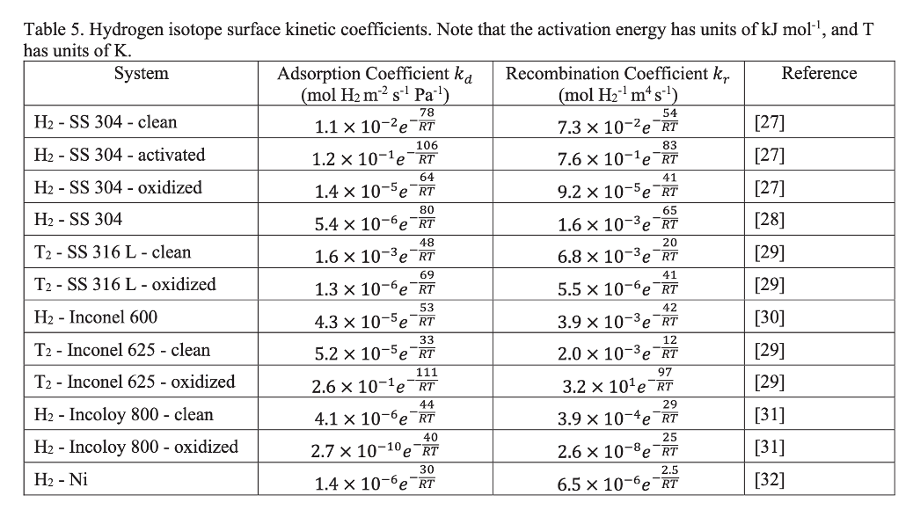

# Rates, units and equilibrium coverage

A study note covering:

- what the package's rate numbers mean and why they are "per second";
- how they convert to the per-area, per-pressure units of the hydrogen-permeation literature;
- what the equilibrium of the H₂ step says about the surface coverage.

Everything here is about the **surface**: adsorbed H on surface sites. Hydrogen dissolved in the metal (the subsurface or bulk) is not modelled and not used.

The only numbers used are round illustrative values and the package's own toy test run (`tests/data/toy_mechanism.yaml`), not literature data. The symbols are listed at the end.

> **Notation.** In this note $\theta_v$ is the fraction of **vacant (empty) sites**. The rest of the package docs write it $\theta_\ast$ (theta-star), and the tables call it `theta_free`. The star is the empty-site symbol, not a multiplication or a power.

---

## 1. The surface model: sites, coverage and site density

The mechanism treats the metal surface as a grid of **sites**.

- **Site density $\Gamma$**: moles of sites per m² of surface. A close-packed facet has about $3\times10^{-5}$ mol m⁻². RMG takes it from the facet in its metal database; it is the `expected_site_density` of a run's `settings.py`.
- **Coverage $\theta_k$**: the fraction of sites holding species $k$. $\theta_v$ is the empty fraction and $\theta_\mathrm{H}$ the fraction holding an H atom. All $\theta$ add up to 1, so they have no units:

$$\theta_v = 1 - \theta_\mathrm{H} - \theta_\mathrm{imp} - \dots \qquad(\text{everything that is occupied})$$

- **Surface concentration**: $C_k = \theta_k\,\Gamma$, in mol m⁻². For hydrogen, $C_\mathrm{H} = \theta_\mathrm{H}\,\Gamma$ (mol H m⁻²).
- **Gas concentration**: $C_{\mathrm{H_2}} = p/RT$, in mol m⁻³.

Everything below is built from these four things.

## 2. One rate, three ways of writing it

Take the dissociation H₂ + 2 sites → 2H(ads).

| Form | Unit | Who uses it |
|---|---|---|
| rate per area, $r$ | mol H₂ m⁻² s⁻¹ | Cantera internally (in kmol); the literature calls it the **flux $J$** |
| rate per site, **TOF** $= r/\Gamma$ | s⁻¹ | the package's tables, and catalysis in general |
| rate per area per pressure, $J/p$ | mol H₂ m⁻² s⁻¹ Pa⁻¹ | the literature's adsorption coefficient $k_d$ (§5) |

**Why "per second" alone.** TOF = (mol H₂ m⁻² s⁻¹) / (mol sites m⁻²). The m⁻² cancels, and "mol H₂ per mol of sites" is a count ratio, so only s⁻¹ is left. It means **H₂ molecules dissociated per surface site per second**. This turnover frequency is the standard catalysis measure because it compares activity per active site, whatever the sample's area.

**Converting** (illustrative numbers): TOF = 10 s⁻¹ with $\Gamma = 3\times10^{-5}$ mol m⁻² gives

$$J = \mathrm{TOF}\cdot\Gamma = 3\times10^{-4}\ \text{mol H}_2\ \text{m}^{-2}\,\text{s}^{-1}.$$

## 3. Where the dissociation and recombination rates come from

**Dissociation** (a sticking reaction in RMG). Cantera's formula, $r = k_f\,C_{\mathrm{H_2}}\,(\theta_v\Gamma)^2$, reduces to

$$J_\mathrm{diss} = \gamma\,\theta_v^2\,Z, \qquad Z = \frac{p}{\sqrt{2\pi M R T}} .$$

Read it as three factors:

- **$Z$, the impingement flux**: mol of H₂ hitting each m² every second (kinetic gas theory). $M$ is the molar mass of H₂, $2.016\times10^{-3}$ kg mol⁻¹.
- **$\gamma$, the sticking coefficient**: the probability that a molecule hitting the surface dissociates. RMG writes it as $\gamma = A\,T^b\,e^{-E_a/RT}$.
- **$\theta_v^2$, the chance of finding two empty sites**: dissociation needs two.

For scale: at 1 bar and 650 K, $Z \approx 1.2\times10^{4}$ mol m⁻² s⁻¹, about $4\times10^{8}$ hits per site per second for $\Gamma = 3\times10^{-5}$ mol m⁻². Most of the drop from there to the actual TOF comes from $\gamma$ and from $\theta_v^2$.

**Recombination** (two adsorbed H atoms meet and leave as H₂):

$$J_\mathrm{rec} = k_r\,C_\mathrm{H}^2 = k_r\,(\theta_\mathrm{H}\,\Gamma)^2 .$$

It depends only on how much H is on the surface, not on the gas pressure.

**Net**: $J_\mathrm{net} = J_\mathrm{diss} - J_\mathrm{rec}$, which is close to 0 when the step is at equilibrium.

## 4. A rate versus a rate coefficient

This is the key to the unit mismatch.

- A **rate** is what happens under given conditions. It depends on $p$, $T$ and the coverages.
- A **rate coefficient** is what is left after dividing those conditions out. It depends only on $T$, so it can be reused anywhere.

| Quantity | What was divided out | Unit |
|---|---|---|
| TOF$_\mathrm{diss}$, TOF$_\mathrm{rec}$, TOF$_\mathrm{net}$ | nothing (rates at that $p$ and those $\theta$) | s⁻¹ |
| intrinsic $k_\mathrm{diss}$ (report) | nothing; it is TOF$_\mathrm{diss}$ at $\theta_v = 1$ and $p = p_\mathrm{ref}$ (1 bar) | s⁻¹ |
| intrinsic $k_\mathrm{rec}$ (report) | nothing; it is TOF$_\mathrm{rec}$ at $\theta_\mathrm{H} = 1$ | s⁻¹ |
| adsorption coefficient $k_d$ | the pressure and the empty sites: $k_d = J_\mathrm{diss}/(p\,\theta_v^2)$ | mol H₂ m⁻² s⁻¹ Pa⁻¹ |
| surface recombination coefficient $k_r$ | the H surface concentration squared: $k_r = J_\mathrm{rec}/(\theta_\mathrm{H}\Gamma)^2$ | m² mol⁻¹ s⁻¹ |

So the report's $k_\mathrm{diss}$ is named like a constant, but it is really "the clean-surface dissociation rate per site at 1 bar". That is why every row in the report states its conditions.

**Checking the units:**

- $k_d$: (mol m⁻² s⁻¹)/Pa → mol m⁻² s⁻¹ Pa⁻¹ ✓
- $k_r$: (mol m⁻² s⁻¹)/(mol m⁻²)² → m² mol⁻¹ s⁻¹ ✓

## 5. Two formats for reporting the rates

The package reports rates per site (Format 1). The per-area, literature-style form (Format 2) follows from the same numbers.

| | Format 1: per site | Format 2: per area |
|---|---|---|
| Dissociation | TOF$_\mathrm{diss}$, s⁻¹ | $J_\mathrm{diss} = k_d\,p\,\theta_v^2$, mol H₂ m⁻² s⁻¹; and $k_{d,\mathrm{eff}} = J_\mathrm{diss}/p$, mol H₂ m⁻² s⁻¹ Pa⁻¹ |
| Recombination | TOF$_\mathrm{rec}$, s⁻¹ | $J_\mathrm{rec} = k_r\,(\theta_\mathrm{H}\Gamma)^2$, mol H₂ m⁻² s⁻¹ |
| Net | TOF$_\mathrm{net}$, s⁻¹ | $J_\mathrm{net} = J_\mathrm{diss} - J_\mathrm{rec}$, mol H₂ m⁻² s⁻¹ |
| Equilibrium | $K$, dimensionless | the same $K$ (it has no units); plus the equilibrium H on the surface, $C_\mathrm{H,eq} = \theta_\mathrm{H,eq}\,\Gamma$, mol H m⁻² (§8) |

### Dissociation in Format 2

$$J_\mathrm{diss} = k_d\;p\;\theta_v^2$$

- **On a clean surface with only hydrogen** (the probe gas alone), $\theta_v = 1 - \theta_\mathrm{H}$:

$$J_\mathrm{diss} = k_d\;p\;(1-\theta_\mathrm{H})^2 ,$$

  which is the Langmuir form the permeation literature uses.
- **With an impurity or other adsorbates**, $\theta_v = 1 - \theta_\mathrm{H} - \theta_\mathrm{imp} - \dots$ Writing $(1-\theta_\mathrm{H})^2$ there would count the impurity's sites as empty and overestimate dissociation. The general form keeps $\theta_v^2$, which is what Cantera computes; it is `theta_free` in the tables.
- Comparing with §3, the coefficient itself is the sticking coefficient times a kinetic-theory factor:

$$k_d = \frac{\gamma}{\sqrt{2\pi M R T}} .$$

  Its $e^{-E/RT}$ is the barrier in $\gamma$: "activated sticking". It does not depend on the impurity.
- The **effective** coefficient seen on a real surface, $k_{d,\mathrm{eff}} = J_\mathrm{diss}/p = k_d\,\theta_v^2$, does depend on the impurity, through $\theta_v$. It is the per-area counterpart of the poisoning factor.

### Recombination in Format 2: surface only

$$J_\mathrm{rec} = k_r\,(\theta_\mathrm{H}\,\Gamma)^2, \qquad k_r \text{ in m}^2\ \text{mol}^{-1}\ \text{s}^{-1}$$

$k_r$ is the **surface** recombination coefficient: two adsorbed H atoms recombining and leaving as H₂. It is Cantera's reverse rate constant of the H₂ step (stored in m² kmol⁻¹ s⁻¹; divide by 1000 for m² mol⁻¹ s⁻¹).

The step follows a plain mass-action law, so $k_r$ is the same in every case. An impurity changes recombination only through $\theta_\mathrm{H}$.

### From the package's numbers to Format 2

| Format-2 quantity | From Format 1 |
|---|---|
| $J_\mathrm{diss}$, $J_\mathrm{rec}$, $J_\mathrm{net}$ | TOF × $\Gamma$ |
| $k_{d,\mathrm{eff}}$ | TOF$_\mathrm{diss}\cdot\Gamma/p$ |
| $k_d$ (clean surface) | $k_\mathrm{diss}\cdot\Gamma/p_\mathrm{ref}$ |
| $k_r$ (surface) | $k_\mathrm{rec}/\Gamma$ (because $k_\mathrm{rec}$ = TOF$_\mathrm{rec}$ at $\theta_\mathrm{H}=1$ = $k_r\Gamma^2/\Gamma$) |

**Counting convention**: fluxes $J$ are in mol of **H₂ molecules**; surface concentrations $C_\mathrm{H}$ are in mol of **H atoms**. This keeps $k_r$ consistent with Cantera. It is also the point on which literature tables are often ambiguous: check whether their concentrations count H or H₂ before comparing, since it changes numbers by a factor of 2 or 4.

### Two consequences

1. **Converting does not change any activation energy.** $\Gamma/p$ is constant at fixed pressure, so Format-2 Arrhenius fits have the same $E_a$ as Format 1. Only the prefactor $A$ changes, and gets literature units.
2. **What the impurity changes.** $k_d$ and $k_r$ are properties of the metal. An impurity changes the rates only through the coverages: dissociation through $\theta_v^2$, recombination through $\theta_\mathrm{H}^2$.

## 6. Why the literature uses its units

The literature's $k_d$ and $k_r$ come from **hydrogen permeation**, hydrogen passing through a metal wall:

```text
 gas H₂ | surface |  metal bulk (dissolved H, concentration c)  | surface | other side
        adsorb ↔ recombine     diffuse (Fick's law)
```

1. **Experiments measure flux per area.** A permeation or pressure-drop rig gives mol H₂ per m² of sample per second. Nobody can count active sites on a polycrystalline, rough or oxidized steel, so per-site units are not available.
2. **The adsorption law is first order in $p$**: $J_\mathrm{ads} = k_d\,p$, or $k_d\,p\,(1-\theta)^2$ with a coverage term. Dividing by $p$ gives one temperature-dependent number per material.
3. **Their recombination is written against the dissolved concentration $c$** (mol H m⁻³ just inside the metal): $J_\mathrm{rec} = k_r^\mathrm{bulk}\,c^2$, with $k_r^\mathrm{bulk}$ in mol⁻¹ m⁴ s⁻¹. That is because $c$ is the variable of the diffusion equation through the wall; the coefficient lumps the surface and subsurface steps together.
4. **Two regimes**: surface-limited, $J \approx k_d\,p$ ($J \propto p$); and diffusion-limited, $J \propto \sqrt{p}$, through Sieverts' law for the dissolved hydrogen, $c \propto \sqrt{p}$.

### What the literature tables report: coefficients, not fluxes

An example of such a table:



*Literature Table 5: hydrogen-isotope surface kinetic coefficients for steels, Inconel, Incoloy and Ni. Source: (add the citation of the paper); the reference numbers [27]–[32] are that paper's. It is shown here for its units only; its values are not used in this note or in the package.*

How to read its units with this note:

- **Adsorption coefficient $k_d$**, mol H₂ m⁻² s⁻¹ Pa⁻¹: the same unit as our Format-2 $k_d$ (§5), so directly comparable. "Clean" rows correspond to our clean-surface $k_d$; "oxidized" or "activated" rows are effective coefficients for that surface state.
- **Recombination coefficient $k_r$**, mol H₂⁻¹ m⁴ s⁻¹: the bulk form $k_r^\mathrm{bulk}$, written against the dissolved concentration $c$. It is **not** comparable to our surface $k_r$ (m² mol⁻¹ s⁻¹, §7).
- Each entry is an Arrhenius expression, $A\,e^{-E/RT}$, with $E$ in kJ mol⁻¹ and $T$ in K, as the caption states.

The experiment **measures** a flux; the paper **reports** a coefficient:

1. **Measure** the flux $J$ (mol H₂ m⁻² s⁻¹) at a known pressure and temperature.
2. **Divide out the conditions**: $k_d = J/p$ (and $k_r^\mathrm{bulk} = J/c^2$ for recombination).
3. **Repeat at several temperatures** and fit $k_d = A\,e^{-E/RT}$.
4. **Tabulate the fit**: $A$ and $E$ of the coefficient. To get a flux back from a table, multiply: $J = k_d\,p$.

Our numbers sit in the same chain:

| Step | Literature | This package |
|---|---|---|
| the rate at given conditions | measured $J$ (mol H₂ m⁻² s⁻¹) | computed TOF (s⁻¹): per site instead of per area |
| divide out the pressure (and the empty sites) | $k_d = J/p$ | Format 2: $k_d = \mathrm{TOF}\cdot\Gamma/(p\,\theta_v^2)$, or $k_{d,\mathrm{eff}} = \mathrm{TOF}\cdot\Gamma/p$ |
| fit against temperature | $k_d = A\,e^{-E/RT}$, the table | the Arrhenius section (Format 1 now; Format 2 proposed) |

So the comparison is **their $k_d$ against our Format-2 $k_d$**: coefficient against coefficient. Their $k_d$ against our TOF would compare a coefficient with a rate.

A "clean" row of such a table describes the bare metal, like our clean-surface $k_d$. An "oxidized" or otherwise covered row is an **effective** coefficient for that surface state. It already includes whatever covers the surface, like our $k_{d,\mathrm{eff}} = k_d\,\theta_v^2$ for an impurity case.

## 7. Surface recombination, not subsurface

This package reports recombination in the **surface** form of §5, $J_\mathrm{rec} = k_r\,(\theta_\mathrm{H}\Gamma)^2$.

The literature's bulk form, $k_r^\mathrm{bulk}\,c^2$, would need a model of how H moves from the surface into the metal: a subsurface step, or a partition or Sieverts' constant. An RMG surface mechanism has no metal bulk, so that link isn't in the mechanism, and it is not used. The two recombination coefficients have different units (m² mol⁻¹ s⁻¹ against mol⁻¹ m⁴ s⁻¹) and describe different steps, so they should not be compared directly.

## 8. Equilibrium and the surface coverage

### The equilibrium constant

When the H₂ step is at equilibrium, dissociation equals recombination:

$$k_d\,p\,\theta_v^2 = k_r\,(\theta_\mathrm{H}\Gamma)^2 \quad\Rightarrow\quad \frac{\theta_\mathrm{H}^2}{\theta_v^2\;p} = \frac{k_d}{k_r\,\Gamma^2} .$$

Define the dimensionless equilibrium constant, with $P^\circ$ = 1 bar:

$$K = \frac{\theta_\mathrm{H}^2}{\theta_v^2\;p/P^\circ}, \qquad\text{so}\qquad \frac{k_d}{k_r} = \Gamma^2\,\frac{K}{P^\circ} .$$

The second relation ties the two formats together: Format-2 coefficients must satisfy it, which makes it a good consistency check. $K$ has no units, so it is the same in both formats.

$K$ comes from thermodynamics:

$$K = e^{-\Delta G^\circ/RT} = e^{\Delta S^\circ/R}\;e^{-\Delta H^\circ/RT} .$$

That is why the report fits $K$ in van 't Hoff form and reads off $\Delta H^\circ$ (the adsorption enthalpy, negative) and $\Delta S^\circ$ (negative: the gas loses freedom on adsorbing).

### Consequence 1: the isotherm

On a clean surface, with only H adsorbed ($\theta_v = 1-\theta_\mathrm{H}$), equilibrium gives

$$\frac{\theta_\mathrm{H}}{1-\theta_\mathrm{H}} = x, \qquad x = \sqrt{K\,p/P^\circ} = \frac{1}{\Gamma}\sqrt{\frac{k_d\,p}{k_r}} ,$$

so

$$\theta_\mathrm{H,eq} = \frac{x}{1+x}, \qquad \theta_{v,\mathrm{eq}} = \frac{1}{1+x}, \qquad C_\mathrm{H,eq} = \theta_\mathrm{H,eq}\,\Gamma\ \ (\text{mol H m}^{-2}) .$$

Both formats give the same coverage.

- At low coverage $\theta_\mathrm{H} \approx \sqrt{K\,p/P^\circ} \propto \sqrt{p}$: the square root comes from dissociation (one H₂ gives two H). This is the dissociative Langmuir isotherm, entirely on the surface.
- At high pressure or low temperature $\theta_\mathrm{H} \to 1$: the surface is saturated.
- $\Delta H^\circ < 0$, so $K$ falls as $T$ rises and hydrogen leaves the surface.

### Consequence 2: the half-coverage temperature

$\theta_\mathrm{H} = 0.5$ when $K\,p/P^\circ = 1$, that is when $\Delta S^\circ/R - \Delta H^\circ/RT + \ln(p/P^\circ) = 0$:

$$T_{1/2} = \frac{\Delta H^\circ}{\Delta S^\circ + R\ln(p/P^\circ)} .$$

Higher pressure gives a higher $T_{1/2}$: the surface stays covered to a higher temperature. In the toy, $\Delta H^\circ = -77.8$ kJ/mol and $\Delta S^\circ = -139$ J/(mol K), so $T_{1/2} = 560$ K at 1 bar. That fits the toy coverage of $\theta_\mathrm{H} = 0.725$ at 500 K and about 0.53 at 550 K.

### Consequence 3: with impurities

When the H₂ step is at equilibrium,

$$\frac{\theta_\mathrm{H}}{\theta_v} = \sqrt{K\,p/P^\circ}$$

**holds whatever the impurity does.** The impurity takes sites and lowers $\theta_\mathrm{H}$ and $\theta_v$ together, but cannot change their ratio. The toy run shows it (500 K, $K = 6.96$):

| Case, $p$ | $\theta_\mathrm{H}$ | $\theta_v$ | $\theta_\mathrm{H}/\theta_v$ | $\sqrt{K\,p/P^\circ}$ |
|---|---|---|---|---|
| probe only, 1 bar | 0.725 | 0.275 | 2.64 | 2.64 |
| impurity I, 1 bar | 0.433 | 0.164 | 2.64 | 2.64 |
| probe only, 0.3 bar | 0.591 | 0.409 | 1.45 | 1.45 |

So at equilibrium the impurity acts only through $\theta_v$, and the poisoning factor is simply

$$\Pi = \left(\frac{\theta_v}{\theta_{v,\mathrm{ref}}}\right)^2 ,$$

the site-blocking prediction that the report checks (`blocking_check` ≈ 1).

The ratio $\theta_\mathrm{H}/\theta_v$ does not depend on Cantera's site-counting convention. The absolute $\theta_\mathrm{H}$ on a surface with two-site impurity adsorbates does (the site-count factor $f$ of the tables).

## 9. Arrhenius forms in either format

Every coefficient is written as $k = A\,e^{-E_a/RT}$.

- **$A$ carries the units**: s⁻¹ in Format 1; mol m⁻² s⁻¹ Pa⁻¹ for $k_d$ and m² mol⁻¹ s⁻¹ for $k_r$ in Format 2.
- **$E_a$ is the same in both formats** (§5).

What each $E_a$ means:

- **Dissociation, clean surface**: $E_a \approx$ (barrier in $\gamma$) $- RT/2$. The $-RT/2$ (about $-2.7$ kJ/mol at 650 K) comes from the $1/\sqrt{T}$ in $Z$. RMG's sticking usually has no barrier, so it fits slightly negative; the toy gives $-2.1$ kJ/mol.
- **Surface recombination**: $E_a \approx$ the energy needed to desorb H₂ from the surface.
- **They are linked by thermodynamics**: $E_{a,\mathrm{rec}} - E_{a,\mathrm{diss}} = -\Delta H^\circ$. Toy check: $75.8 - (-2.1) = 77.9$ kJ/mol, against $-\Delta H^\circ = 77.8$ kJ/mol.
- **Observed (crowded surface)**: $E_a$ is higher than the clean-surface value because the step has to wait for free sites, which costs the energy of desorbing H or an impurity. An impurity's effect then shows up as $\Delta E_a$ and $A/A_\mathrm{ref}$.

## 10. Summary

| Quantity | Format 1 (per site) | Format 2 (per area) | Literature (permeation) |
|---|---|---|---|
| dissociation rate | TOF$_\mathrm{diss}$, s⁻¹ | $J_\mathrm{diss} = k_d\,p\,\theta_v^2$, mol H₂ m⁻² s⁻¹ | $J_\mathrm{ads} = k_d\,p$ (or $\times(1-\theta)^2$) |
| dissociation coefficient | $k_\mathrm{diss}$ at $p_\mathrm{ref}$, s⁻¹ | $k_d = k_\mathrm{diss}\Gamma/p_\mathrm{ref} = \gamma/\sqrt{2\pi MRT}$, mol H₂ m⁻² s⁻¹ Pa⁻¹ | $k_d$, same unit: directly comparable |
| recombination rate | TOF$_\mathrm{rec}$, s⁻¹ | $J_\mathrm{rec} = k_r(\theta_\mathrm{H}\Gamma)^2$, mol H₂ m⁻² s⁻¹ | $J_\mathrm{rec} = k_r^\mathrm{bulk}c^2$ |
| recombination coefficient | $k_\mathrm{rec}$ at $\theta_\mathrm{H}=1$, s⁻¹ | $k_r = k_\mathrm{rec}/\Gamma$, m² mol⁻¹ s⁻¹ (surface) | $k_r^\mathrm{bulk}$, mol⁻¹ m⁴ s⁻¹ (bulk): **not comparable** (§7) |
| equilibrium | $K$, – | $K$, –; $k_d/k_r = \Gamma^2K/P°$ | Sieverts' constant (bulk): not used |
| equilibrium H | $\theta_\mathrm{H,eq}$, – | $C_\mathrm{H,eq} = \theta_\mathrm{H,eq}\Gamma$, mol H m⁻² | dissolved $c$, mol m⁻³ (bulk) |

## 11. What each format calculates and plots

### Format 1: per site (in the package now)

| Analysis | Calculated | Plotted |
|---|---|---|
| `steady_state` | TOF$_\mathrm{diss}$, TOF$_\mathrm{rec}$, TOF$_\mathrm{net}$ (s⁻¹); $\theta_v$, $\theta_\mathrm{H}$, $\theta_\mathrm{imp}$; site factor; $\Pi$ and the slowdown $1/\Pi$ | `rates_summary`: (a) TOF$_\mathrm{diss}$, (b) slowdown, (c) $\theta_v$ |
| `composition` | the coverage of every surface species | stacked coverage bars per point |
| `diagnostics` | binding $\Delta H$ against literature; what-if rate ratio; main sources and sinks (s⁻¹) | `binding_check` |
| `convergence` | coverages, TOF and residual against solver time | three panels per traced condition |
| `curves` | $\Pi$ and $\theta_\mathrm{imp}$ against the impurity level; the tolerated ppm | `poisoning_curves`, `site_blocking` |
| `sweep` | TOF against $T$; local $E_\mathrm{app}$; $\Pi$ against $T$; the release temperature | `temperature_sweep`, `sweep_coverages` |
| `arrhenius` | intrinsic $k_\mathrm{diss}$, $k_\mathrm{rec}$ (s⁻¹), $K$ (–), $\Delta H^\circ$, $\Delta S^\circ$; observed fits of TOF$_\mathrm{diss}$, TOF$_\mathrm{rec}$ and their ratio per case; $\Delta E_a$, $A/A_\mathrm{ref}$ | `arrhenius` (four panels) |
| `pressure_sweep` | TOF against $p$; local slope; $\Pi$ against $p$; the half-rate pressure | `pressure_sweep`, coverage bars |
| `orders` | $d\ln\mathrm{TOF}/d\ln p$ for H₂ and the impurity | one panel per point |
| `rate_control` | TRC per species, DRC per reaction (–) | TRC and DRC bars per point |
| `paths` | relative element fluxes (the scale in kmol m⁻² s⁻¹) | path diagrams |
| `transients` | TOF/TOF(0) against time; half and tenth times | rate and $\theta_\mathrm{imp}$ against time |

### Format 2: per area (planned)

All of it comes from the Format-1 results and $\Gamma$, with no new solving.

**Quantities**

- fluxes $J_\mathrm{diss}$, $J_\mathrm{rec}$, $J_\mathrm{net}$ = TOF × $\Gamma$ (mol H₂ m⁻² s⁻¹);
- the effective adsorption coefficient $k_{d,\mathrm{eff}} = J_\mathrm{diss}/p$ (mol H₂ m⁻² s⁻¹ Pa⁻¹), the one to compare with literature $k_d$ values;
- the clean-surface coefficient $k_d = J_\mathrm{diss}/(p\,\theta_v^2) = \gamma/\sqrt{2\pi MRT}$;
- the surface recombination coefficient $k_r = J_\mathrm{rec}/(\theta_\mathrm{H}\Gamma)^2$ (m² mol⁻¹ s⁻¹);
- the H on the surface, $C_\mathrm{H} = \theta_\mathrm{H}\,\Gamma$ (mol H m⁻²);
- Arrhenius fits of $k_d$, $k_{d,\mathrm{eff}}$ and $k_r$: $A$ in literature units, $E_a$ unchanged.

**Figures**: a separate Format-2 copy (`<name>_per_area`) of every figure that plots an absolute rate:

| Figure | Format-2 copy |
|---|---|
| `rates_summary_vs_T/_vs_P` | (a) $k_{d,\mathrm{eff}}$ per case |
| `temperature_sweep` | (a) $k_{d,\mathrm{eff}}$ against $1000/T$ |
| `arrhenius` | $k_d$ (clean) and $k_r$ (surface); $k_{d,\mathrm{eff}}$ per case |
| `pressure_sweep` | (a) $J_\mathrm{diss}$ against $p$ (the flux $J$, so the slopes stay reaction orders) |

Figures of ratios, coverages and sensitivities have no units: they would be identical copies and get none.

### What Format 2 adds beyond the conversion

1. **Sticking probability per collision**, $\gamma_\mathrm{eff} = J_\mathrm{diss}/Z$ with $Z = p/\sqrt{2\pi MRT}$: the fraction of H₂ molecules hitting the surface that dissociate (0 to 1). On a clean surface it equals the mechanism's sticking coefficient (no Motz–Wise correction in these mechanisms); with an impurity it shows the impurity's effect as one probability. Plotted against $T$ and against $p$ per case.
2. **Exchange flux** $J_\mathrm{ex}$: the part of the gross flux that cycles between gas and surface, $\min(J_\mathrm{diss}, J_\mathrm{rec})$, which equals $J_\mathrm{diss} = J_\mathrm{rec} = J_0$ at equilibrium. It is what isotope-exchange experiments measure (H₂ + D₂ → 2HD). Given per case and, on the clean surface at equilibrium coverage, as $J_0 = k_d\,p\,\theta_{v,\mathrm{eq}}^2$. Plotted as an Arrhenius plot per case.
3. **Effective coefficients per impurity**: $k_{d,\mathrm{eff}}(T) = A\,e^{-E/RT}$ fitted for each impurity case. This gives rows like a literature table's "oxidized" rows ("metal with H₂O", "metal with CO"), in the same units: a table of the same form, from the mechanism.
4. **Equilibrium coverage**:
   - $\theta_\mathrm{H,eq}$ and $C_\mathrm{H,eq}$ (mol H m⁻²) on the clean surface against $p$ (isotherms) and against $T$;
   - $T_{1/2}$ at each pressure;
   - the equilibrium check $(\theta_\mathrm{H}/\theta_v)\big/\sqrt{K p/P^\circ}$ per case and point, where 1 means the H₂ step is at equilibrium.

   $C_\mathrm{H,eq}$ answers "how much hydrogen sits on each m² of this metal".

Possible later, not planned: the surface supply rate in engineering units (g H₂ m⁻² h⁻¹); the pressure exponent $n$ of $J \propto p^n$ (from the pressure sweep's slope); and, only with literature values supplied, an overlay of literature $k_d$ lines on ours.

### Points that matter when using Format 2

- **Per what area.** $\Gamma$ belongs to an ideal single-crystal facet (Cu(111), Ni(111), …), so "per m²" here is the atomic surface. Literature fluxes are per geometric area of a real, rough sample, so their $k_d$ can be higher than ours by a roughness factor, typically 1–10. Every Format-2 figure states the $\Gamma$ used.
- **Comparing metals.** Format 1 compares the chemistry per site; Format 2 also includes how densely the sites are packed. The two can rank metals differently.
- **H against H₂**: fluxes in mol H₂, surface concentrations in mol H (§5).
- **No bulk**: no permeation flux, no dissolved hydrogen, no bulk $k_r$ (§7).

## 12. Status

**Decided**

- Recombination in the surface form, $k_r\,(\theta_\mathrm{H}\Gamma)^2$; nothing subsurface, no Sieverts-type constants.
- Empty sites written $\theta_v$ in the Format-2 material.
- Scope: the Format-2 core plus items 1–4 above.
- Layout: separate duplicate files (`<name>_per_area`); both versions in each report section; the flux $J$ (not $J/p$) for the pressure sweep.

**Awaiting approval**: the implementation plan.

## 13. Symbols

| Symbol | Meaning | Unit |
|---|---|---|
| $\Gamma$ | site density | mol m⁻² |
| $\theta_k$ | coverage of species $k$ | – |
| $\theta_v$ | vacant (empty) sites; $\theta_\ast$ / `theta_free` elsewhere in the package | – |
| $\theta_\mathrm{H}$, $\theta_\mathrm{imp}$ | sites holding H; sites holding impurity-derived species | – |
| $C_\mathrm{H} = \theta_\mathrm{H}\Gamma$ | H on the surface | mol H m⁻² |
| $C_\mathrm{H,eq}$, $\theta_\mathrm{H,eq}$ | the same at equilibrium on a clean surface | mol H m⁻², – |
| $p$, $P^\circ$ | H₂ partial pressure; standard pressure, 1 bar | Pa |
| $R$ | gas constant, 8.314 | J mol⁻¹ K⁻¹ |
| $M$ | molar mass of H₂, $2.016\times10^{-3}$ | kg mol⁻¹ |
| $Z$ | impingement flux of H₂ | mol m⁻² s⁻¹ |
| $\gamma$ | sticking coefficient | – |
| TOF | turnover frequency: events per site per second | s⁻¹ |
| $J_\mathrm{diss}$, $J_\mathrm{rec}$, $J_\mathrm{net}$ | dissociation, recombination and net flux | mol H₂ m⁻² s⁻¹ |
| $k_d$ | adsorption (dissociation) coefficient, clean surface | mol H₂ m⁻² s⁻¹ Pa⁻¹ |
| $k_{d,\mathrm{eff}} = k_d\,\theta_v^2$ | effective adsorption coefficient on the actual surface | mol H₂ m⁻² s⁻¹ Pa⁻¹ |
| $k_r$ | surface recombination coefficient | m² mol⁻¹ s⁻¹ |
| $k_\mathrm{diss}$, $k_\mathrm{rec}$ | the report's intrinsic per-site rates (clean surface at $p_\mathrm{ref}$; full of H) | s⁻¹ |
| $K$ | dimensionless equilibrium constant of the H₂ step | – |
| $\Delta H^\circ$, $\Delta S^\circ$ | adsorption enthalpy and entropy | kJ mol⁻¹, J mol⁻¹ K⁻¹ |
| $T_{1/2}$ | temperature at which the clean surface is half covered | K |
| $\Pi$ | poisoning factor: TOF with impurity / TOF without | – |
| $\gamma_\mathrm{eff} = J_\mathrm{diss}/Z$ | sticking probability per collision on the actual surface | – |
| $J_\mathrm{ex}$, $J_0$ | exchange flux: $\min(J_\mathrm{diss}, J_\mathrm{rec})$; its value at equilibrium | mol H₂ m⁻² s⁻¹ |
| $c$, $k_r^\mathrm{bulk}$ | literature only: dissolved H in the metal, and its recombination coefficient | mol m⁻³, mol⁻¹ m⁴ s⁻¹ |
