# Surface mechanism simulation workflow

How the `hydrogen_surface_kinetics` package simulates a surface reaction mechanism with Cantera: what each stage does, why it is done that way, and the equations behind it. For installing and running, see the [README](../README.md) and [Running an analysis](#running-an-analysis).

> [!NOTE]
> **Scope.** This document is mechanism-agnostic. It describes the workflow for any surface mechanism exported to Cantera's YAML format (usually by RMG) and reports no results. Every figure comes from a small, fictitious toy mechanism ([`figures/toy_mechanism.yaml`](figures/toy_mechanism.yaml)) or is a schematic.
>
> **Checked against** Cantera 3.0.1 on Python 3.11, October 2026. After upgrading Cantera, run [`figures/check_equations.py`](figures/check_equations.py); every line should print `PASS` ([Appendix E](#e-checking-the-equations-against-cantera)).

## Contents

- [How to use this document](#how-to-use-this-document)
- **Part I. Overview**
  [1.1 What the workflow answers](#11-what-the-workflow-answers) ·
  [1.2 Two ways of simulating the surface](#12-two-ways-of-simulating-the-surface) ·
  [1.3 The pipeline at a glance](#13-the-pipeline-at-a-glance) ·
  [1.4 Model assumptions and limits](#14-model-assumptions-and-limits) ·
  [1.5 Software and environment](#15-software-and-environment)
- **Part II. Theory**
  [2.1 Surface phase, coverages and site counting](#21-surface-phase-coverages-and-site-counting) ·
  [2.2 Rate laws](#22-rate-laws) ·
  [2.3 Thermodynamic consistency](#23-thermodynamic-consistency) ·
  [2.4 Conservation equations](#24-conservation-equations) ·
  [2.5 Rates per site](#25-rates-per-site) ·
  [2.6 Numerical aspects](#26-numerical-aspects)
- **Part III. Stages**
  [Stage 0: Inputs and consistency checks](#stage-0-inputs-and-consistency-checks) ·
  [Stage 1: Loading the model and naming the roles](#stage-1-loading-the-model-and-naming-the-roles) ·
  [Stage 2: Transient batch simulation and flux diagrams](#stage-2-transient-batch-simulation-and-flux-diagrams) ·
  [Stage 3: Designing the operating conditions](#stage-3-designing-the-operating-conditions) ·
  [Stage 4: Steady-state solver](#stage-4-steady-state-solver) ·
  [Stage 5: Multiple steady states](#stage-5-multiple-steady-states) ·
  [Stage 6: Batch execution, time limits and caching](#stage-6-batch-execution-time-limits-and-caching) ·
  [Stage 7: Rates and poisoning metrics](#stage-7-rates-and-poisoning-metrics) ·
  [Stage 8: Surface composition](#stage-8-surface-composition) ·
  [Stage 9: Rate plots](#stage-9-rate-plots) ·
  [Stage 10: Mechanism diagnostics](#stage-10-mechanism-diagnostics) ·
  [Stage 11: Further analyses](#stage-11-further-analyses)
- **Part IV. Practical**
  [Running an analysis](#running-an-analysis) ·
  [Writing a settings.py](#writing-a-settingspy) ·
  [Reading the results](#reading-the-results) ·
  [The run report](#the-run-report) ·
  [Troubleshooting](#troubleshooting) ·
  [Reproducibility checklist](#reproducibility-checklist) ·
  [Code map](#code-map) ·
  [Planned improvements](#planned-improvements)
- **Appendices**
  [A. Notation](#a-notation) ·
  [B. Settings reference](#b-settings-reference) ·
  [C. Output files](#c-output-files) ·
  [D. Unit conversions](#d-unit-conversions) ·
  [E. Checking the equations against Cantera](#e-checking-the-equations-against-cantera) ·
  [F. Glossary](#f-glossary) ·
  [G. References](#g-references)

---

## How to use this document

Read Part I first: it explains what the workflow is for and how the stages fit together. Part II collects the equations in one place; the stages link back to it rather than repeating it. Part III has one section per stage, each laid out the same way:

| Heading | What it tells you |
|---|---|
| **Purpose** | what the stage is for |
| **At a glance** | inputs, outputs, and where the stage lives in the code |
| **Concepts** | the ideas and equations the stage relies on |
| **Procedure** | what the code does, step by step |
| **Design choices** | why it is done this way, and which alternatives were rejected |
| **Checks and failure modes** | what is verified, and what goes wrong |

Part IV is for day-to-day use: running an analysis, writing the input file for a new mechanism, reading the results, troubleshooting, reproducibility, a map of the code, and planned improvements. The appendices list the notation, every setting, the columns of every output file, unit conversions, how the equations were checked, a glossary and references.

**Running example and notation.** The document uses generic symbols:

- **A₂**: the *probe gas*, whose surface reaction is being tracked.
- **I** (or I₁, I₂, …): *impurity* gases.
- **∗**: an empty surface site. **A∗** is A adsorbed on one site; **I∗∗** is an adsorbate occupying two sites.
- **Probe reaction** $R_p$: the surface reaction whose rate is the quantity of interest. The running example is dissociative adsorption, A₂ + 2∗ ⇌ 2A∗.

Units are SI with kilomoles, as Cantera uses internally: gas concentrations in kmol m⁻³, surface concentrations in kmol m⁻², rates of progress in kmol m⁻² s⁻¹, unless stated otherwise. [Appendix A](#a-notation) lists every symbol.

Rates are reported **per site** (TOF, s⁻¹; Format 1) and also **per area** in the units of the hydrogen-surface literature (Format 2: fluxes in mol m⁻² s⁻¹, an adsorption coefficient in mol m⁻² s⁻¹ Pa⁻¹, a sticking probability, hydrogen on the surface in mol m⁻²; [Stage 7](#stage-7-rates-and-poisoning-metrics)). [`rates_units_equilibrium.md`](rates_units_equilibrium.md) explains both formats, how they relate to literature tables, and the equilibrium coverage of the surface.

Two kinds of boxes appear throughout:

> [!IMPORTANT]
> Behavior that is easy to get wrong.

> [!NOTE]
> **Planned:** a feature that is described but not implemented yet.

---

# Part I. Overview

## 1.1 What the workflow answers

Given a surface mechanism and a gas environment (temperature and partial pressures), the workflow answers:

1. **How fast does the probe reaction run per surface site?** Forward, reverse and net turnover frequencies (TOF).
2. **What covers the surface?** The steady-state coverage of every surface species.
3. **How do (1) and (2) change when impurities are present**, singly or together, and is the change explained by impurities taking the sites the probe reaction needs?
4. **Can the answers be trusted**, given how the mechanism was built?

It also gives a time-resolved picture: which reaction pathways carry flux, and when, in the reactor conditions the mechanism was generated for.

## 1.2 Two ways of simulating the surface

The workflow uses two simulation modes, because they answer different questions.

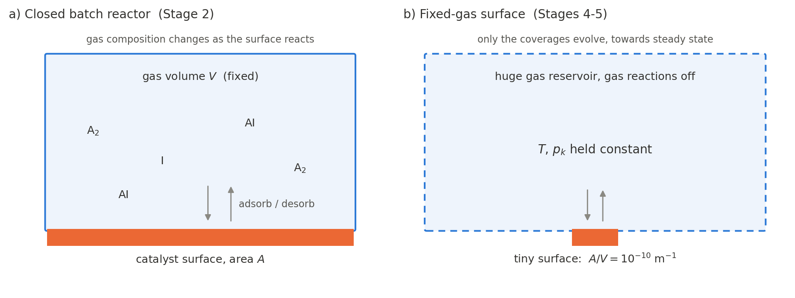

*Figure 1. (a) In a closed batch reactor, the gas changes as the surface reacts. (b) In the fixed-gas mode, the gas is held constant and only the surface evolves, towards a steady state.*

| | Closed batch reactor (Stage 2) | Fixed-gas surface (Stages 4–5) |
|---|---|---|
| Represents | the reactor RMG used to build the mechanism | a catalyst exposed to gas of constant composition (a differential reactor, or the inlet of a flow reactor) |
| What evolves | gas and surface | surface only |
| Result | trajectories in time and pathway fluxes | steady-state coverages and rates at a precisely defined gas state |
| Used for | flux diagrams, overall mechanism behavior | rates, poisoning, surface composition |
| Needs | Cantera YAML plus RMG's seed mechanism, species dictionary and `input.py` | Cantera YAML only |

In a closed reactor the gas composition drifts as the surface consumes or produces species, so "the rate at impurity level *x*" is not well defined there. Holding the gas fixed and solving for the surface's steady state gives exactly that rate, at the cost of the time-resolved view.

## 1.3 The pipeline at a glance

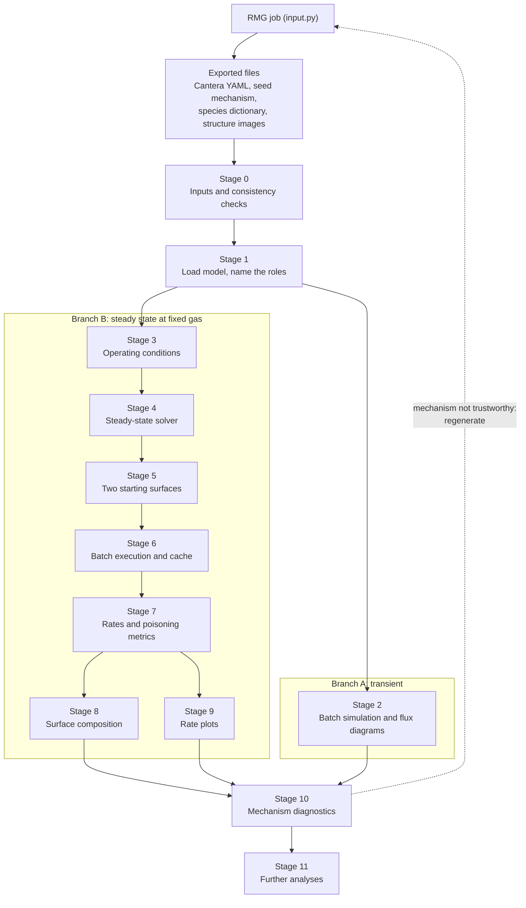

*Diagram 1. The two branches share Stages 0–1 and meet again in the diagnostics.*

| Stage | Purpose | Main inputs | Main outputs | Code |
|---|---|---|---|---|
| 0 | Check the files belong together | RMG job directory | a verified set of files | manual; `Model` checks the site density |
| 1 | Load the model, find the probe reaction | Cantera YAML, `settings.py` roles | `Model` | `model.py` |
| 2 | Batch simulation and flux diagrams | YAML, seed, dictionary, RMG `input.py` | frames and a video per reactor | `analyses/flux.py` (optional) |
| 3 | Define the gas environments: a temperature series and a pressure series | `settings.py` conditions | conditions table | `conditions.py` |
| 4 | Solve one steady state | T, P, mole fractions, start surface | coverages and diagnostics | `solver.py`: `set_state` … `solve_steady_state` |
| 5 | Two starting surfaces per condition | one condition | two solutions, agreement flag | `solver.py`: `solve_condition` |
| 6 | Run every condition in parallel, cached | conditions table | results, cache files | `runner.py`; `solver.run_conditions` |
| 7 | Rates and poisoning metrics | results | `steady_state_results.csv` | `analyses/steady_state.py`, `analyses/common.py` |
| 8 | Surface composition | results | coverage tables, bar chart | `analyses/composition.py` |
| 9 | Rate plots | summary table | `rates_summary_vs_T.png`, `_vs_P.png` | `analyses/steady_state.py` |
| 10 | Mechanism diagnostics | mechanism, results | binding check, what-if runs, traces | `analyses/diagnostics.py` |
| 11 | Further analyses | the Stage 4–6 solver, results | poisoning curves, temperature and pressure sweeps, Arrhenius forms, equilibrium coverage, orders, rate control, path diagrams, transients; every rate also per area | `analyses/curves.py` … `analyses/transients.py` |
| – | The run report | the output folder, `settings.py` | `output/report/<run>_report.pdf` | `report.py`, `report_text.py` ([The run report](#the-run-report)) |

Paths are inside the package folder `hydrogen_surface_kinetics/`; the [Code map](#code-map) lists every file. Each analysis is chosen by its name in `analyses = [...]` of the run's `settings.py` ([Running an analysis](#running-an-analysis)). The RMG input of a run is also called `input.py`; in this document `input.py` always means RMG's file, and `settings.py` the package's.

## 1.4 Model assumptions and limits

- **Mean field.** Rates depend only on average coverages. There are no islands, ordering or correlations between neighboring sites. Lateral interactions enter only if the mechanism contains coverage-dependent parameters (Cantera evaluates them; RMG mechanisms usually have none).
- **Ideal surface.** One type of site, at a constant site density $\Gamma$.
- **Isothermal.** Heats of reaction do not change the temperature.
- **Intrinsic kinetics.** No mass-transfer limitation between gas and surface; the gas is uniform.
- **Fixed gas means negligible conversion.** The steady-state mode assumes the surface does not change the gas noticeably (differential conditions) and runs no gas-phase chemistry.
- **Parameters as given.** RMG estimates much of the thermochemistry and kinetics, from libraries, group additivity, rate rules and linear scaling from other metals. Results are only as good as those estimates; Stage 10 is about judging that.
- **Cantera's site counting.** Species that occupy more than one site follow Cantera's convention ([Section 2.1](#21-surface-phase-coverages-and-site-counting)), which differs from a strict "the number of sites is conserved" picture.

## 1.5 Software and environment

| Component | Used for | Notes |
|---|---|---|
| Cantera (tested 3.0.1) | every simulation | interface kinetics, reactor networks, steady-state solver |
| NumPy, pandas, matplotlib | arrays, tables, plots | |
| RMG-Py (local build) | Stage 2 only: reading the seed mechanism and `input.py`, flux pairs, flux diagrams, structure images | contains compiled modules, so the kernel's Python version must match the one RMG-Py was built with |
| RDKit | Stage 2 structure matching | |
| Graphviz (`dot`) and ffmpeg | Stage 2 rendering and video | |
| Python environment | running the package (`run.sh`, the notebook kernel) | pick the environment that has all of the above (here `rmg4.0`); the wrong one shows up as `ModuleNotFoundError` for `rdkit` or for a compiled RMG module. Only Stage 2 needs RMG-Py, RDKit and ffmpeg |

---

# Part II. Theory

## 2.1 Surface phase, coverages and site counting

**Site density.** $\Gamma$ is the number of moles of surface sites per unit area. The YAML file gives it under `site-density`, in the units declared at the top of the file; Cantera converts it to kmol m⁻². A common pitfall is the conversion from the mol cm⁻² used in RMG input files:

$$1\ \mathrm{mol\,cm^{-2}} = 10\ \mathrm{kmol\,m^{-2}}$$

**Coverages.** Every surface species $k$, including the empty site, occupies $\sigma_k$ sites (`sites:` in the YAML, default 1). The coverage $\theta_k$ is the fraction of sites occupied by species $k$, so

$$\sum_k \theta_k = 1 .$$

**Concentrations.** Rate laws use surface concentrations $C_k$ (kmol m⁻²). Cantera relates them to coverages as follows (verified in [Appendix E](#e-checking-the-equations-against-cantera)):

$$C_k = \frac{\Gamma\,\theta_k}{\sigma_k\,S}, \qquad S = \sum_j \frac{\theta_j}{\sigma_j}, \qquad\text{so that}\qquad \sum_k C_k = \Gamma, \qquad \theta_k = \frac{\sigma_k C_k}{\sum_j \sigma_j C_j}.$$

If every species occupies one site, $S = 1$ and $C_k = \Gamma\theta_k$. With multi-site species $S < 1$: Cantera holds the total number of surface *entities* (adsorbates plus empty sites) at $\Gamma$, so the number of *sites* it implies, $\sum_k \sigma_k C_k$, is larger than $\Gamma$. The **site-count factor** measures this:

$$f = \frac{\sum_k \sigma_k C_k}{\Gamma} = \frac{1}{S}, \qquad 1 \le f \le \max_k \sigma_k ,$$

and the concentration of empty sites is

$$C_{\ast} = f\,\theta_{\ast}\,\Gamma .$$

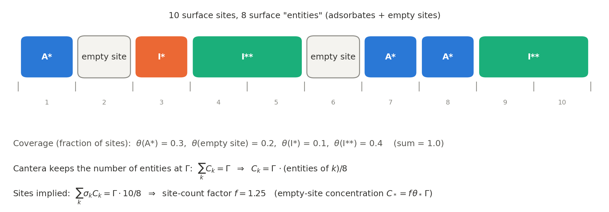

*Figure 2. Ten sites hold eight entities. The coverages add up to 1, but because Cantera normalizes the entities to $\Gamma$, the implied number of sites is $1.25\,\Gamma$.*

> [!IMPORTANT]
> **Consequences of the site-counting convention.**
> - A reaction that needs $n$ empty sites runs $f^{\,n}$ times faster than $\theta_\ast$ alone suggests.
> - When multi-site adsorbates dominate, $f$ approaches 2, so a surface covered by them is not directly comparable with one covered by single-site species.
>
> The workflow reports $f$ for every condition (`site_count_factor`, Stage 7) and plots an alternative "fixed site count" estimate (Stage 9). This convention could change between Cantera versions; re-run [Appendix E](#e-checking-the-equations-against-cantera) after upgrading.

## 2.2 Rate laws

For reaction $i$, let $\nu'_{ki}$ and $\nu''_{ki}$ be the stoichiometric coefficients of species $k$ as reactant and product, and $\nu_{ki} = \nu''_{ki} - \nu'_{ki}$ the net coefficient. The **rate of progress** (kmol m⁻² s⁻¹) follows mass action:

$$q_i = q_{f,i} - q_{r,i} = k_{f,i}\prod_k C_k^{\nu'_{ki}} - k_{r,i}\prod_k C_k^{\nu''_{ki}} ,$$

with gas concentrations in kmol m⁻³ and surface concentrations in kmol m⁻²; the units of the rate constants absorb the difference.

**Arrhenius rate constants:**

$$k_f = A\,T^{\,b}\exp\!\left(-\frac{E_a}{RT}\right).$$

**Sticking coefficients.** Adsorption reactions are often written with a sticking coefficient $\gamma$, the fraction of gas–surface collisions that react on a bare surface:

$$\gamma = a\,T^{\,b}\exp\!\left(-\frac{c}{RT}\right), \qquad k_f = \frac{\gamma}{\Gamma^{\,m}}\sqrt{\frac{RT}{2\pi W}} ,$$

where $m$ is the sum of the stoichiometric coefficients of the *surface* reactants (2 for A₂ + 2∗), and $W$ is the molar mass of the gas species. An optional Motz–Wise correction replaces $\gamma$ by $\gamma/(1-\gamma/2)$ (YAML `Motz-Wise: true`; off by default). A sticking coefficient above 1 is unphysical; Cantera checks each sticking expression at several temperatures and warns when it exceeds 1, and Stage 1 records these warnings.

**Coverage dependence.** If the YAML contains coverage-dependent parameters, Cantera applies them. The workflow makes no assumption about them, except the site-blocking check in Stage 7, which would flag them.

## 2.3 Thermodynamic consistency

**Species thermochemistry.** RMG exports NASA 7-coefficient polynomials, with one set of coefficients for a low and one for a high temperature range (other Cantera thermo models work too):

$$\frac{c_p^\circ}{R} = a_1 + a_2T + a_3T^2 + a_4T^3 + a_5T^4$$

$$\frac{H^\circ}{RT} = a_1 + \frac{a_2T}{2} + \frac{a_3T^2}{3} + \frac{a_4T^3}{4} + \frac{a_5T^4}{5} + \frac{a_6}{T}$$

$$\frac{S^\circ}{R} = a_1\ln T + a_2T + \frac{a_3T^2}{2} + \frac{a_4T^3}{3} + \frac{a_5T^4}{4} + a_7$$

and $G^\circ = H^\circ - TS^\circ$.

**Reverse rates.** For every reversible reaction, Cantera computes the reverse rate constant from the equilibrium constant in concentration units:

$$K_{c,i} = \exp\!\left(-\frac{\Delta G^\circ_i}{RT}\right)\prod_k \left(C_k^\circ\right)^{\nu_{ki}}, \qquad k_{r,i} = \frac{k_{f,i}}{K_{c,i}},$$

where $\Delta G^\circ_i = \sum_k \nu_{ki}\,G^\circ_k(T)$ uses reference-state Gibbs energies (gas species at their reference pressure $P^\circ$, the species' `reference-pressure`, usually 1 bar or 1 atm), and the standard concentrations are $C_k^\circ = P^\circ/RT$ for gas species and $C_k^\circ = \Gamma/\sigma_k$ for surface species.

> [!IMPORTANT]
> Cantera's `standard_gibbs_RT` for an ideal gas is evaluated at the *current* pressure, not at $P^\circ$. When computing $K_c$ by hand, use reference-state values (each species' `thermo.h(T)` and `thermo.s(T)`). [Appendix E](#e-checking-the-equations-against-cantera) checks both statements.

**Editing thermochemistry changes kinetics.** Shifting species $k$'s enthalpy by $\delta H$ (adding $\delta H/R$ to $a_6$) multiplies the equilibrium constant of every reaction containing $k$ by $\exp(-\nu_{ki}\,\delta H/RT)$, and therefore its reverse rate constant by $\exp(+\nu_{ki}\,\delta H/RT)$. Forward rate constants, estimated by RMG with the original thermochemistry, do not change. For example, $\delta H$ = 50 kJ mol⁻¹ at 300 K gives a factor $e^{20} \approx 5\times10^{8}$. Stage 10 explains why the workflow does not edit thermochemistry in place.

## 2.4 Conservation equations

The **net production rate** of species $k$ by surface reactions is

$$\dot s_k = \sum_i \nu_{ki}\,q_i \qquad [\mathrm{kmol\,m^{-2}\,s^{-1}}],$$

defined for gas species too, which the surface consumes and releases through adsorption and desorption. Gas-phase reactions produce species $k$ at the volumetric rate $\dot\omega_k$ (kmol m⁻³ s⁻¹).

**Closed batch reactor** (isothermal, constant volume $V$, catalyst area $A$):

$$\frac{dC_k}{dt} = \dot\omega_k + \frac{A}{V}\,\dot s_k \quad (k\ \text{in the gas}), \qquad \frac{d\theta_k}{dt} = \frac{\sigma_k\,\dot s_k}{\Gamma} \quad (k\ \text{on the surface}).$$

The coverage equation is what Cantera's reactor integrates (verified in [Appendix E](#e-checking-the-equations-against-cantera)), with $\dot s_k$ evaluated from the concentrations of [Section 2.1](#21-surface-phase-coverages-and-site-counting). Every reaction conserves sites ($\sum_{k\in\text{surface}} \sigma_k\,\nu_{ki} = 0$), so $\sum_k\theta_k$ stays equal to 1. RMG sizes its batch reactor for 1 mol of gas, $V = RT/P$, and sets $A = V\cdot(A/V)$ from the area-to-volume ratio in `input.py`.

**Fixed-gas surface.** With the gas state ($T$, $P$, mole fractions $x$) held constant, only the coverages evolve:

$$\frac{d\theta_k}{dt} = \frac{\sigma_k}{\Gamma}\,\dot s_k(\boldsymbol{\theta};\,T, p).$$

The **steady state** is the solution of

$$\dot s_k(\boldsymbol{\theta}) = 0 \quad \text{for every surface species } k, \qquad \sum_k \theta_k = 1,$$

where one of the $\dot s_k$ equations is redundant because of the site balance.

In practice (Stage 4), a reactor with a tiny area-to-volume ratio emulates a fixed gas. Over a time $t$ its gas composition changes by roughly

$$\Delta x_k \approx \frac{(A/V)\,\lvert\dot s_k\rvert\,t}{C_{\mathrm{tot}}}, \qquad C_{\mathrm{tot}} = \frac{P}{RT}.$$

The workflow does not rely on this estimate; it measures the drift and rejects any solution where the gas moved (Stage 4).

## 2.5 Rates per site

The **turnover frequency** (TOF) of reaction $i$ is its rate per surface site, in events per site per second:

$$\mathrm{TOF}_{f,i} = \frac{q_{f,i}}{\Gamma}, \qquad \mathrm{TOF}_{r,i} = \frac{q_{r,i}}{\Gamma}, \qquad \mathrm{TOF}_{i} = \mathrm{TOF}_{f,i} - \mathrm{TOF}_{r,i} \qquad [\mathrm{s^{-1}}].$$

If the mechanism writes the probe reaction in the opposite direction (2A∗ ⇌ A₂ + 2∗), forward and reverse are swapped so that "forward" always means the direction of interest (the direction sign $s_p$ in Stage 1).

**Forward vs net.** When the probe reaction is close to equilibrium at steady state, as with adsorption balanced by desorption in pure probe gas, the net TOF is close to zero even though the forward TOF is large. The forward TOF is the rate of the elementary step itself. The net TOF is non-zero only when the step's products are consumed elsewhere. The workflow reports both.

**Net gas consumption per site**, $-\dot s_{A_2}/\Gamma$, includes every surface reaction that consumes A₂. It differs from the probe reaction's net TOF when other pathways take up the gas, for example a molecularly adsorbed A₂∗ that reacts directly with other adsorbates.

TOFs are per nominal site, $\Gamma$. With multi-site species ($f > 1$), Cantera's implied number of sites is $f\,\Gamma$ ([Section 2.1](#21-surface-phase-coverages-and-site-counting)).

## 2.6 Numerical aspects

- **Stiffness.** Surface time scales range from adsorption (well below a microsecond) to slow accumulation (hours to years of surface time), and rate constants can span more than 30 orders of magnitude, especially at low temperature. This needs implicit integration (BDF methods in SUNDIALS CVODES, through Cantera's `ReactorNet`) with tight tolerances.
- **Tolerances.** The absolute tolerance applies to every state variable, including surface concentrations, which are at most $\Gamma \sim 10^{-8}$ kmol m⁻². It must therefore be far below $\Gamma\,\theta$ for the smallest coverages that matter, e.g. $10^{-22}$, with a relative tolerance of about $10^{-10}$. Cantera's defaults (rtol $10^{-9}$, atol $10^{-15}$) can fail on stiff surfaces with repeated error-test failures.
- **Newton steady-state solve.** `Interface.advance_coverages_to_steady_state()` calls Cantera's `solvePseudoSteadyStateProblem`: a damped Newton iteration on the steady-state equations, with time stepping to improve a poor starting point. It is fast when it converges, but it needs a non-singular Jacobian. Switching reactions off (rate multiplier 0) leaves species with identically zero rows, which makes the Jacobian singular.
- **Residual scaling.** The gross rate $G_k$ of a species (creation plus destruction, converted to s⁻¹) limits how small its net residual can get: round-off gives about $\varepsilon_{\text{mach}}\,G_k$ ($\varepsilon_{\text{mach}} \approx 2.2\times10^{-16}$), and time integration about $\text{rtol}\cdot G_k$. A purely absolute residual threshold therefore cannot be met by species that turn over very fast, which is why Stage 4 adds a relative term.

---

# Part III. Stages

## Stage 0: Inputs and consistency checks

**Purpose.** Make sure the files to be combined describe the same mechanism, in the units expected, before running anything.

**At a glance.**
- Inputs: an RMG job directory.
- Outputs: a verified set of files, and the expected site density for Stage 1.
- Code: manual checks; Stage 1 asserts the site density.

**Concepts.** What each file holds:

| File | Written by | Contains | Used by |
|---|---|---|---|
| `chem_annotated.yaml` (RMG may write several exports, e.g. `cantera1/` and `cantera2/`) | RMG's Cantera writer | gas and surface phases; species with thermochemistry; every reaction with its parameters; per-reaction notes (provenance, RMG index, flux pairs) | Stages 1–11 |
| `seed/seed/reactions.py` and `seed/seed/dictionary.txt` | RMG (seed mechanism) | RMG reaction objects with kinetics; species structures as adjacency lists | Stage 2 |
| `chemkin/species_dictionary.txt` | RMG | species structures, labeled like the Chemkin and YAML exports | alternative dictionary for Stage 2 |
| `input.py` | the user (RMG input file) | reactor conditions; catalyst properties (site density, binding energies); libraries used | Stages 0 and 2 |
| `species/*.png` | RMG | structure images named `label(index).png` | Stage 2 |

Cantera species names are RMG labels with the RMG index appended, `label(index)`; removing the trailing `(index)` gives the *base label*. For surface species, RMG often uses SMILES-like labels in which the surface site is written `[Pt]`, *whatever the metal*: RMG's SMILES conversion represents its site atom X as Pt. Labels with two `[Pt]`, or ending in `XX`, usually denote two-site species.

**Procedure.**

1. **Writer and units.** The YAML header gives the units (`units: {length: m, quantity: mol, ...}`) and the writer (`generator:` line). Note both.
2. **Site density.** Interpret the YAML's `site-density` in its declared units and compare it with `surfaceSiteDensity` in `input.py`, using $\Gamma\,[\mathrm{kmol\,m^{-2}}] = 10\,\Gamma\,[\mathrm{mol\,cm^{-2}}]$. A writer that copies the mol cm⁻² number into a kmol-based file gives a value 10× too small. Stage 1 asserts this check.
3. **Same iteration.** If Stage 2 will be used, compare the species and reaction counts of the seed mechanism and the YAML, and count how many seed labels appear among the YAML base labels. Large mismatches mean the files were saved at different RMG iterations or exported with different labeling. Get both from the same final iteration, or rely on Stage 2's structure matching.
4. **Reactor conditions.** Read the `surfaceReactor` blocks in `input.py` and look for accidental duplicates (copy-paste), since every block is simulated.
5. **Environment.** Pick the Python environment that can import Cantera, RDKit and the compiled RMG-Py.

**Design choices.** When several YAML exports exist, use the one whose site density matches `input.py`; prefer mol-based units.

**Checks and failure modes.**

| Symptom | Likely cause |
|---|---|
| Site-density assertion fails in Stage 1 | unit error in the export, or the wrong file |
| Few seed labels found among the YAML names | seed and YAML from different iterations, or labeled differently |
| Two identical `surfaceReactor` blocks | copy-paste in `input.py`; fewer distinct conditions than intended |
| Warning: reactions "marked duplicate but have no duplicate" | RMG flagged a reaction `duplicate: true` without writing its partner, which Cantera refuses. The package loads `output/<mechanism>.duplicates_fixed.yaml`, the same file without those flags (the flag changes no rate) and reuses it while the mechanism is unchanged. A missing partner may mean a reaction was lost when RMG wrote the file, so tell whoever ran RMG |

## Stage 1: Loading the model and naming the roles

**Purpose.** Load the mechanism into Cantera, confirm it is the intended file, and identify, by their role, the species and reactions the analysis is about.

**At a glance.**
- Inputs: the Cantera YAML; the names of the role species.
- Outputs: a `Model` holding `gas` (a Cantera `Solution`), `surf` (an `Interface`), the index and direction of the probe and molecular-adsorption reactions, and the impurity species names.
- Code: `model.py`: `Model`, `find_role_reaction`, `Model._resolve_gas`.

**Concepts.** The roles are declared in the run's `settings.py`, and the `Model` finds the rest:

| Role | Symbol here | `settings.py` setting | `Model` attribute | Found by |
|---|---|---|---|---|
| probe gas | A₂ | `probe_gas` | `probe_gas` | name |
| empty site | ∗ | `empty_site` | `site` | name |
| dissociated adsorbate | A∗ | `probe_adsorbate` | `probe_adsorbate` | name |
| molecularly adsorbed probe gas | A₂∗ | `molecular_adsorbate` (optional) | `molecular_adsorbate` | name |
| probe reaction, A₂ + n∗ ⇌ A∗ | $R_p$ | none | `i_probe`, `sign_probe`, `probe_sites` | `find_role_reaction` |
| molecular adsorption, A₂ + ∗ ⇌ A₂∗ | $R_m$ | none | `i_molec`, `sign_molec` | `find_role_reaction` |
| impurities | I₁, I₂, … | `impurities` (label → name or composition) | `impurities` | name, or elemental composition |

Nothing in the code is specific to one mechanism: a new mechanism needs only a new `settings.py` ([Writing a settings.py](#writing-a-settingspy)).

**Procedure.**

1. Load the gas with `transport_model=None`, and the interface with the gas as its adjacent phase. Record any warnings about sticking coefficients above 1.
2. Assert that the site density equals the expected value (relative tolerance $10^{-3}$) and that the role species exist.
3. Find each role reaction by its species sets ({probe gas, empty site} ⇌ {adsorbate}), in either direction, requiring exactly one match. Record its index, a direction sign (+1 if the mechanism writes it as given, −1 if reversed) and the number of empty sites $n$ it consumes, which the site-blocking columns of Stage 7 use.
4. List every surface reaction that involves the probe gas. If there are others besides $R_p$ and $R_m$, record a warning (shown by `check` and at the start of every run): the probe reaction is then not the whole story of how A₂ reaches the surface, and the net consumption column of Stage 7 includes the other reactions.
5. Resolve each impurity: a name must be a gas species; a composition (e.g. `{'C': 1, 'O': 1}`) must match exactly one gas species.
6. Record the SHA-256 checksum of the mechanism file, which goes into every cache fingerprint (Stage 6).

**Design choices.**
- **By equation, not by index.** Reaction indices change between exports and RMG iterations.
- **By composition for gas species.** Robust to renumbering. It fails loudly when two species share a composition (isomers); name the intended one explicitly in that case.
- **Transport off.** Exports can lack transport data for some species (inert gases, for example), which stops loading. A uniform, zero-dimensional problem does not use transport.

**Checks and failure modes.**
- `expected exactly one reaction … found N`: the reaction is missing, or the mechanism contains duplicates (RMG can generate the same reaction from different templates).
- `expected one gas species with composition …`: isomers share the composition; give the species name instead.
- `site density … does not match the expected`: the wrong file, or a unit error in the export (Stage 0).
- A warning that other reactions use the probe gas: revisit what "the probe rate" should mean.

## Stage 2: Transient batch simulation and flux diagrams

**Purpose.** Re-run, with Cantera, the reactor conditions the mechanism was generated for, and animate which species-to-species pathways carry flux over time.

**At a glance.**
- Inputs: Cantera YAML, seed `reactions.py` and `dictionary.txt`, the RMG `input.py`, structure images (optional). By default the RMG `input.py` and `seed/seed` (or `seed`) next to `settings.py` are used.
- Outputs: for each reactor, a folder `output/flux/<n>/` with frames `flux_diagram_XXXX.dot` and `.png` and a video `flux_diagram.avi`; missing structure images drawn into `output/flux_species/` (or `flux['species_dir']`).
- Code: `analyses/flux.py` (`load_seed`, `build_matched_model`, `mol_from_pt_smiles`, `draw_species_images`, `reaction_index`, `simulate`, `condition_label`, `bake_condition_label`, `run`) and RMG's `rmgpy.tools.fluxdiagram.generate_flux_diagram`. Optional: it is the only part that needs RMG-Py, and it runs only when named (`--only flux`).

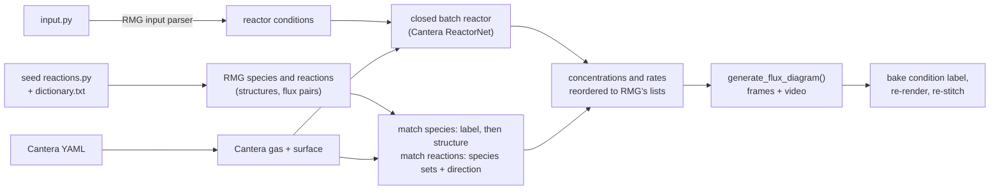

*Diagram 2. Data flow in Stage 2.*

**Concepts.**

*Reactor conditions.* RMG's own input parser (`RMG.load_input`) returns one reaction system per `surfaceReactor` block, with temperature, initial pressure, initial gas mole fractions, initial coverages, area-to-volume ratio and termination criteria.

*Reactor model.* A closed, isothermal, constant-volume reactor with gas-phase reactions active ([Section 2.4](#24-conservation-equations)), sized like RMG's: $V = RT/P$ for 1 mol of gas and $A = V\cdot(A/V)$.

*Flux pairs.* Every RMG reaction carries *flux pairs*: (reactant, product) pairs of species that exchange atoms. The YAML notes list them too, as `Flux pairs: …`. The species-to-species flux sums the rates of progress over every reaction in which $(a, b)$ is a pair:

$$R_{ab}(t) = \sum_i \sum_{(a,b)\in\mathcal P_i} q_i(t) \;-\; \sum_i \sum_{(b,a)\in\mathcal P_i} q_i(t), \qquad R_{ba} = -R_{ab},$$

where $\mathcal P_i$ is the set of flux pairs of reaction $i$. A positive $R_{ab}$ means net flow from $a$ to $b$.

*How the diagram encodes it* (RMG's `generate_flux_diagram`). Species pairs are ranked by their largest flux over time, $\max_t\lvert R_{ab}(t)\rvert$, and added until the node and edge limits are reached (`max_node_count`, `max_edge_count`; 50 each by default). The layout is computed once, with maximum line widths, so positions stay fixed across frames. In each frame, line width follows

$$w = w_{\max}\left(1 - \frac{\log_{10} x}{\log_{10} x_{\mathrm{tol}}}\right) \quad (x \ge x_{\mathrm{tol}}), \qquad w = 0 \quad (x < x_{\mathrm{tol}}),$$

with $x = C_k(t)/\max_{k,t} C$ for node borders and $x = \lvert R_{ab}(t)\rvert / \max\lvert R\rvert$ for edges; by default $w_{\max} = 10$ and $x_{\mathrm{tol}} = 10^{-6}$. The arrow points in the direction of net flux; below the tolerance no arrow is drawn.

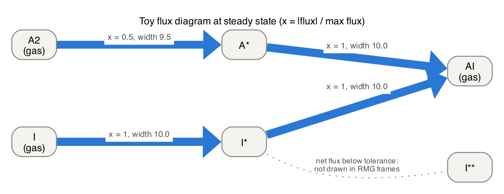

*Figure 3. A toy flux diagram at steady state. Edge width grows with the logarithm of the normalized flux $x$; the arrow shows the net direction. A pair whose net flux is below the tolerance (here I∗ ⇌ I∗∗, at equilibrium) is not drawn in RMG's frames. Empty sites, which RMG also shows as a node, are omitted here.*

> [!IMPORTANT]
> **Node borders compare gas and surface concentrations on one scale**, even though gas concentrations are in kmol m⁻³ and surface concentrations in kmol m⁻². Gas near 1 bar and 300–1000 K has $C \approx 0.01$–0.04 kmol m⁻³, while surface concentrations are at most $\Gamma \sim 10^{-8}$ kmol m⁻², so surface nodes sit near or below $x_{\mathrm{tol}}$ and get thin or no borders. Compare node borders within a phase only. Edge widths (fluxes) are comparable across the whole diagram.

**Procedure.**

1. Load the RMG species and reactions from the seed mechanism (structures, kinetics, flux pairs) and the Cantera model.
2. **Match species.** First by base label. For species still unmatched, parse the Cantera base label as SMILES with RDKit, convert Pt atoms to RMG's site atom X (with no radical electrons on X), rebuild an RMG `Molecule`, and compare it with each unmatched seed species by graph isomorphism (`Species.is_isomorphic`, which also tries resonance structures). Relabel every matched seed species with the Cantera base label and index, so labels and image file names line up.
3. Keep the reactions whose species all matched, and regenerate their flux pairs against the shared species objects.
4. Draw any missing structure images.
5. **Match reactions.** Index Cantera reactions by (set of reactant base labels, set of product base labels), in both orientations, and map each RMG reaction to a phase, an index and a sign.
6. **Simulate** each reactor, one at a time (skipping those that already have a video when `skip_existing` is set) on log-spaced times from $10^{-8}$ s to the termination time (1000 s if none is given), with tolerances `rtol` and `atol` (the `flux` section). Record gas concentrations, surface concentrations, and gas and surface net rates of progress. A solver failure is caught, and the batch moves on.
7. Reorder concentrations and rates into RMG's species and reaction order, multiplying rates by the matching sign.
8. `generate_flux_diagram` writes one `.dot` and one `.png` per time point, repeating the first and last frames (frame rate × padding) so the video pauses on them, and stitches an AVI.
9. **Bake the condition label** (T, P, composition) into each `.dot` file's label, re-render the PNGs with `dot`, and re-stitch the video with ffmpeg.

**Design choices.**
- **Cantera rather than RMG's solver**, so the simulation uses exactly the YAML analyzed in the other stages.
- **Structure fallback**, because different exports can label the same species differently.
- **Labels baked in afterwards**, because RMG's tool labels frames with the time only.
- **One reactor at a time, in the main process.** Unlike Stage 6, no worker processes: on macOS a process forked after RDKit/Cairo have drawn structure images dies without a result, and each reactor is one long Cantera run anyway. The videos on disk serve as the cache.

**Checks and failure modes.**
- The matching report lists unmatched seed species, unmatched Cantera species and unmatched reactions; all of them are left out of the diagrams. Check the counts.
- Reaction matching uses *sets* of species, so stoichiometry (A + A vs A) and duplicate reactions are not told apart: the first match wins.
- Termination by conversion in `input.py` is ignored; only the termination time is used.
- `FAILED - CanteraError …`: tighten `rtol` and `atol`; failed reactors are listed at the end, and the batch carries on.
- Text labels instead of structures: images are missing and could not be drawn.

## Stage 3: Designing the operating conditions

**Purpose.** Define the gas environments at which steady states are computed, so that the effect of impurities can be separated from other changes, and the effect of temperature from that of pressure.

**At a glance.**
- Inputs: the role names and the condition settings of `settings.py` (`temperatures`, `reference_pressure`, `pressures`, `pressure_temperatures`, `impurity_ratio`, `mixture_mode`, `include_input_basis`, `input_basis`).
- Output: the conditions table, one row per (basis, case, point), with total pressure (`P_total_bar`), probe-gas and impurity partial pressures (`P_probe_bar`, `P_impurity_bar`), the mole-fraction dictionary `X`, and the point's labels `P_ref_bar` and `series`.
- Code: `conditions.py`: `series_points`, `main_conditions`, `partial_pressures`, `point_row`, `case_labels`, `condition_key`.

**Concepts.**

*Two separate series.* Temperature and pressure are never varied together:

| Series | What varies | What is held fixed | Settings |
|---|---|---|---|
| temperature | $T$ over `temperatures` | $p_{A_2} = $ `reference_pressure` | `temperatures`, `reference_pressure` |
| pressure | $p_{A_2}$ over `pressures` | $T$, one series at each of `pressure_temperatures` | `pressures`, `pressure_temperatures` (default: the lowest temperature) |

Every pressure series also contains `reference_pressure`, so the two series meet. A point $(T, p)$ in both is solved once and labeled `both`; a point is never a combination that neither series asked for, so there is no $T \times p$ grid. `pressures = []` means no pressure series. With 4 temperatures and 3 pressures at 2 temperatures, for example, there are $4 + 2\times3 - 2 = 8$ points, not 12.

*Cases*: probe gas only (the reference, named by `reference_label`), each impurity alone (named by its label in `impurities`), and all impurities together (named by `mixture_label`; only with two or more impurities). Partial pressures are $p_k = x_k P$.

*Fixed probe-gas pressure* (basis `fixed_probe`, the main analysis). At each point the probe gas has the point's partial pressure in every case, and impurities are added on top at a fixed ratio to it:

$$p_{A_2} = p_{\mathrm{point}}, \qquad p_{I_j} = r\,p_{A_2}\ \ \text{for each impurity in the case}, \qquad P = p_{A_2} + \sum_j p_{I_j}, \qquad x_k = \frac{p_k}{P}.$$

Along the pressure series the impurity therefore keeps the same purity ($r$ = `impurity_ratio`), and every partial pressure scales together. With `mixture_mode = 'split'`, each impurity in the mixture gets $r/N_I$ instead of $r$.

*One ratio per impurity.* `impurity_ratio` can also be a dict, `{impurity label: r_j}`, with an entry for every impurity. Each impurity alone is then at its own level, and the all-impurities case has every impurity at its own level together, so its gas is exactly a given composition. For an RMG reactor with initial amounts $n_k$ (any units, as in `initialGasMoleFractions`), $r_j = n_j / n_{A_2}$; for example `{'CO': 1 / 190, 'H2O': 10 / 190, ...}` reproduces a reactor with 190 parts H₂, 1 part CO and 10 parts H₂O. `mixture_mode = 'split'` needs a single number. Condition names then say `r=per-impurity` instead of a number.

*Fixed mole fractions* (basis `input_X`, a check). Mole fractions are taken from `input_basis` (by default those of the RMG reactor definitions of the first Ni run: 0.8/0.2 for a single impurity, 0.75 + 0.05 each in the mixture, renormalized), at total pressure $P = p_{\mathrm{point}}$, so $p_{A_2} = x_{A_2}P$ and adding an impurity dilutes the probe gas. The ratio $\mathrm{TOF}(\texttt{input\_X})/\mathrm{TOF}(\texttt{fixed\_probe})$ for the same case and point isolates that dilution effect.

*Labels are not physics.* `P_ref_bar` and `series` describe where a point sits in the study. They are kept out of the cache fingerprint (Stage 6), so adding a temperature to the pressure series, for instance, relabels an existing point from `temperature` to `both` without solving it again.

**Procedure.** Build the series points; for each basis, point and case compute partial pressures, total pressure and mole fractions. Assert that the mole fractions sum to 1 and that the probe gas is present.

**Design choices.**
- **Separate series instead of a grid**, so every comparison changes one thing: along the temperature series only $T$, along a pressure series only $p$. The earlier option of temperature-linked pressures (`pressure_mode = 'input'`) mixed the two and was removed.
- **Fixed probe pressure as the main basis**, so any change in the probe rate at a point comes from the impurity.
- **Fixed impurity ratio along the pressure series**, so the gas has the same purity at every pressure.
- **`mixture_mode = 'same_each'` by default**, so the mixture can be compared directly with the worst single impurity.
- **High impurity ratios by default** make effects clear; trace levels belong in poisoning curves ([Stage 11.1](#111-poisoning-curves)).

**Checks and failure modes.** The assertions above; `settings.py` is checked before anything runs, and setting the removed `pressure_mode` or `input_pressures` stops with a message saying what replaces them. Turning on `include_input_basis` doubles the number of conditions.

## Stage 4: Steady-state solver

**Purpose.** For one gas state and one starting surface, find the steady-state coverages ([Section 2.4](#24-conservation-equations)) and prove they are converged.

**At a glance.**
- Inputs: $T$, $P$, mole fractions $x$, starting coverages $\theta^0$.
- Outputs: $\theta$ (an array in `surf.species_names` order) and `info` (the method that succeeded, convergence diagnostics, every attempt).
- Code: `model.py`: `Model.new_surface`, `Model.probe_rates`; `solver.py`: `set_state`, `check_convergence`, `method_direct`, `fixed_gas_reactor`, `method_reactor`, `solve_steady_state`, `describe`. Every setting comes from the `solver` section of `settings.py` ([Appendix B](#b-settings-reference)).

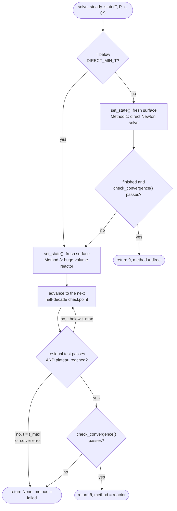

*Diagram 3. How one steady state is solved.*

### Setting the state

`set_state(T, P, X, theta0)`:

1. Create a fresh `Interface` object (`Model.new_surface`).
2. Set the gas temperature, pressure and mole fractions, then the surface temperature and pressure.
3. Validate the starting coverages: every species must exist, and they must sum to 1 within $10^{-8}$. Cantera would otherwise renormalize silently and run a different start than the one asked for.
4. Set the coverages; species not listed get 0.
5. Confirm that temperature, pressure, mole fractions and coverages were applied, and return a copy of the gas mole fractions for the drift check.

> [!IMPORTANT]
> **A fresh surface object for every solve.** Cantera's steady-state solver keeps internal state attached to the `Interface` object. With Cantera 3.0.1, a second call to `advance_coverages_to_steady_state()` on the same object failed at once with a singular-matrix error, even for conditions that solve on a fresh object. Creating the object costs well under a second, even for a large mechanism.

### Method 1: direct (Newton) solve

`method_direct()` calls `surf.advance_coverages_to_steady_state()` ([Section 2.6](#26-numerical-aspects)). The gas is not touched. Errors are caught and returned as messages.

### Method 3: time integration in a huge-volume reactor

`method_reactor()` ages the surface in a constant gas until nothing changes:

- an `IdealGasReactor` with energy off and $V$ = 1 m³, carrying a `ReactorSurface` of area $10^{-10}$ m², so $A/V = 10^{-10}$ m⁻¹;
- gas-phase reactions switched off (multiplier 0) during the integration, and switched back on afterwards, also after an error;
- relative and absolute tolerances $10^{-10}$ and $10^{-22}$;
- integration through half-decade checkpoints $t_j = 10^{-8}, 10^{-7.5}, \ldots, t_{\max}$ ($t_{\max} = 10^{8}$ s).

At checkpoint $j \ge 1$ the surface is accepted if the residual test (below) passes **and** the solution has reached a plateau:

$$\frac{\lvert\mathrm{TOF}_f(t_j)-\mathrm{TOF}_f(t_{j-1})\rvert}{\lvert\mathrm{TOF}_f(t_{j-1})\rvert} < \varepsilon_{\mathrm{TOF}}, \qquad \max_k \lvert\theta_k(t_j)-\theta_k(t_{j-1})\rvert < \varepsilon_\theta ,$$

with $\varepsilon_{\mathrm{TOF}} = \varepsilon_\theta = 10^{-4}$. Otherwise the method reports "no plateau by $t_{\max}$".

"Method 2", repeated calls to `Interface.advance_coverages(dt)` with the gas fixed, was tried during development and dropped as far too slow; the numbering is kept to match the code.

### Choosing the method

`solve_steady_state()` tries the direct solve first and falls back to the reactor. Below `direct_min_T` (400 K) it uses the reactor only, because there the direct solve tends to fail, and to do so slowly. Every attempt starts from a fresh `set_state()`, so a failed method cannot leave a half-solved surface behind. A method that returns normally but fails `check_convergence()` counts as a failure. Every attempt is recorded in `info['attempts']`.

### Convergence test

`check_convergence(gas_X_start)` uses the same right-hand side as the reactor equation ([Section 2.4](#24-conservation-equations)). For each surface species, the residual and the gross rate are

$$r_k = \frac{\sigma_k\,\dot s_k}{\Gamma}, \qquad G_k = \frac{\sigma_k\,(\dot c_k + \dot d_k)}{\Gamma} \qquad [\mathrm{s^{-1}}],$$

where $\dot c_k$ and $\dot d_k$ are its creation and destruction rates. A state is converged only if all of the following hold:

$$\lvert r_k\rvert \le \varepsilon_{\mathrm{abs}} + \varepsilon_{\mathrm{rel}}\,G_k \ \ \text{for every } k, \qquad \Big\lvert \sum_k\theta_k - 1\Big\rvert \le \varepsilon_\Sigma, \qquad \min_k \theta_k \ge \varepsilon_-, \qquad \max_k\lvert x_k - x_k^0\rvert \le \varepsilon_{\mathrm{gas}} ,$$

with defaults $\varepsilon_{\mathrm{abs}} = 10^{-8}$ s⁻¹, $\varepsilon_{\mathrm{rel}} = 10^{-12}$, $\varepsilon_\Sigma = 10^{-8}$, $\varepsilon_- = -10^{-12}$ and $\varepsilon_{\mathrm{gas}} = 10^{-9}$. The diagnostics record the residual of the species closest to its limit, which species that is, its allowed value, the ratio of residual to forward TOF (for information only), the forward TOF, the site-balance error, the smallest coverage and the gas drift.

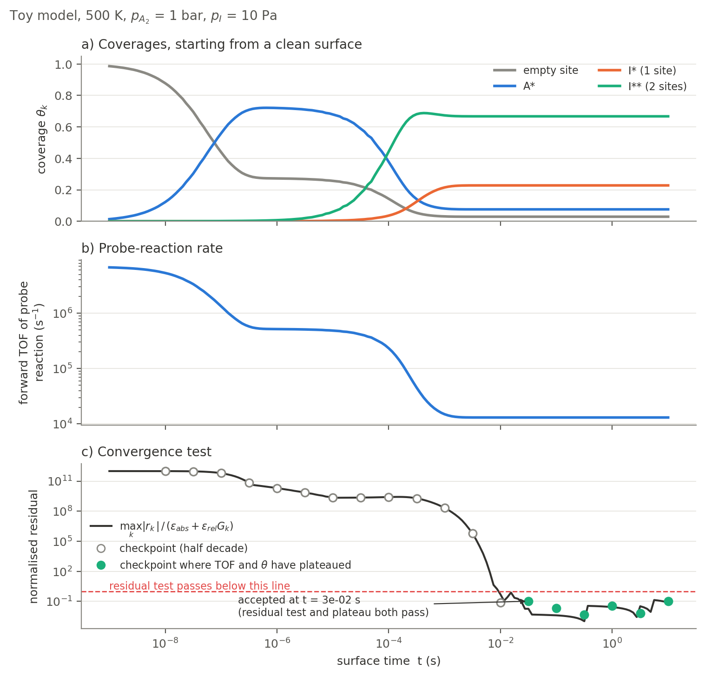

*Figure 4. Toy model, clean start. (a) Coverages and (b) the forward probe TOF settle in stages. (c) The normalized residual falls below 1 only once the slow species have settled; the reactor method accepts the first half-decade checkpoint at which the residual test passes and TOF and coverages have stopped changing since the previous checkpoint.*

**On real data** (`convergence` analysis, `convergence.png`). The same trace for chosen conditions of the run: by default the main conditions whose clean start did not converge, otherwise the reference case at the first point. The surface is integrated exactly as the reactor method does, every checkpoint is recorded (`convergence.csv`), and the integration continues to `reactor_t_max`, so a figure shows both where the state was accepted (dotted line) and what happens afterwards. For a failed condition it shows why: for example a coverage still drifting at $10^{8}$ s. A residual that climbs back above 1 after acceptance means the accepted state was a long-lived intermediate, not the final steady state; check such conditions before relying on them. Code: `analyses/convergence.py` (`trace`, `plot_convergence`).

**Design choices.**
- **Two methods with a fallback.** The Newton solve is fast but fragile; time integration is robust but slower.
- **Absolute plus relative residual.** An absolute threshold alone cannot be met by species that turn over $10^{8}$–$10^{9}$ times per second, where round-off alone gives residuals of $10^{-8}$–$10^{-7}$ s⁻¹. A relative threshold alone would accept a large absolute residual on a slow species. A test relative to the *probe TOF* was tried and rejected: when the probe reaction is very slow, such as under strong poisoning, it accepted surfaces that were still evolving.
- **Plateau check for the reactor.** A small residual at one instant can occur while the surface still drifts slowly; requiring no change between checkpoints guards against stopping early.
- **Gas fixed exactly, and checked.** Gas-phase reactions are off and the drift is measured, rather than assumed small.

**Checks and failure modes.**

| Symptom | Meaning and action |
|---|---|
| Direct solve: singular-matrix error | a reused surface object, or switched-off species ([Stage 10](#stage-10-mechanism-diagnostics)); the reactor method handles it |
| Direct solve fails slowly at low T | expected; `direct_min_T` skips it |
| Reactor: "no plateau by t_max" | a genuine slow drift (e.g., accumulation), or a residual limited by integrator error while TOF and coverages are constant; inspect the trajectory |
| "finished but failed checks" | a method's own success is not trusted; the next method runs, or the solve fails |

> [!NOTE]
> **Planned: a "plateau" convergence label.** At high temperature, the residuals of very fast species can stay above $\varepsilon_{\mathrm{abs}} + \varepsilon_{\mathrm{rel}}G_k$ because of integrator error (about $\text{rtol}\cdot G_k$), even though TOF and coverages have not changed for many decades of time. The plan is to accept such cases under a separate label, "plateau" (TOF and coverages unchanged over at least two decades), so they are reported but stay distinguishable from strict convergence.

## Stage 5: Multiple steady states

**Purpose.** Detect whether the steady state depends on the surface's history.

**At a glance.**
- Input: one row of `conditions`.
- Outputs: the solutions from two starting surfaces, the starting surfaces themselves, and an agreement flag with its metrics.
- Code: `solver.py`: `clean_surface`, `probe_covered_start`, `impurity_covered_start`, `coverages_to_dict`, `compare_starts`, `solve_condition`.

**Concepts.** Non-linear surface kinetics can have more than one stable steady state. A classic case is a reactant that needs two adjacent empty sites, competing with a strongly bound adsorbate that it also reacts with. For the same gas, a reactive surface and a poisoned surface can then both be stable, and which one the catalyst ends up in depends on where it started (hysteresis).

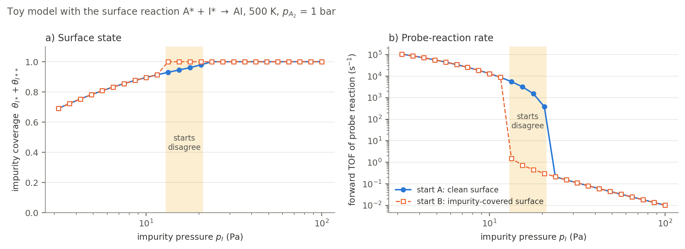

*Figure 5. Toy model with a surface reaction between A∗ and I∗. Inside the shaded window, a clean start stays reactive while an impurity-covered start stays poisoned: two steady states for the same gas.*

The two starts:

- **Start A**, a clean surface ($\theta_\ast = 1$). This is the main reported result.
- **Start B**, a surface already covered:
  - for the probe-gas-only case, 99 % A∗ and 1 % empty sites (`probe_covered_fraction`);
  - for impurity cases, a *pre-exposed* surface: a clean surface held for `pre_exposure_time` (1 s) in the impurity gas alone, with the probe gas removed and the impurity partial pressures unchanged. This uses the same huge-volume reactor with gas reactions off. The surface it reaches, clipped at zero and renormalized, is start B. It is cached per temperature and impurity partial pressures.

The two solutions agree if

$$\max_k\lvert\theta_k^{A}-\theta_k^{B}\rvert \le 10^{-3} \qquad\text{and}\qquad \frac{\lvert\mathrm{TOF}_f^{A}-\mathrm{TOF}_f^{B}\rvert}{\max(\mathrm{TOF}_f^{A},\,\mathrm{TOF}_f^{B})} \le 10^{-2}.$$

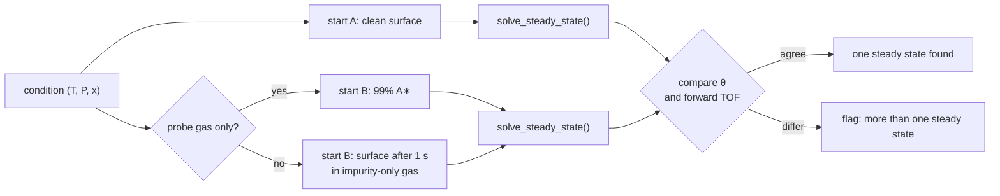

*Diagram 4. Two starting surfaces per condition.*

**Design choices.**
- **Pre-exposed, not "steady state in the impurity alone".** Some impurity-only systems never settle (decomposition products can keep accumulating), while a fixed exposure time always gives a defined start. It also represents a catalyst that met the impurity before the probe gas.
- **Start A as the main result**: a fresh catalyst exposed to the gas.

**Interpreting the result.**
- **Agree**: one steady state was reached from two very different starts. This is evidence, not proof, of uniqueness.
- **Disagree**: at least two steady states exist. Report both, and map the window by sweeping the impurity pressure up from a clean start and down from a covered start (poisoning curves, [Stage 11.1](#111-poisoning-curves)). The poisoning-curve figures draw the start-B branch (dashed, open squares where it differs) and shade the window, the real-data version of Figure 5; the tables carry start B's `tof_fwd_B`, `poisoning_factor_B`, `theta_free_B` and `theta_impurity_B`.
- **One start fails**: agreement is recorded as unknown (`None`).

## Stage 6: Batch execution, time limits and caching

**Purpose.** Solve every condition robustly and in parallel, and never recompute a result that is still valid.

**At a glance.**
- Input: a conditions table (or, for Stages 10–11, any list of jobs).
- Outputs: the results dictionary (keyed "basis | case | T K"), one cache file per job, and a status table.
- Code: `runner.py`: `run_jobs`, `cache_path`, `canonical`; `solver.py`: `run_conditions`, `condition_jobs`, `status_table`. Settings: the `run` section (`workers`, `job_timeout`, `recompute`), overridable from the command line (`--workers`, `--timeout`, `--recompute`).

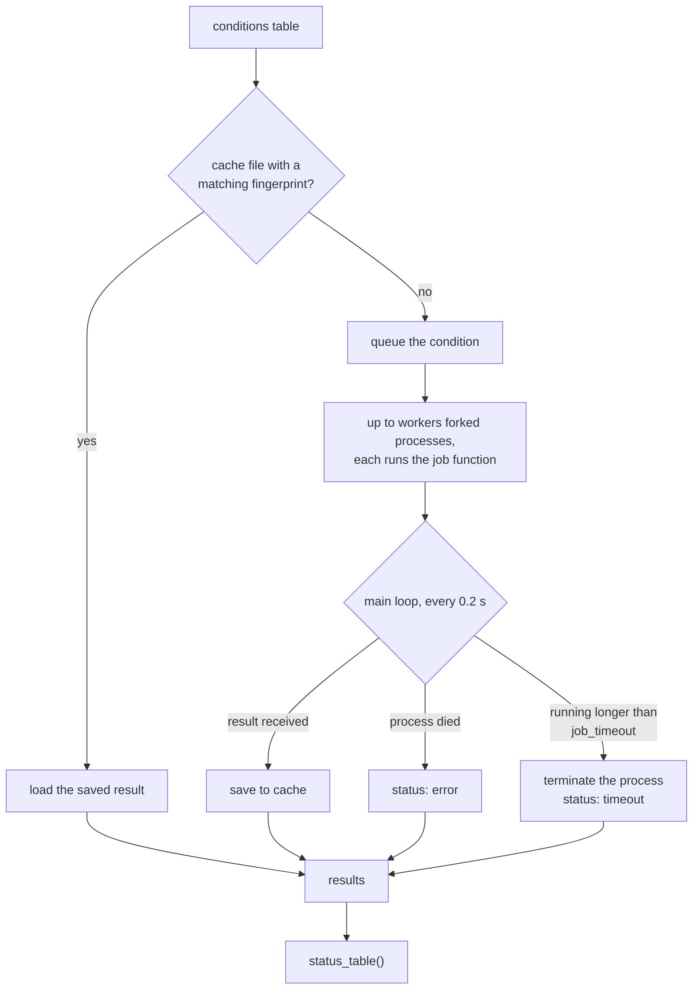

*Diagram 5. Batch execution.*

**Procedure.**

1. For each job, compute its cache path. If the file exists and `recompute` is off, load it.
2. Start up to `workers` processes (default: half the logical CPUs). Each is a fork of the main process, so it inherits the loaded `Model` and the job function. Each runs the job (for a condition, `solve_condition()`) and sends the result back through a pipe.
3. Every 0.2 s, the main loop collects finished results, notices workers that died, and terminates workers running longer than `job_timeout`.
4. Save each finished result immediately.
5. Print the status table, and a list of conditions that need attention (not done, not converged, or starts disagreeing).

**The fingerprint.** Each cache file is named `<job key>_<fingerprint>.pkl` (the key made file-safe, e.g. `fixed_probe_CO_300_K_1_bar_…`). The fingerprint is the first 12 hexadecimal digits of an MD5 hash of everything that affects the answer: the job itself (gas state, and any rate multipliers, enthalpy shifts or starting surface), every `solver` setting, the phase names, the SHA-256 checksum of the mechanism file, and the Cantera version. Floats are rounded to 12 significant digits and dictionaries sorted first, so equal settings always give equal fingerprints. Changing any of these gives a new fingerprint, so the job is solved again; old files are ignored, not deleted. Job fields whose name starts with `_` (the point labels `P_ref_bar` and `series`) are not hashed.

**Design choices.**
- **Processes, not threads.** Cantera's C++ solvers cannot be interrupted from Python, so terminating a process is the only reliable time limit. Processes also isolate crashes.
- **Save each condition as soon as it finishes**, so a crash or kernel restart loses at most the conditions still running.

> [!IMPORTANT]
> **Operational pitfalls.**
> - **Sleep.** Time limits count wall-clock time, which keeps running while the computer sleeps, so a sleep shows up as false timeouts. `run.sh` runs under `caffeinate -dims`; keep the lid open. `caffeinate -i` is not enough, because it does not stop maintenance sleep ([Stage 11](#long-runs-and-sleep)). From the notebook, start `caffeinate -dims` in a terminal yourself for long batches.
> - **Thread oversubscription.** Numerical libraries can start several threads in every worker, pushing the load far above the number of cores. The package sets `OMP_NUM_THREADS`, `OPENBLAS_NUM_THREADS`, `MKL_NUM_THREADS` and `VECLIB_MAXIMUM_THREADS` to 1 on import (unless already set), and `run.sh` sets them too. In a notebook, import the package before NumPy for this to take effect.
> - **Forking needs a fork-safe parent.** Workers are forked; anything in the parent that does not survive a fork (on macOS, for example, RDKit/Cairo drawing) must not run before a batch. This is why Stage 2 runs in the main process.

## Stage 7: Rates and poisoning metrics

**Purpose.** Turn the steady-state coverages into the rates and metrics that answer the questions of [Section 1.1](#11-what-the-workflow-answers).

**At a glance.**
- Input: the results of Stage 6.
- Output: the summary table (`ctx.outputs['steady_state']['summary']`), saved as `steady_state_results.csv`, with every rate per site and per area.
- Code: `analyses/common.py`: `load_state`, `evaluate`, `results_frame`, `add_poisoning`; `analyses/steady_state.py`: `build_summary`, `run`.

**Procedure.**

1. For each converged condition, rebuild its state from start A's solution: a fresh surface, the gas, and the solved coverages. Nothing is solved here.
2. Read the forward, reverse and net TOF of the probe reaction (direction-corrected) and of molecular adsorption; the net consumption of probe gas per site; $\theta_\ast$, $\theta_{A\ast}$ and $\theta_{A_2\ast}$; the site-count factor $f$; and the three most abundant surface species.
3. Join the reference condition (probe gas only, same basis and point: same $T$ and $p$) and compute the poisoning factor, the slowdown and the site-blocking columns.
4. List conditions that are not converged, whose starts disagree, or whose site-blocking check differs from 1 by more than $10^{-6}$.

**Concepts.**

The **poisoning factor** compares the forward probe TOF with the reference:

$$\Pi = \frac{\mathrm{TOF}_f}{\mathrm{TOF}_{f,\mathrm{ref}}}, \qquad \text{slowdown} = \frac{1}{\Pi}.$$

**Site blocking.** Suppose the probe reaction is elementary, consumes one gas molecule and $n$ empty sites, and has a forward rate constant that does not depend on coverage ([Sections 2.1](#21-surface-phase-coverages-and-site-counting) and [2.2](#22-rate-laws)). Then

$$\mathrm{TOF}_f = \frac{k_f\,C_{A_2}\,C_\ast^{\,n}}{\Gamma} = \frac{k_f\,C_{A_2}\,(f\,\theta_\ast\,\Gamma)^{n}}{\Gamma}.$$

At the same temperature, $k_f$ is the same and $C_{A_2}$ is proportional to $p_{A_2}$, so

$$\Pi = \frac{p_{A_2}}{p_{A_2,\mathrm{ref}}}\left(\frac{\theta_\ast}{\theta_{\ast,\mathrm{ref}}}\right)^{n}\left(\frac{f}{f_{\mathrm{ref}}}\right)^{n}.$$

The code computes the first two factors as `blocking_from_theta`, and `blocking_check` = $\Pi$ divided by the full right-hand side, which should equal 1. $n$ is the number of empty sites the probe reaction consumes, read from the mechanism (`Model.probe_sites`).

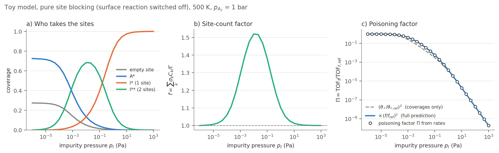

*Figure 6. Toy model with the surface reaction switched off, so the impurity can only block sites. (a) The impurity takes over the surface, partly as a two-site species. (b) This raises the site-count factor $f$. (c) The poisoning factor computed from rates (circles) follows the full site-blocking prediction exactly; the coverage-only prediction (dashed) misses where two-site species are abundant.*

**On real data** (`site_blocking.png`, drawn by the poisoning curves of Stage 11.1). Figure 6 for the run: at one point (`curves['blocking_point']`, default the first series point), one row per impurity that changes the rate or takes sites there: (a) empty sites and impurity-held sites, (b) $f$, (c) $\Pi$ from rates against the full prediction (`blocking_full`) and the coverage-only one (`blocking_from_theta`).

**Interpreting the columns.**
- For an elementary step, impurities change the forward rate *only* through empty sites (and $f$). The substantive question is therefore which species take the sites, answered in Stage 8. A `blocking_check` different from 1 would point to coverage-dependent parameters, an indexing error, or a probe reaction that is not elementary.
- **Forward, net and gas consumption** ([Section 2.5](#25-rates-per-site)). If `tof_probe_consumed` (net probe-gas consumption) is much larger than `tof_net` (net probe TOF), other reactions consume the probe gas, for example through a molecular adsorbate. Follow up with Stage 10.

**Per area (Format 2).** `results_frame` also converts every rate to the units of the hydrogen-surface literature (`per_area.add_columns`; derivations in [`rates_units_equilibrium.md`](rates_units_equilibrium.md)). With $\Gamma$ in mol m⁻², $p$ the probe-gas partial pressure, $M$ its molar mass and $Z = p/\sqrt{2\pi MRT}$ its impingement flux:

| Column | Definition | Unit |
|---|---|---|
| `J_diss_mol_m2_s`, `J_rec_mol_m2_s`, `J_net_mol_m2_s` | TOF × $\Gamma$ | mol A₂ m⁻² s⁻¹ |
| `J_exchange_mol_m2_s` | $\min(J_\mathrm{diss}, J_\mathrm{rec})$: the part that cycles between gas and surface ($J_0$ at equilibrium) | mol A₂ m⁻² s⁻¹ |
| `kd_eff_mol_m2_s_Pa` | $J_\mathrm{diss}/p = k_d\,\theta_\ast^{\,n}$: the effective adsorption coefficient | mol A₂ m⁻² s⁻¹ Pa⁻¹ |
| `gamma_eff` | $J_\mathrm{diss}/Z$: the sticking probability per collision, $\gamma\,\theta_\ast^{\,n}$ | – |
| `C_H_mol_m2` | $\theta_{A\ast}\,\Gamma$: the probe adsorbate on the surface | mol A m⁻² |

Nothing is solved for these, and converting does not change any activation energy. $\Gamma$ is the site density of the mechanism's facet, so "per m²" is per atomic surface area; literature values per geometric area of a real, rough sample can be higher by a roughness factor (typically 1–10). Fluxes count probe-gas molecules, surface concentrations atoms. Recombination is the surface step, $J_\mathrm{rec} = k_r\,(\theta_{A\ast}\Gamma)^n$; the mechanism has no subsurface or bulk hydrogen.

**Checks and failure modes.** The "need attention" list; any condition missing from the reference makes its poisoning factor undefined.

## Stage 8: Surface composition

**Purpose.** Show which species occupy the surface at steady state.

**At a glance.**
- Inputs: the summary table and the results.
- Outputs: `steady_state_coverages.csv`, `steady_state_surface_species.csv`, `surface_composition_vs_T.png` and (with a pressure series) `surface_composition_vs_P.png`.
- Code: `analyses/composition.py`: `coverage_table`, `surface_species`, `plot_surface_composition`; `labels.py`: `species_label`.

**Procedure.**

1. Build a coverage matrix: one row per (basis, T, case), one column per surface species whose coverage is non-zero anywhere.
2. List every species above `composition['min_listed']` ($10^{-3}$) for each condition.
3. **Readable labels.** Use the `species_labels` dictionary of `settings.py` where an entry exists. Otherwise build one automatically: "empty site" for the empty site; for others the formula (C, H, N and O first, then other elements alphabetically; site atoms left out), one `*` per occupied site, and the mechanism number, because isomers share a formula.
4. **Stacked bars**: one bar per case and one panel per point: for the temperature series a panel per $T$, for the pressure series a row per pressure-series temperature and a panel per $p$. Segments are empty sites (pale neutral); then up to `composition['max_named']` (7) species that reach `composition['min_plotted']` (2 %) anywhere, ordered by peak coverage with a fixed color each; then everything else as "other".

**Design choices.** The same species keeps the same color in every panel, and in the coverage-against-temperature figure of Stage 11.2 (`composition.species_palette`: colors follow the species, not its rank). Empty sites are neutral so they read as "nothing here". The thresholds keep the legend short.

## Stage 9: Rate plots

**Purpose.** Compare probe rates, slowdowns and empty sites across cases and temperatures at a glance.

**At a glance.**
- Input: the summary table.
- Outputs: `rates_summary_vs_T.png`, `rates_summary_vs_P.png` (with a pressure series), each also per area (`…_per_area.png`), plus printed tables.
- Code: `analyses/steady_state.py`: `plot_rates`; `plotting.py`: `style_axis`, `save`. With both bases, `basis_comparison.csv`.

**Procedure.** Three panels share the case axis: (a) the forward probe TOF (log scale), (b) the slowdown relative to the probe-gas-only case (log scale, with a "no effect" line at 1), and (c) the fraction of empty sites $\theta_\ast$ (linear). In the temperature-series figure each temperature has its own marker shape and color, offset side by side; in the pressure-series figure each pressure does, with one row of panels per pressure-series temperature. In panel (b), open markers show the slowdown if the site count were fixed:

$$\text{slowdown}_{\text{fixed sites}} = \text{slowdown}\times\left(\frac{f}{f_{\mathrm{ref}}}\right)^{n}.$$

The `…_per_area` copies (Format 2) show in panel (a) the effective adsorption coefficient $k_{d,\mathrm{eff}} = J_\mathrm{diss}/p$ instead of the TOF, with $\Gamma$ on the axis; panels (b) and (c) have no units and are the same.

If both bases were computed, `basis_comparison.csv` gives the ratio $\mathrm{TOF}(\texttt{input\_X})/\mathrm{TOF}(\texttt{fixed\_probe})$ for every case and temperature.

**Design choices.**
- **Dot plots, not bars.** Values span orders of magnitude, and the length of a bar on a log axis has no meaning.
- **Color and marker shape**, so temperature is not encoded by color alone.
- **The open-marker estimate rescales only the probe rate.** A model that conserved sites would also shift the coverages, so treat it as an indication of sensitivity, not as an alternative solution.

## Stage 10: Mechanism diagnostics

**Purpose.** Decide how far the results can be trusted, and find which species and reactions drive them.

**At a glance.**
- Inputs: the mechanism, the results, literature values entered by hand.
- Outputs: `mechanism_binding_check.csv` and `binding_check.png`, `mechanism_switch_off_<label>.csv` and `switch_off_<label>.png` per what-if and `mechanism_switch_off.csv` with all of them (only when `switch_off` lists what-ifs), `top_reactions.csv`.
- Code: `analyses/diagnostics.py`: `reaction_thermo`, `binding_check` (10.1); `switch_off` (10.2); `top_reactions` (10.3). Settings: the `diagnostics` section (`adsorption_checks`, `switch_off`, `switch_off_cases`, `top_reactions`, `top_n`).

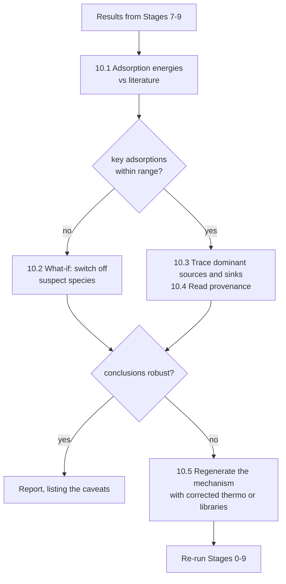

*Diagram 6. Deciding whether results can be trusted.*

### 10.1 Adsorption energies vs literature

For each key adsorption (gas + sites → adsorbate), the mechanism's own thermochemistry gives

$$\Delta H_{\mathrm{ads}}(T) = \sum_k \nu_k\,H_k^\circ(T), \qquad \Delta G_{\mathrm{ads}}(T) = \sum_k \nu_k\left(H_k^\circ(T) - T\,S_k^\circ(T)\right),$$

with reference-state values ([Section 2.3](#23-thermodynamic-consistency)). $\Delta H$ at 298 K is compared with a literature range entered by hand, with its source, giving the verdict OK, TOO STRONG or TOO WEAK. A negative $\Delta G(T)$ means the adsorbate is favored at the standard state. For a single-site adsorbate (and $f = 1$), equilibrium with its gas gives the Langmuir relation

$$\frac{\theta_k}{\theta_\ast} = \exp\!\left(-\frac{\Delta G_{\mathrm{ads}}}{RT}\right)\frac{p_k}{P^\circ},$$

so a binding energy that is too strong by $\delta$ raises $\theta_k/\theta_\ast$ by about $\exp(\delta/RT)$.

**Figure** (`binding_check.png`): one row per adsorption, the literature range as a gray bar and the mechanism's $\Delta H_{298}$ as a marker. The verdict is shown three ways: color (blue = too weak, red = too strong, dark = within range), marker shape (◀ too strong, ▶ too weak, ● within range), and a text label beside every value outside its range.

### 10.2 What-if experiments with rate multipliers

Setting the multiplier to 0 for every reaction that makes or consumes a species removes it from the network *without touching thermochemistry*. A multiplier scales the forward and reverse rates equally, so equilibrium constants stay unchanged ([Appendix E](#e-checking-the-equations-against-cantera)). `diagnostics['switch_off']` lists the what-ifs; it is empty by default, so none runs unless you ask. Each entry is one what-if: a species name (every surface reaction that makes or uses it), a reaction number, or a list of those switched off together:

```python
diagnostics = {'switch_off': ['H(19)', 47, ['OX(14)', 'HOX(293)']]}   # three what-ifs
```

For each, `switch_off` sets the multiplier of those reactions to 0, passes the multipliers to every fresh surface object (`Model.new_surface(multipliers=…)`), and solves `switch_off_cases` again from a clean start. The multipliers are part of each job, so they are part of its cache fingerprint, and normal runs never see them. Each what-if gets `mechanism_switch_off_<label>.csv` (label `H_19`, `R47`, `OX_14+HOX_293`), and `mechanism_switch_off.csv` holds them all; next to the rates and slowdowns they list the reactions switched off, the net rate, the probe-gas consumption, $\theta_{A\ast}$ and the equilibrium check $q$ (11.2c), normal and switched off. The report shows the what-ifs listed in the current settings.

**Figure** (`switch_off_<label>.png`, one per what-if): every main point on the x axis (the temperature series, then the pressure series), one color per case. (a) The rate ratio, dissociation TOF switched off / normal; 1 = no change. (b) The slowdown of each impurity case, normal (dot) and switched off (ring): a ring around its dot means the impurity effect does not depend on the reactions switched off. (c) The equilibrium check $q$ of the H₂ step, normal and switched off: dots below 1 with rings on 1 mean the reactions drain H\* and hold the step off equilibrium. A panel turns logarithmic when its values span more than a factor of 30; a missing marker is a point that did not converge with the what-if.

**When to use it.** For a species the binding check flags as TOO STRONG (its coverage, and the poisoning it causes, may be over-predicted), or a route you suspect. Example: on Cu, $q < 1$ at 1000–1200 K for the probe gas alone, because H atoms desorb into a gas held at zero H atoms; switching off `H(19)` (its one surface reaction, H + ∗ ⇌ H∗) restores $q$ = 1 and shows that the dissociation rate changes by at most 5 %, while the net rate and the H coverage change much more.

- When a switched-off species is on the surface, its Jacobian rows are identically zero and the direct solve fails; the reactor method then solves it. A switched-off gas species does not have this problem.
- Removing a dominant species makes the network reroute, and other weakly constrained species can take over. Remove one species at a time and compare.
- What-if results are sensitivity tests, not corrected predictions.

### 10.3 Tracing sources and sinks

At a steady state, reaction $i$ contributes $\nu_{ki}\,q_i/\Gamma$ (per site, s⁻¹) to species $k$. `top_reactions()` (for each `(case, T, species)` in `diagnostics['top_reactions']`) sorts these contributions by magnitude, showing the dominant producers and consumers of a species together with the provenance line from each reaction's YAML note.

### 10.4 Reading provenance

RMG annotates every reaction and species in the YAML file:
- **Reactions**: `Library reaction: <library>`, `Template reaction: <family>`, `Estimated using template … for rate rule …`, or a matched training reaction.
- **Species**: `Thermo library: <library>`, group-additivity estimates, and adsorption corrections such as `Binding energy corrected by LSR (…) from <facet>` (linear scaling relations from another metal or facet).

As a rough order of confidence: a library value for the same metal and facet, then training reactions and rate rules, then values scaled from another metal. Multi-site adsorbates estimated by group additivity, and weakly bound (van der Waals) species that take part in reactions, deserve extra scrutiny.

### 10.5 Why thermochemistry is not edited in place

Shifting a species' enthalpy changes reverse rates through the equilibrium constant ([Section 2.3](#23-thermodynamic-consistency)), but leaves forward rates as RMG estimated them with the *old* thermochemistry; rate rules often tie barriers to reaction enthalpies. Effective barriers can become negative, and at low temperature the factors $\exp(\delta H/RT)$ become so large that the equations are too stiff to integrate. The fix belongs at the source: regenerate the mechanism with corrected thermochemistry or libraries, so the kinetics are re-estimated consistently.

### 10.6 Deciding

Report the results with their caveats listed; or run what-if sensitivity tests to see whether the conclusions survive; or regenerate the mechanism and re-run Stages 0–9 (Diagram 6).

## Stage 11: Further analyses

**Purpose.** Go beyond single conditions: how the probe rate depends on impurity level, temperature and partial pressures; which reactions and which species control it; where the atoms flow; and how fast the surface is poisoned after an impurity arrives.

**At a glance.**
- Inputs: the solver of Stages 4–6, and the solved main results (11.5 and 11.6 start from them).
- Outputs: one CSV per analysis (listed in [Appendix C](#c-output-files)), plots, and path diagrams.
- Code: one module per analysis in `analyses/`, each with a `run(ctx)` and a settings section of the same name in `settings.py`. An analysis that needs the main steady states runs `steady_state` first if it has not run yet (from the cache, if it is there).

| Analysis | Name in `analyses` | Solves | Reuses |
|---|---|---|---|
| 11.1 Poisoning curves | `curves` | impurities × levels × T, + 1 reference per T | `run_conditions` (two starts, cache) |
| 11.2 Temperature sweep | `sweep` | (2 + impurities) × T: reference, each impurity, the mixture | `run_conditions` |
| 11.2a Arrhenius form | `arrhenius` | none | the temperature sweep's results; fresh surface objects for the intrinsic constants |
| 11.2b Pressure sweep | `pressure_sweep` | (2 + impurities) × p × T | `run_conditions` |
| 11.2c Equilibrium coverage | `equilibrium` | none | the run's steady states; the mechanism thermochemistry |
| 11.3 Reaction orders | `orders` | 3 per probe-gas-only case, 5 per impurity case, per T | `run_conditions` |
| 11.4 Degree of rate control | `rate_control` | 2 per screened reaction and per screened species, per case | `run_jobs` (one start, cache) |
| 11.5 Reaction path diagrams | `paths` | none | main results, `common.load_state` |
| 11.6 Poisoning over time | `transients` | 1 transient per impurity × level × T | `run_jobs`, main results |

**Conventions shared by every analysis.**
- **Impurity level** is the ratio $r = p_I/p_{A_2}$ on the fixed-probe-pressure basis of Stage 3: $p_{A_2}$ stays at $P_{\mathrm{ref}}(T)$ and the impurity is added on top.
- **Unique condition labels.** Each analysis builds its own conditions table and gives every row a distinct `basis` label (e.g. `curve r=1e-06`, `Tsweep r=0.25`, `order probe+`). `condition_key()` (basis | case | T) must be unique: the runner refuses duplicate keys. The cache files cannot collide, because their fingerprints include the full gas state.
- **Reference rate.** Each analysis that reports a poisoning factor computes its own probe-gas-only reference at the same temperature and $p_{A_2}$.
- **Both series by default.** Every point-based analysis (curves, orders, rate control, transients, paths, the switch-off what-if) runs at every point of both series, and draws one figure per series (`…_vs_T`, `…_vs_P`; rate control and transients draw per point instead). Its section can narrow that with `series` (`'temperature'` or `'pressure'`) and its own `temperatures`, `pressures` and `pressure_temperatures` (each `None` = the main setting). Restrict them to where the mechanism is trusted (Stage 10), as `runs/ni_first_try` does with 300 K. The temperature sweep (11.2) is the fine-grained temperature series, always at `reference_pressure`.
- **Default impurity level.** `impurity_ratio`, unless the section sets `ratio`.

### 11.1 Poisoning curves

**What it does.** Sweeps the impurity level logarithmically (default $r$ = 10⁻⁶ … 0.25, twelve levels) for every impurity, solves each point from both starting surfaces (Stage 5), and reports:
- the poisoning factor $\Pi(r)$ ([Stage 7](#stage-7-rates-and-poisoning-metrics));
- the fraction of sites taken by impurity-derived species, $\theta_{\mathrm{imp}} = 1 - \theta_\ast - \theta_{A\ast} - \theta_{A_2\ast}$;
- the **half-rate level** $r_{1/2}$, at which $\Pi = 0.5$, by log–log interpolation between the levels tested.

**Details found while building it.**
- **$\theta_{\mathrm{imp}}$ rather than $\theta_\ast$.** When the probe adsorbate (A∗) fills the surface, the fraction of empty sites is tiny in every case and shows nothing; $\theta_{\mathrm{imp}}$ shows directly how the impurity displaces A∗.
- **Log-axis floors.** A display floor (10⁻¹²) applies to coverages only. Applying it to $\Pi$ would clip real values: strong poisons can reach $\Pi < 10^{-12}$.
- **Boundary cases of $r_{1/2}$.** If $\Pi < 0.5$ already at the lowest level tested, the table reports that level as an upper bound ("at most this"); if $\Pi$ never falls below 0.5, it reports "never halved in the range tested".
- **Two starts at every level**, so a window with two steady states (Figure 5) is visible as a ring around the affected points.
- **Half-rate marker.** An open diamond on the 0.5 line marks each interpolated $r_{1/2}$, in the impurity's color. Bounds ("at most this", "never halved") get no marker; they are in `poisoning_tolerance.csv`.

### 11.2 Temperature sweep

**What it does.** Solves the probe-gas-only case and every impurity case at one impurity level over a temperature grid (default 300–1000 K in 50 K steps), and reports:
- an Arrhenius plot of the forward probe TOF;
- the **local apparent activation energy** by central differences, on the non-uniform grid of converged points (`np.gradient` in $1/T$), for cases with at least three converged temperatures:

$$E_{\mathrm{app}}(T) = -R\,\frac{\partial\ln\mathrm{TOF}}{\partial(1/T)} ;$$

- the poisoning factor against temperature, and the **release temperature**: the lowest temperature at which a poisoned rate recovers to $\Pi = 0.5$, interpolated in $T$ on $\log\Pi$.

**Interpretation.** Curvature in an Arrhenius plot means the coverages change with temperature. When an impurity covers most of the surface, $\theta_\ast$ is roughly proportional to $1/(K_I\,p_I)$, so for a probe step that needs $n$ empty sites, $E_{\mathrm{app}}$ grows by up to about $n$ times the impurity's adsorption enthalpy (in magnitude): the impurity frees sites as the temperature rises, and poisoning lifts.

**Details found while building it.**
- **Gaps, not bridges.** A temperature without a converged steady state is plotted as a gap, so a line never jumps across a missing point.
- **"No steady state" is a result.** A condition can relax for longer than `reactor_t_max` (for example, an adsorbate slowly converting into a more stable form). The reactor method then reports "no plateau" and the point is left out rather than given a misleading value; 11.6 shows what happens over time instead. Each such point can cost up to the direct-solve and reactor time limits, so expect the sweep to take longer where it occurs.
- **Release temperature notes**: "rate never below half (not poisoning)", or "still poisoned at <highest T>". Each release temperature is marked on panel (c) with an open diamond on the 0.5 line.

**What covers the surface against temperature** (`sweep_coverages.png`): one panel per case, one stacked bar per solved temperature, with the species colors of Stage 8. Bars rather than areas, because every temperature is a separate solve: an isolated converged point still shows, and a temperature without a steady state is a visible gap. This is the figure that explains the rate curves, for example which adsorbate holds the sites up to which temperature.

**Per area** (`temperature_sweep_per_area.png`): panel (a) as $k_{d,\mathrm{eff}}$ against $1000/T$. The slope, and so $E_\mathrm{app}$, is the same; only the prefactor and units change.

### 11.2a Hydrogen rates in Arrhenius form

**What it does.** Writes the rates of the probe step as $k = A\,\exp(-E_a/RT)$, at two levels, without solving anything.

- **Intrinsic: the probe step alone.** At each temperature (default: the temperature sweep's; `arrhenius['temperatures']`), on fresh surface objects at $p_{A_2}$ = `reference_pressure`:
  - $k_{\mathrm{diss}} = q_f/\Gamma$ on an empty surface ($\theta_\ast = 1$): the dissociation rate per site;
  - $k_{\mathrm{rec}} = q_r/\Gamma$ on a surface full of A∗ ($\theta_{A\ast} = 1$): the recombination rate per site;
  - $K = (k_{\mathrm{diss}}/k_{\mathrm{rec}})\,P^\circ/p_{A_2}$, the dimensionless equilibrium constant $\theta_{A\ast}^2/(\theta_\ast^2\,p_{A_2}/P^\circ)$ with $P^\circ$ = 1 bar. Its van 't Hoff fit, $\ln K = \Delta S^\circ/R - \Delta H^\circ/RT$, gives $\Delta H^\circ$ and $\Delta S^\circ$, listed next to the values from the mechanism's thermochemistry at each temperature.

  These belong to the metal (the mechanism), not to an impurity. Rate constants have no coverage dependence in RMG mechanisms, so $k_{\mathrm{diss}}/k_{\mathrm{rec}} = K_c\,p_{A_2}/RT$ exactly. For a sticking reaction, $k_{\mathrm{diss}} \propto \gamma\,p/\sqrt{T}$ ([Section 2.2](#22-rate-laws)): with no barrier in $\gamma$, the fitted $E_a$ is about $-RT/2$ (−2.7 kJ/mol at 650 K).
- **Observed: the steady-state surface of each case.** From the temperature sweep (11.2), or its `temperature_sweep.csv` from an earlier run; the sweep is never re-run. For the reference, each impurity and the mixture: the dissociation TOF (`tof_fwd`), the recombination TOF (`tof_rev`) and their ratio, which is 1 when the probe step is at equilibrium. Each is fitted on its converged points.

Every fit reports $A$, $E_a$, $R^2$, the number of points, the temperature range and its exact conditions ($p_{A_2}$, and each impurity's partial pressure and ratio). Impurity cases also get $\Delta E_a = E_a - E_{a,\mathrm{ref}}$ and $A/A_{\mathrm{ref}}$ for the same quantity: an impurity's effect on the hydrogen rates in two numbers. A fit with $R^2$ below `min_r2` (0.99) is flagged `curved`: one $E_a$ does not describe the whole range, and the local values $E_a(T) = -R\,\partial\ln y/\partial(1/T)$ of `arrhenius_local.csv` should be read instead. $R^2$ is left empty for a quantity that does not change (forward/reverse = 1 at equilibrium).

**Interpretation.** The observed $E_a$ of dissociation is higher than the intrinsic one when the step has to wait for free sites: it includes the cost of desorbing A∗ or the impurity. For an impurity that holds most sites, $\Delta E_a$ approaches $n$ times the magnitude of its adsorption enthalpy (11.2). Compare metals with the intrinsic constants, and impurities with $\Delta E_a$ and $A/A_{\mathrm{ref}}$ under the same conditions.

**Per area (Format 2).** The same constants in the units of literature tables ([Stage 7](#stage-7-rates-and-poisoning-metrics)):
- intrinsic: the clean-surface **adsorption coefficient** $k_d = J_\mathrm{diss}/p$ on an empty surface, which is $\gamma/\sqrt{2\pi MRT}$ (mol A₂ m⁻² s⁻¹ Pa⁻¹); the **surface recombination coefficient** $k_r$ of $J_\mathrm{rec} = k_r(\theta_{A\ast}\Gamma)^2$ (m² mol⁻¹ s⁻¹), the same in every case; the clean-surface sticking probability, which is the mechanism's sticking coefficient; and the equilibrium exchange flux $J_0$ (11.2c);
- observed, per case: $k_{d,\mathrm{eff}}$, the exchange flux $J_\mathrm{ex}$ and the sticking probability $\gamma_\mathrm{eff}$.

Converting does not change $E_a$: $\Gamma/p$ is constant at fixed pressure, so only $A$ changes (Figure 7). `surface_coefficients.csv` lists $k_d$ and $k_r$ as $A\,e^{-E_a/RT}$ in the form of literature tables: one row for the clean metal (intrinsic $k_d$) and one per case for its steady-state surface (effective $k_d$). An impurity row is the coefficient of the surface that impurity leaves, the counterpart of the "oxidized" rows of such tables.

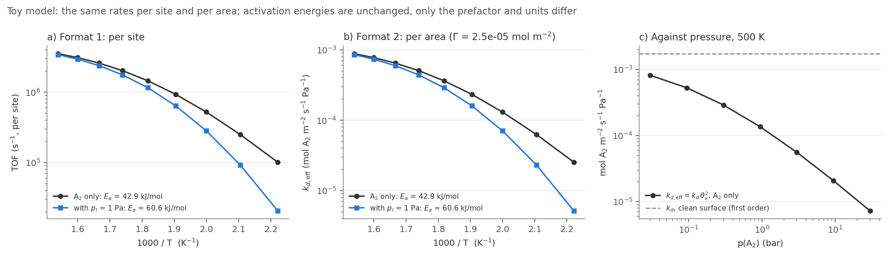

*Figure 7. Toy model. (a) Temperature sweep per site and (b) the same per area: identical slopes and activation energies, different prefactors and units. (c) Against pressure at 500 K, $k_{d,\mathrm{eff}} = k_d\,\theta_\ast^2$ falls as the surface fills; a first-order surface, as the literature's $J = k_d\,p$ assumes, would follow the dashed clean-surface $k_d$.*

**Sticking and exchange** (`surface_exchange_vs_T.png`; `surface_exchange_vs_P.png` from 11.2b), per case: the **sticking probability** $\gamma_\mathrm{eff} = J_\mathrm{diss}/Z$, the fraction of impinging probe-gas molecules that dissociate ($\gamma\,\theta_\ast^2$ for a two-site step); the **exchange flux** $J_\mathrm{ex}$, the hydrogen cycling between gas and surface, which isotope exchange (H₂ + D₂ → 2 HD) measures; and the **hydrogen on the surface** $C_\mathrm{H}$. Dashed lines give the clean surface: its sticking coefficient, and $J_0$ and $C_\mathrm{H,eq}$ at the equilibrium coverage (11.2c).

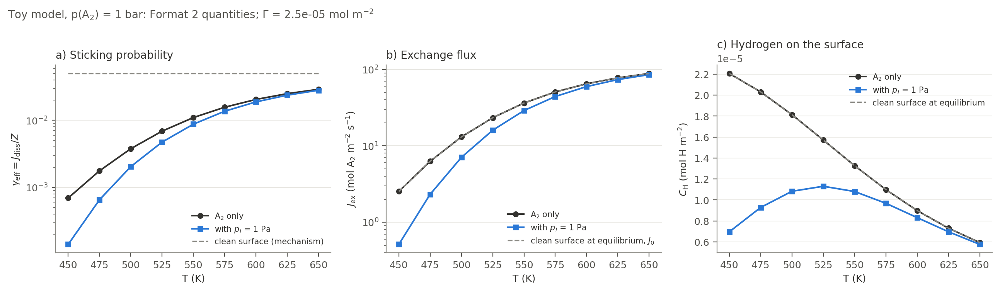

*Figure 8. Toy model at 1 bar. (a) The sticking probability stays below the mechanism's sticking coefficient (dashed) by the factor $\theta_\ast^2$; the impurity lowers it further at low temperature. (b) The exchange flux of the probe gas alone lies on the clean-surface $J_0$: that surface is at its equilibrium coverage. (c) The impurity displaces hydrogen at low temperature and leaves as $T$ rises.*

**Standard pressure.** $K$ uses $P^\circ$ = 1 bar; RMG writes thermochemistry at 1 atm. `dS_thermo_J_per_mol_K` is converted to 1 bar ($\Delta S^\circ$ changes by $R\ln 1.01325$ = 0.11 J mol⁻¹ K⁻¹ per gas molecule consumed; $\Delta H^\circ$ does not change), and `check_K_thermo` = $K$ from the rates / $K$ from the thermochemistry is 1 for a thermodynamically consistent mechanism.

**Outputs.** `arrhenius_intrinsic.csv`, `arrhenius_fits.csv` (with the units of each fit), `arrhenius_local.csv`, `surface_coefficients.csv`, `arrhenius_per_area.png` ((a) $k_d$, (b) $k_r$, (c) $k_{d,\mathrm{eff}}$ per case, (d) as below), `surface_exchange_vs_T.png`, and `arrhenius.png`: (a) intrinsic $k_{\mathrm{diss}}$ and $k_{\mathrm{rec}}$ against $1000/T$, (b) the van 't Hoff plot of $K$, (c) the observed dissociation TOF per case with its fit, (d) $E_a$ of dissociation and recombination per case against the intrinsic dissociation $E_a$. Code: `analyses/arrhenius.py`, `per_area.py`; `tests/test_units.py` checks that a fit recovers known $A$ and $E_a$, that $k_{\mathrm{diss}}/k_{\mathrm{rec}} = K_c\,p/RT$, that the clean-surface sticking probability equals the toy's sticking coefficient, and that $K$ agrees with the thermochemistry.

### 11.2b Pressure sweep

**What it does.** The pressure counterpart of 11.2: at each temperature of `pressure_sweep['temperatures']` (default `pressure_temperatures`), the probe-gas pressure runs over a log grid (default `per_decade` = 2 points per decade spanning the pressure series, or two decades either side of `reference_pressure` without one), for the reference, each impurity and the mixture. Every impurity keeps its ratio to the probe gas (`impurity_ratio`, one number or one per impurity), so the gas has the same purity at every pressure. It reports:
- the forward probe TOF against $p_{A_2}$ (log–log);
- the **local slope** $\partial\ln\mathrm{TOF}/\partial\ln p$ by central differences. For the reference case this is the order in the probe gas over the whole range, not just at one point (11.3). For impurity cases every partial pressure moves together, so it is the order in the total pressure at fixed purity;
- the poisoning factor against pressure, and the **half-rate pressure**: the first pressure, going up, at which $\Pi$ crosses 0.5, with the direction (`recovers above half` or `falls below half`) in `half_rate_pressure.csv`;
- what covers the surface against pressure (`pressure_sweep_coverages_<T>K.png`);
- per area: `pressure_sweep_per_area.png`, with panel (a) as the flux $J_\mathrm{diss}$ (mol m⁻² s⁻¹), whose slope is the same reaction order, and `surface_exchange_vs_P.png` (sticking probability, exchange flux and hydrogen on the surface against $p$; 11.2a).

**Interpretation for a two-site probe step.** With the probe adsorbate filling the surface, $\theta_\ast \propto p_{A_2}^{-1/2}$ and the slope falls towards 0 as $p$ rises; with a strongly bound impurity at fixed purity, $\theta_\ast \propto 1/p_I \propto 1/p$, and the slope tends to $-1$. Code: `analyses/pressure_sweep.py`.

### 11.2c Equilibrium coverage

**What it does.** Without solving anything, from the equilibrium constant of the probe step alone:

$$K = \frac{\theta_{A\ast}^{\,n}}{\theta_\ast^{\,n}\,p/P^\circ} = e^{-\Delta G^\circ/RT}\,\frac{P^\circ}{P_\mathrm{thermo}}, \qquad \frac{\theta_{A\ast}}{\theta_\ast} = \left(\frac{K\,p}{P^\circ}\right)^{1/n},$$

with $\Delta G^\circ$ from the mechanism's thermochemistry (at its reference pressure $P_\mathrm{thermo}$, converted to $P^\circ$ = 1 bar). For a surface holding only the probe adsorbate, with $x = (K p/P^\circ)^{1/n}$:
- the **equilibrium coverage** $\theta_{A,\mathrm{eq}} = x/(1+x)$, $\theta_{\ast,\mathrm{eq}} = 1/(1+x)$, and $C_\mathrm{H,eq} = \theta_{A,\mathrm{eq}}\Gamma$ (mol m⁻²), on a grid of temperatures (default: the temperature series and `pressure_temperatures`) and pressures (default: a log grid spanning the pressure series, `per_decade` = 4);
- the **exchange flux** at that equilibrium, $J_0 = k_d\,p\,\theta_{\ast,\mathrm{eq}}^{\,n}$;
- the **half-coverage temperature** $T_{1/2}$ at each pressure, where $K p/P^\circ = 1$ (searched from 200 to 3000 K).

It also checks every converged steady state of the run (main conditions and both sweeps):

$$q = \frac{\theta_{A\ast}/\theta_\ast}{(K\,p/P^\circ)^{1/n}} .$$

$q = 1$ means the probe step is at equilibrium in that steady state, whatever else covers the surface: an impurity lowers $\theta_{A\ast}$ and $\theta_\ast$ together but cannot change their ratio, so at equilibrium it acts only through $\theta_\ast$, and $\Pi = (\theta_\ast/\theta_{\ast,\mathrm{ref}})^n$. $q < 1$: other reactions consume A∗ faster than dissociation replaces it, so the probe step is not equilibrated and limits the rate; $q > 1$: other reactions produce A∗ (for example an impurity decomposing), which leaves as A₂.

**Design choices.** $K$ comes from the thermochemistry, fast at any temperature; the rate-based $K$ is computed at the grid temperatures as a check (`check_K_rates`, which is 1 for a thermodynamically consistent mechanism). The analysis runs after the sweeps, whose steady states it checks; from an earlier run it reads their tables.

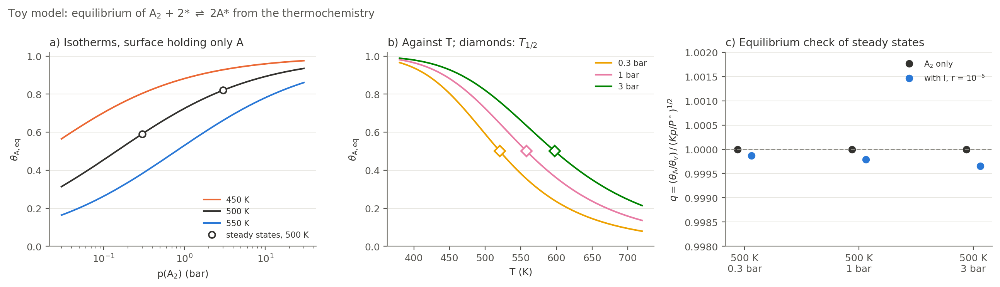

*Figure 9. Toy model. (a) Isotherms of a surface holding only A, with steady states of the probe gas alone (circles) on them. (b) The same against temperature at three pressures; diamonds: $T_{1/2}$, which rises with pressure. (c) The equilibrium check: $q$ = 1 for the probe gas alone; with the impurity, $q$ is slightly below 1, because the surface reaction consumes A∗.*

**Outputs.** `equilibrium_coverage.csv`, `half_coverage_temperature.csv`, `equilibrium_check.csv`, `equilibrium_coverage.png` (the three panels of Figure 9) and `equilibrium_coverage_per_area.png` ((a) and (b) as $C_\mathrm{H,eq}$). Code: `analyses/equilibrium.py`.

### 11.3 Reaction orders

**What it does.** For each case, scales one partial pressure at a time by $(1\pm\delta)$ (default $\delta$ = 0.10), with the others fixed, and computes

$$n_j = \frac{\partial\ln\mathrm{TOF}_f}{\partial\ln p_j} \approx \frac{\ln\mathrm{TOF}_f\big(p_j(1+\delta)\big) - \ln\mathrm{TOF}_f\big(p_j(1-\delta)\big)}{\ln(1+\delta) - \ln(1-\delta)}$$

for the probe gas and, in impurity cases, for the impurity.

**Interpretation for a two-site probe step.** Since $\mathrm{TOF}_f \propto p_{A_2}\,\theta_\ast^2$, the orders measure how the empty sites respond:
- order ≈ 0 in the probe gas when its own adsorbate fills the surface ($\theta_\ast \propto p_{A_2}^{-1/2}$ cancels the explicit $p_{A_2}$);
- order ≈ −2 in the impurity and ≈ +1 in the probe gas when the impurity controls the empty sites ($\theta_\ast \propto 1/p_I$, squared): the signature of a strongly adsorbed poison;
- values in between when both share the surface.

**Figure** (`reaction_orders_vs_T.png`, `_vs_P.png`): one panel per point, one marker per case and pressure (● probe gas, ■ impurity), on the same scale in every panel, labeled where $|n_j| \ge 0.1$.

**Details.** The step must be large enough that the rate change exceeds the solver's tolerance on the TOF ($\varepsilon_{\mathrm{TOF}} = 10^{-4}$ for the reactor method): with $\delta$ = 0.1 the logarithmic span is 0.2, so the error in $n_j$ is about $10^{-3}$. The flag `all_starts_agree` is True only if every perturbed point agreed between its two starts.

### 11.4 Degree of rate control: kinetic and thermodynamic

**Why both kinds are needed.** The usual degree of rate control (DRC) speeds up one reaction's forward and reverse rates together, so its equilibrium constant is unchanged. It finds slow, rate-limiting steps. But poisoning is mostly decided by *balance*, not speed: adsorption of the poison is often at equilibrium, and how much of the surface it covers depends on how strongly it binds. Speeding up a step that is already at equilibrium changes nothing, so DRC reports almost zero for exactly the steps that cause the poisoning. The **degree of thermodynamic rate control** (TRC) answers the question that matters here: how much does the rate change when one *species* is made slightly more stable, with transition-state energies held fixed?

**Kinetic DRC** (step $i$):

$$X_{\mathrm{RC},i} = \left(\frac{\partial\ln r}{\partial\ln k_i}\right)_{K_i,\;k_{j\neq i}} \approx \frac{\ln r\big((1+\delta)k_i\big) - \ln r\big((1-\delta)k_i\big)}{\ln(1+\delta) - \ln(1-\delta)} ,$$

implemented with `surf.set_multiplier(1 ± δ, i)`, which scales the forward and reverse rates of reaction $i$ only, so $K_i$ is unchanged ([Appendix E](#e-checking-the-equations-against-cantera)). Default $\delta$ = 0.05.

**Thermodynamic TRC** (species $n$):

$$X_{\mathrm{TRC},n} = \frac{\partial\ln r}{\partial(-G_n/RT)} \approx -RT\,\frac{\ln r(G_n+\delta_G) - \ln r(G_n-\delta_G)}{2\,\delta_G},$$

with transition-state energies fixed. Default $\delta_G$ = 1 kJ mol⁻¹. It is implemented in two parts, applied to a fresh surface object by `Model.new_surface()`:

1. **Shift the species' enthalpy** by $\delta_G$: add $\delta_G/R$ to the $a_6$ coefficient of both NASA ranges (for constant-$c_p$ thermo, to $h_0$) and replace the species with `modify_species` (`Model.new_surface(h_shifts=…)`). This changes the equilibrium constant of every reaction containing $n$ ([Section 2.3](#23-thermodynamic-consistency)).
2. **Hold transition states fixed**: multiply every reaction in which $n$ is a *reactant* by $e^{\nu'_{n}\delta_G/RT}$.

Together these give exactly the intended changes. For reactions with $n$ as a reactant, $k_f$ changes by $e^{\nu'\delta_G/RT}$ and $k_r$ is unchanged; for reactions with $n$ as a product, $k_r$ changes by $e^{\nu''\delta_G/RT}$ and $k_f$ is unchanged.

**Why this is safe, unlike editing thermochemistry in place** ([Stage 10.5](#105-why-thermochemistry-is-not-edited-in-place)): the shift is tiny ($e^{0.4}$ at 300 K for 1 kJ mol⁻¹, compared with factors like $e^{47}$ for a 100+ kJ mol⁻¹ correction), and the multiplier keeps the barriers where they were, so no effective barrier becomes negative.

**Screening.**
- DRC: the probe and molecular-adsorption reactions, plus the `drc_top_n` (20) reactions with the largest |net rate| at the base steady state. Near equilibrium most net rates are round-off, so beyond the first few the ranking is arbitrary: a re-run can screen different reactions, all with $X \approx 0$. Screening by gross rate would be more stable ([Planned improvements](#planned-improvements)).
- TRC: the empty site, A∗, A₂∗, and every species with coverage at least `trc_min_coverage` (10⁻³) at the base.

**Rates analyzed.** The forward probe TOF and the net probe-gas consumption. The forward TOF is a gross rate, so its DRC values need not sum to 1. The net consumption is a net rate, but it is left blank where it is essentially zero (near equilibrium), because its logarithmic sensitivity is then meaningless. For a single overall reaction with a well-defined net rate, $\sum_i X_{\mathrm{RC},i} = 1$ is a useful check (Figure 7b).

**Why a warm start failed.** Starting each perturbed solve from the base steady state looks like an obvious speed-up, and it was tried:
- **The direct solve still failed at low temperature**, slowly (minutes per solve), even from a starting point next to the solution.
- **The reactor method accepted the warm start almost at once** (after about $3\times10^{-8}$ s). Starting next to the old solution, TOF and coverages did not change between the first checkpoints, so the plateau test passed, but slowly relaxing species had not re-equilibrated to the perturbation. The sensitivities that depend on them would have come out wrong (close to zero).

So every perturbed solve starts from a **clean surface with the normal method choice**, exactly like its base solve. This is slower, but correct: from a clean start the plateau test only passes once the slow species have settled.

**Figures** (one set per point, "what controls the rate"): `rate_control_<T>K_<P>bar.png`, the TRC of the forward probe rate, one panel per case (up to 3 × 3), species with $|X_{\mathrm{TRC}}| \ge 0.01$, with the sum in the axis label. The reaction orders of Stage 11.3 have their own figure. For a probe step that needs $n$ empty sites, with adsorbates in equilibrium with the gas, $X_{\mathrm{TRC},i} \approx -n\,\theta_i$, so the values add up to about $-n(1-\theta_\ast)$: whichever species holds the sites controls the rate, in proportion to how many it holds. `rate_control_<T>K_<P>bar_DRC.png`, only for the cases where it is not trivial (up to 3 × 2 panels): the DRC of the forward rate (blue) and of the net probe-gas consumption (orange), for the six reactions with the largest values, labeled `#<reaction index>: equation` with readable species names. Trivial means no defined net DRC (near equilibrium) and a forward DRC of 1 on one step and about 0 elsewhere, the usual case at low temperature. Where the net DRC is drawn its values add up to 1, as in Figure 7b.

**Code.** `analyses/rate_control.py`: `drc_reactions`, `trc_species`, `trc_multipliers`, `plot_rate_control`, `run`. Each perturbed solve is a job with its own `multipliers` and `h_shifts`, which are part of its cache fingerprint (`output/cache_sensitivity/`).

### 11.5 Reaction path diagrams

**What it does.** For a solved main steady state (`paths['conditions']`, by default every case at every series point), rebuilds the state (`common.load_state`) and draws Cantera's element-flux diagram, `ct.ReactionPathDiagram(surf, element)`, for each element in `paths['elements']` (by default those of the probe gas). It works on the interface object. The `.dot` output is rendered with Graphviz in `paths['formats']` (if `dot` is not installed, only the `.dot` files are written). No new solving. Code: `analyses/paths.py` (`raw_dot`, `style_dot`, `render`).

**How it is drawn** (defaults in brackets):
- **Style** `style` (`'rmg'`): the look of RMG's flux diagrams (Stage 2) on Cantera's numbers. Arrows are black, with width growing linearly in $\log_{10}$ of the flux relative to the largest, from 0.6 pt at `threshold` to 8 pt at the largest; each species sits in an outline whose thickness grows with $\log_{10}$ of its amount, from 0 at $10^{-6}$ to 6 pt at 1, where the amount is the **coverage for surface species and the mole fraction for gas species** (RMG puts both on one concentration scale, which makes every surface outline thin; see Stage 2). A species below $10^{-6}$ gets a thin gray outline. `'cantera'` keeps Cantera's colors and widths.
- **Structure images** `species_images` (`None`: `species/` next to `settings.py`, else `output/flux_species/`): each node shows `<Cantera name>.png` from that folder; a species without an image keeps its readable name (Stage 8). `False` = names only. RMG's images are small PNGs, so they look soft when enlarged.
- **Names under the images** `image_names` (`False`).
- **Orientation** `orientation` (`'TB'`, top to bottom; `'LR'`, left to right).
- **Flux numbers on the arrows** `edge_labels` (`True`): each arrow's flux relative to the largest. With `False` the picture is cleaner and the widths still show the flux.
- Arrowheads are capped at 1.4× and nodes spaced a little, so the thickest pair of arrows stays readable.

**Net flow vs one-way flow.** A path diagram can show the net flow between two species (forward minus reverse) or the one-way flows in each direction.
- **Near equilibrium, net flows cancel.** At low temperature most surface steps are equilibrated, and every pair has equal forward and reverse fluxes. A net-flow diagram is then empty: nothing is wrong, the net flows really are about zero.
- **One-way flow is the default** (`flow_type = 'OneWayFlow'`): it shows how much of the element moves in each direction, which is what "where does H go?" means at equilibrium. Use `'NetFlow'` where there is net conversion, for example at higher temperature with product formation.

**Threshold.** Fluxes below `threshold` × the largest flux are hidden. The default is small (10⁻⁸) because the step of interest can be orders of magnitude smaller than the dominant, equilibrated exchange. A physisorbed probe molecule exchanging with the gas can carry most of the flux, while dissociation, the probe reaction, carries only $10^{-5}$–$10^{-6}$ of it; with the usual 1 % threshold the probe step would disappear from the diagram.

**Reading the diagram.** Edge labels are fluxes relative to the largest one; line width grows with flux. The "Scale" printed below the diagram is that largest flux, in kmol m⁻² s⁻¹; divide by $\Gamma$ for a rate per site.

### 11.6 Poisoning over time

**What it does.** Answers how fast a working catalyst is poisoned, rather than where it ends up:

1. Start from the **probe-gas-only steady state** at the same point (from the main results, or solved first if the point is not a main one): a catalyst running in clean gas.
2. At $t = 0$, switch the gas to probe gas + impurity at level $r$.
3. Integrate the fixed-gas surface (the huge-volume reactor of Stage 4, gas reactions off) and record the state on a logarithmic time grid (default $10^{-9}$–$10^{8}$ s, four points per decade: `t_start`, `t_stop`, `per_decade`). Code: `analyses/transients.py`: `run_transient`, `crossing_time`, `settle_time`.

The forward probe TOF is normalized by its value **at $t = 0$**, computed before integration starts. Normalizing by the first recorded point would hide changes faster than that point.

**Metrics** (in `poisoning_over_time.csv`):
- `t_half_s` and `t_tenth_s`: first times the rate falls to 1/2 and 1/10 of its $t = 0$ value (log-interpolated);
- `min_over_t0` and `t_min_s`: the **deepest drop** and when it occurs;
- `end_over_t0`: the rate at the end of the integration;
- `t_settle_s`: first time after which the rate stays within 10 % of its final value.

**Why the deepest drop matters.** The approach to steady state need not be monotonic. A surface can first flood with an impurity's quickly adsorbing form and then relax, partly freeing sites, so that the rate falls far below its eventual steady value before recovering. The worst moment can then be orders of magnitude worse than the steady state, which neither 11.1 nor 11.2 would show.

**Details.** Each trajectory is saved (`poisoning_over_time_trajectories.csv`), so other metrics can be computed later without re-running. A transient that hits a solver error keeps the points recorded so far and reports the error.

**Precision of the times.** The integration is deterministic, but during a fast drop it is very sensitive to the starting surface: changing the start coverages by $10^{-10}$ moved one half-time by 1.7 %. Starting coverages from two converged solves differ by about $10^{-8}$, so half-times and tenth-times can differ by a few percent between otherwise equal runs. Quote them to about two significant figures; end states and $t = 0$ rates agree to $10^{-9}$.

### Long runs and sleep

The analyses of this stage run many solves, often for tens of minutes. Time limits count wall-clock time, so any sleep of the computer during a batch turns into false timeouts ([Stage 6](#stage-6-batch-execution-time-limits-and-caching)).

> [!IMPORTANT]
> On macOS, `caffeinate -i` prevents only *idle* sleep. In testing, the system still entered a "maintenance sleep" of about 18 minutes during a batch, and every job running at that moment hit its time limit. Use
>
> ```bash
> caffeinate -dims
> ```
>
> for the whole run (`run.sh` does this), keep the lid open, and stay on AC power. Check `pmset -g log | grep -E " Sleep | Wake "` afterwards if timeouts cluster at one moment.

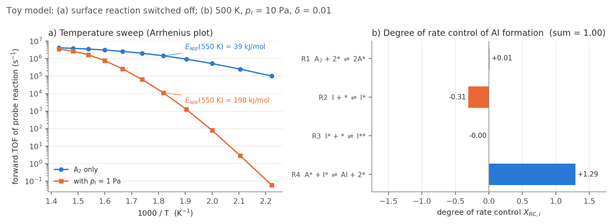

*Figure 10. Toy model. (a) Arrhenius plot of the forward probe TOF with and without an impurity, annotated with local apparent activation energies (11.2). (b) Degree of rate control of the net formation of the product AI; the values add up to 1 (11.4).*

---

# Part IV. Practical

## Running an analysis

Every run lives in its own folder with a `settings.py` (`runs/<name>/settings.py`), which can sit next to the RMG files of the same run (`chem_annotated.yaml`, RMG's `input.py`, `seed/`). Outputs go to `runs/<name>/output/` (or `output_dir`). From the repository folder:

```bash
bash run.sh runs/ni_first_try check                    # settings, mechanism, both series, solves per analysis (seconds)
bash run.sh runs/ni_first_try                          # every analysis listed in settings.py
bash run.sh runs/ni_first_try --only curves,sweep      # a subset (always run in the fixed order below)
bash run.sh runs/ni_first_try --workers 4 --recompute  # fewer processes; ignore the cache
bash run.sh runs/ni_first_try status                   # what is cached and saved
bash run.sh runs/try_2/Cu runs/try_2/Fe runs/try_2/Ni  # several runs, one after another
bash run.sh runs/try_*/Ni/settings.py check            # a folder or its settings.py; globs work
bash run.sh runs/try_4/Cu report                       # rebuild the PDF report from the saved results
```

`run.sh` keeps the Mac awake (`caffeinate -dims`), sets one thread per worker, uses the `rmg4.0` Python (or `$PYTHON`), and appends everything to `runs/<name>/run.log` with start and end times and the exit status. With several runs, they go one after another, each to its own `run.log`; the options after `check`/`status` apply to all of them. Every path is looked up before the first run starts, so a typo fails at once rather than hours in. A failed run does not stop the rest, a summary at the end lists the failures, and the exit status is that of the last failed run. Ctrl-C stops the whole batch. Under the hood it calls `python -m hydrogen_surface_kinetics check|run|status|report <settings.py>`, which works without `run.sh` too. A run of every analysis in `settings.py` ends with the PDF report ([The run report](#the-run-report); `--no-report` skips it).

**From a notebook** (`notebooks/analyze.ipynb` is a ready-made front end):

```python
import hydrogen_surface_kinetics as hsk
from hydrogen_surface_kinetics import analyses

cfg = hsk.load_config('runs/ni_first_try/settings.py', curves={'ratios': [1e-4, 1e-2]})  # overrides merge into sections
ctx = analyses.run(cfg, only='steady_state')           # returns a Context
analyses.run(ctx=ctx, only=['curves', 'orders'])       # more analyses on the same loaded model
ctx.outputs['curves']['tolerance']                     # every table is a DataFrame in ctx.outputs
```

The command line and the notebook share the cache: whatever one solved, the other loads.

**Which analyses.** `analyses = [...]` in `settings.py` chooses them; `--only` (command line) or `only=` (Python) overrides that list for one run. They always run in this order: `steady_state`, `composition`, `diagnostics`, `convergence`, `curves`, `sweep`, `arrhenius`, `pressure_sweep`, `equilibrium`, `orders`, `rate_control`, `paths`, `transients`, `flux`. `flux` (Stage 2) needs RMG-Py and is not run unless named.

**How long.** `check` lists, for every chosen analysis, the number of points and solves and how many are already cached, before anything runs (exact for the main conditions, curves, sweep and orders; an estimate for rate control and transients, whose job lists depend on solved states). Rate control dominates: about 50 solves per case and point. For the 196-species Ni mechanism on 8 workers, the full list (without `flux`) took about 2 hours from scratch: main steady states 10 min, curves 20 min, sweep 45 min, orders 10 min, rate control 25 min, the rest a few minutes. Rerunning from the cache takes a few minutes, mostly for recomputing rates from the stored coverages. `flux` takes about 2 minutes per reactor at `n_points = 12`, longer at the default 100.

## Writing a settings.py

A `settings.py` is plain Python: every top-level name is a setting, anything left out takes the default of [Appendix B](#b-settings-reference), and dictionary sections (`solver`, `run`, one per analysis) only need the keys they change. Paths are relative to the file. Names starting with `_` are ignored, so they can hold helper values. The settings are checked before anything runs, and every problem is reported at once. Pointing the package at an RMG `input.py` by mistake stops with a message.

A minimal input:

```python
mechanism = 'chem_annotated.yaml'               # relative to settings.py
expected_site_density = (3.148e-9, 'mol/cm2')   # from the RMG input; catches unit errors in the export

probe_gas = 'H2(6)'                 # species names as in the mechanism
empty_site = 'site(10)'
probe_adsorbate = 'HX(11)'          # the probe reaction is found as  probe_gas + n empty_site <=> probe_adsorbate
molecular_adsorbate = '[H][H].[Pt](42)'   # optional
reference_label = 'H2 only'

impurities = {'CO': {'C': 1, 'O': 1},     # by elemental composition (robust to renumbering) ...
              'NH3': 'NH3(4)'}            # ... or by name

temperatures = [650.0, 800.0, 1000.0]   # temperature series (K), at reference_pressure
reference_pressure = 1e5                # Pa
pressures = [1e3, 1e5, 1e7]             # pressure series (Pa) ...
pressure_temperatures = [650.0]         # ... at each of these temperatures
analyses = ['steady_state', 'composition', 'curves']
curves = {'series': 'temperature'}      # only what differs from the defaults
```

For a new mechanism, metal or impurity set:

1. **Mechanism and site density.** `mechanism`, `gas_phase`/`surface_phase` if the phases are not named `gas`/`surface`, and `expected_site_density` from the RMG input ([Stage 0](#stage-0-inputs-and-consistency-checks)).
2. **Roles.** `probe_gas`, `empty_site`, `probe_adsorbate`, and `molecular_adsorbate` if there is one. `bash run.sh runs/<name> check` shows the probe reaction it found and the number of sites $n$.
3. **Impurities.** A label for each (it becomes the case name), with a species name or a composition; `mixture_label` for all of them together (`None` for no mixture case).
4. **Conditions.** The temperature series (`temperatures` at `reference_pressure`), the pressure series (`pressures` at each of `pressure_temperatures`; `[]` for none), `impurity_ratio`, `mixture_mode`. Keep both inside the range the mechanism was generated for (the RMG reactor conditions).
5. **Readable names.** `probe_label` and `species_labels` for plots and tables.
6. **Diagnostics.** `diagnostics['adsorption_checks']` with literature ranges for the key adsorptions, and `top_reactions` for species worth tracing.
7. **Analysis series.** Every point-based analysis runs on both series; narrow `curves`, `orders`, `rate_control`, `paths` and `transients` with their own `series`, `temperatures`, `pressures` or `pressure_temperatures` where needed (`check` shows the cost).
8. **Tolerances.** Keep the `solver` defaults; change them only with evidence from Stage 4's tests.
9. **Output.** `plot_style = 'publication'` for journal figures (vector PDF plus 600 dpi PNG, `publication_width_cm` wide); `'screen'` for slides.
10. **Environment.** If the Cantera version changed, run `docs/figures/check_equations.py`.

`runs/ni_first_try/settings.py` is a complete example with every analysis configured (temperature series only). `runs/try_*/<metal>/settings.py` are examples with both series, written next to their RMG files.

## Reading the results

This section is for interpreting the outputs, not for how they are computed (Part III does that). Start from your question in Table R1, find the figure or table, and read it with Tables R2 and R3. Table R4 lists patterns that recur across analyses and what they mean. Every file is in the run's `output/` folder; column definitions are in [Appendix C](#c-output-files). Figures of point-based analyses come as `<name>_vs_T` (temperature series) and `<name>_vs_P` (pressure series). No figure has more than 9 panels (3 rows, 4 columns); a larger one is split into parts `<name>_1`, `<name>_2`, …

**Conventions used in every figure**

- **Rates** are turnover frequencies (TOF): events per site per second (s⁻¹). "Forward" is the rate of the probe reaction in the adsorption direction, the quantity of interest; "net" is forward minus reverse and is close to 0 near equilibrium.
- **Poisoning factor** $\Pi$ = TOF with the impurity / TOF of the probe gas alone, at the same temperature and probe-gas pressure. $\Pi = 1$: no effect; $\Pi = 0.5$: the rate is halved (dashed line in the figures); $\Pi = 10^{-6}$: a million times slower. The slowdown is $1/\Pi$.
- **Impurity level** $r = p_{\text{impurity}}/p_{\text{probe gas}}$; $10^{-6}$ = 1 ppm of the probe gas.
- **Coverages** are fractions of sites; "impurity-held" means every site not empty and not holding the probe gas or its adsorbate.
- **Markers.** Open ring: the two starting surfaces reached different steady states (two steady states; Stage 5). Open diamond on the 0.5 line: where the rate is halved (a half-rate level, release temperature or half-rate pressure). Gap in a line: no converged steady state at that point; it is a result, not a plotting error.
- **Colors** follow the case or species, never the rank, so the same impurity or adsorbate has the same color in every figure of a run.

### Table R1. Where to find the answer

| Question | Look at | What answers it |
|---|---|---|
| How fast is the probe reaction (H₂ dissociation) at each condition? | `rates_summary_vs_T/_vs_P` (a); `steady_state_results.csv` | `tof_fwd` (s⁻¹) |
| What covers the surface? | `surface_composition_vs_T/_vs_P`; `steady_state_surface_species.csv` | species and their coverages, largest first |
| How much does each impurity slow it down? | `rates_summary_*` (b); `steady_state_results.csv` | `slowdown_x` (times slower), `poisoning_factor` |
| From what impurity level is it a problem? | `poisoning_curves_*` (a); `poisoning_tolerance.csv` | `ratio_at_half_rate`, `ppm_of_probe` |
| Does a higher temperature help? | `temperature_sweep` (c); `release_temperature.csv` | `release_T_K`: where the rate recovers to half |
| What are the hydrogen rates in Arrhenius form, and how does each impurity shift them? | `arrhenius`; `arrhenius_fits.csv` | $A$, $E_a$ of dissociation, recombination and their ratio; `dEa_vs_reference_kJ_per_mol`, `A_over_reference` |
| What are the rates in literature units (per area)? | the `…_per_area` figures; `surface_coefficients.csv`; the Format-2 columns ([Stage 7](#stage-7-rates-and-poisoning-metrics)) | `kd_eff_mol_m2_s_Pa`, `J_diss_mol_m2_s`; $k_d$ and $k_r$ as $A\,e^{-E_a/RT}$ |
| How likely is a molecule to dissociate when it hits the surface? | `surface_exchange_vs_T/_vs_P` (a); `gamma_eff` | the sticking probability, 0 to 1 |
| How much hydrogen is on the surface at equilibrium, and is the H₂ step at equilibrium? | `equilibrium_coverage`; `equilibrium_check.csv`, `half_coverage_temperature.csv` | `C_H_eq_mol_m2`, `T_half_K`, `q` |
| Does a higher pressure help? | `pressure_sweep` (c); `half_rate_pressure.csv` | `half_rate_P_bar` and its `direction` |
| Why is it slower: lost sites, or something else? | `site_blocking`; `blocking_check` in the tables | the rate follows the site-blocking prediction or not |
| Which species or step controls the rate? | `rate_control_<T>K_<P>bar` (TRC), `…_DRC`; `reaction_orders_*`; `sensitivity.csv`; `reaction_orders.csv` | TRC per species, DRC per reaction, reaction orders |
| How fast does a working catalyst get poisoned? | `poisoning_over_time_*`; `poisoning_over_time.csv` | `t_half_s`, `t_tenth_s`, `min_over_t0`, `end_over_t0` |
| Where do the H atoms go? | `reaction_paths/*.png` | edge widths and labels (relative fluxes) |
| Is there more than one possible steady state? | rings and dashed branches in `poisoning_curves_*`; `starts_agree` | `starts_agree = False` |
| Can I trust the mechanism? | `binding_check`; `mechanism_switch_off.csv`; `top_reactions.csv` | verdicts vs literature; sensitivity to suspect species |
| Did the solver really converge? | `status` command; `convergence`; `converged` columns | accepted checkpoint, residual below 1 and staying there |
| All of it in one document? | `output/report/<run>_report.pdf` ([The run report](#the-run-report)) | every table and figure, with how to read each |

### Table R2. Figures

| Figure | What it shows | How to read it | Check before believing it |
|---|---|---|---|
| `rates_summary_vs_T`, `_vs_P` (Stage 9) | per case (x axis): (a) forward TOF, (b) slowdown vs the probe gas alone, (c) fraction of empty sites. One marker shape and color per temperature (`_vs_T`) or pressure (`_vs_P`; one row per pressure-series temperature) | (a) log scale: one decade up = 10× faster. (b) points above the dashed "no effect" line are slower; open markers = the slowdown if the number of sites were fixed, so a big gap between filled and open markers means multi-site adsorbates (CO\*\*) inflate the site count. (c) few empty sites = a crowded surface | each point needs `converged` and `starts_agree` True in `steady_state_results.csv` |
| `surface_composition_vs_T`, `_vs_P` (Stage 8) | stacked bars: one bar per case, one panel per point; segments = coverage of each species | the tallest segment is what holds the surface; compare a case's bar with the reference bar to see what the impurity displaced. Pale gray = empty sites; dark gray "other" = everything below the plotting threshold together | a large "other" means many minor species; list them in `steady_state_surface_species.csv` |
| `binding_check` (Stage 10.1) | per adsorption: literature range (gray bar) and the mechanism's ΔH at 298 K (marker) | a marker on its bar is consistent; ◀ red, left of the bar = binds too strongly (over-predicts that adsorbate's coverage); ▶ blue, right = too weakly. Error of δ shifts θ/θ\* by about $e^{\delta/RT}$ | literature ranges are entered by hand in `settings.py`: verify them |
| `switch_off_<label>` (Stage 10.2) | per what-if, every case at every main point: (a) dissociation TOF switched off / normal, (b) slowdown normal (dot) and switched off (ring), (c) equilibrium check $q$ normal and switched off | (a) on the dashed 1 = the rate does not depend on those reactions; all cases off it together = they act on H₂ itself. (b) a ring around its dot = the impurity effect holds without them. (c) dots below 1 with rings on 1 = those reactions drain H\* | a sensitivity test, not a corrected prediction; missing markers = not converged with the what-if |
| `convergence` (Stage 4) | per traced condition: (a) coverages, (b) forward TOF, (c) normalized residual, against surface time from a clean surface | the dotted line is where the reactor method accepted the state. A good trace: everything flat after the dotted line and the residual below the dashed limit (1) to the end. Residual climbing back above 1, or coverages moving late (10⁶–10⁸ s), means the accepted state was a long-lived intermediate | "never accepted" = no plateau within `reactor_t_max`: treat that point as no steady state |
| `poisoning_curves_vs_T`, `_vs_P` (Stage 11.1) | one column per point (up to four per figure): Π against impurity level (top), impurity-held sites (bottom); one line per impurity | read along a line: where it crosses the dashed 0.5 line (diamond) is the tolerated level. A steep drop over a decade = a threshold-like poison. Ring + dashed line + shaded band = two steady states: solid is a fresh (clean) catalyst, dashed one that was covered first; inside the band the history decides | Π below $10^{-12}$ is real (log axis, no floor on Π); coverages are floored at $10^{-12}$ for display only |
| `site_blocking` (Stage 7) | at one point, per impurity: (a) empty vs impurity-held sites, (b) site-count factor f, (c) Π from rates (dots), full site-blocking prediction (line), coverage-only prediction (dashed) | dots on the line: the impurity acts only by taking sites. Dashed below the line: multi-site adsorbates raise f, and the coverage-only estimate would exaggerate the poisoning | dots off the line: the probe step is not simply elementary, or rates depend on coverage; see `blocking_check` |
| `temperature_sweep` (Stage 11.2) | (a) Arrhenius plot, log TOF against 1000/T (hot on the left), (b) apparent activation energy against T, (c) Π against T | (a) a straight line = constant E_app; curvature = coverages changing with T. (b) an impurity case far above the reference = the impurity frees sites as T rises. (c) a rising curve = poisoning lifts with temperature; the diamond is the release temperature | gaps = no steady state; RMG estimates are least reliable far from the conditions it was run at |
| `arrhenius` (11.2a) | (a) intrinsic $k_{\mathrm{diss}}$, $k_{\mathrm{rec}}$ against $1000/T$; (b) van 't Hoff plot of $K$; (c) observed dissociation TOF per case with fits; (d) $E_a$ per case, forward and reverse | (a) a flat $k_{\mathrm{diss}}$ = no barrier, the rate is the impingement flux times $\gamma$; a steep $k_{\mathrm{rec}}$ = activated desorption. (b) $K$ falling with T = exothermic adsorption. (c) points off the line = curved, read the local $E_a$. (d) observed above the dashed intrinsic line = the step waits for free sites; equal forward and reverse bars = the step is at equilibrium | each fit's conditions and $R^2$ in `arrhenius_fits.csv`; only converged sweep points are fitted |
| `sweep_coverages`, `pressure_sweep_coverages_<T>K` | stacked bars of coverage against T (or p), one panel per case | follow a color across bars to see which adsorbate gives way to which as T (or p) changes; this explains the rate curves | missing bars = no steady state |
| `pressure_sweep` (Stage 11.2b) | per temperature: (a) TOF against p (log–log), (b) local slope d ln TOF/d ln p, (c) Π against p | (b) for the probe gas alone, slope 1 = few adsorbates, 0 = surface saturated with H\*. With an impurity at fixed purity, slope near −1 = a strong poison that scales with pressure. (c) diamond = the pressure where Π crosses 0.5 | impurities scale with H₂ (same purity), so this is not "more H₂ against a fixed impurity" |
| `<name>_per_area` (Format 2) | the same figure per area: the rate panel as $k_{d,\mathrm{eff}}$ (or $J_\mathrm{diss}$ for the pressure sweep; $k_d$, $k_r$ in `arrhenius_per_area`); unitless panels unchanged; $\Gamma$ on the axis | the same pattern in the units of literature tables; equal slopes, so equal activation energies. In the pressure series a falling $k_{d,\mathrm{eff}}$ = the surface fills (a constant one = first order) | per atomic area of an ideal facet: literature values per geometric area can be higher by a roughness factor |
| `surface_exchange_vs_T`, `_vs_P` (Stage 11.2a) | per case: (a) sticking probability $\gamma_\mathrm{eff}$, (b) exchange flux $J_\mathrm{ex}$, (c) hydrogen on the surface $C_\mathrm{H}$; dashed: the clean surface | (a) below the dashed line by $\theta_\ast^2$; an impurity case lower still = the impurity takes the sites. (b) on the dashed $J_0$ = that surface is at its equilibrium coverage; lower = slower isotope exchange. (c) lower than the reference = the impurity displaces hydrogen | $J_\mathrm{ex}$ is the smaller of the two gross fluxes |
| `equilibrium_coverage`, `…_per_area` (Stage 11.2c) | (a) isotherms of a surface holding only hydrogen, (b) coverage against T with $T_{1/2}$, (c) the equilibrium check $q$ per case | (a) rising as $\sqrt{p}$, then saturating; circles on the lines = the probe-only steady states are at equilibrium. (b) $T_{1/2}$ rises with pressure. (c) $q$ = 1: the H₂ step is at equilibrium; below 1: it is consumed faster than it equilibrates | `check_K_rates` = 1 in `equilibrium_coverage.csv` |
| `rate_control_<T>K_<P>bar`, `…_DRC` (Stage 11.3–11.4); `reaction_orders_vs_T`, `_vs_P` (11.3) | per point: TRC bars per case; DRC bars for the cases where it is not trivial. Orders: one panel per point | TRC: the bar is $X_{\mathrm{TRC}} = \partial\ln r/\partial(-G/RT)$, how strongly the rate responds when that species is made more stable; negative = it holds sites the reaction needs. Values sum to about −n(1−θ\*) (−2 for H₂ dissociation on a crowded surface). DRC (blue forward, orange net): which elementary steps limit the rate; net values add up to 1. Orders: see Table R4 | DRC near equilibrium is round-off except on the probe step; DRC is shown only where it carries information |
| `reaction_paths/path_<el>_<case>_<T>K_<P>bar_OneWayFlow.png` (Stage 11.5) | where atoms of one element flow between species at a steady state | arrows = flow direction; label = flux relative to the largest, width = its logarithm; outline thickness = how much of that species there is (coverage or mole fraction, log scale; gray = below 10⁻⁶); nodes show the species' structures. "Scale" below = the largest flux (kmol m⁻² s⁻¹; divide by Γ for s⁻¹). One-way flow shows both directions, so a pair at equilibrium shows two equal arrows | fluxes below 10⁻⁸ of the largest are hidden; the probe step can be 10⁻⁵–10⁻⁶ of an equilibrated exchange |
| `poisoning_over_time_<T>K_<P>bar` (or `poisoning_over_time_<impurity>_vs_T`, `_vs_P` when a series has more points than impurities) (Stage 11.6) | per point and impurity, up to four per figure: TOF relative to t = 0 (top) and impurity-held sites (bottom) after the impurity arrives; light to dark = more impurity | where a line crosses the dashed 0.5 is the time to half rate. A dip below the final level, then partial recovery, = a transient worse than the steady state (the deepest drop is `min_over_t0`) | half-times are sensitive to the start: quote them to 2 significant figures |
| `flux/<n>/flux_diagram.avi` (Stage 2, optional) | species-to-species fluxes over time in each RMG reactor | edge width = flux (log scale); compare node borders only within the gas or within the surface | uses RMG's reactors (gas changes), not the fixed-gas steady state |

### Table R3. Result tables: the numbers to quote

| File | Quote | Meaning and typical values |
|---|---|---|
| `steady_state_results.csv` | `tof_fwd`, `poisoning_factor`, `slowdown_x`, `theta_free`, `theta_probe`, `top_species` | one row per case and point. `blocking_check` should be 1 (±10⁻⁶); `converged` and `starts_agree` should be True |
| `steady_state_surface_species.csv` | `species`, `coverage` | every species above 10⁻³ per condition, readable names |
| `poisoning_tolerance.csv` | `ratio_at_half_rate`, `ppm_of_probe` | impurity level that halves the rate. Notes: "already halved at the lowest level: at most this" (an upper bound) or "never halved in the range tested" |
| `release_temperature.csv` | `release_T_K` | lowest T at which the rate is back to half. Notes: "rate never below half (not poisoning)", "still poisoned at <highest T> K" |
| `arrhenius_fits.csv` | `A`, `Ea_kJ_per_mol`, `R2`, `conditions`, `dEa_vs_reference_kJ_per_mol`, `A_over_reference`, `curved` | one row per level (intrinsic, observed), quantity and case; `arrhenius_intrinsic.csv` has $k_{\mathrm{diss}}$, $k_{\mathrm{rec}}$, $K$, $\Delta H^\circ$, $\Delta S^\circ$ per T |
| `half_rate_pressure.csv` | `half_rate_P_bar`, `direction` | probe-gas pressure where Π crosses 0.5, and whether it recovers above or falls below half going up |
| `surface_coefficients.csv` | `kd_A_mol_m2_s_Pa`, `kd_Ea_kJ_per_mol`, `kr_A_m2_mol_s`, `kr_Ea_kJ_per_mol` | literature-style $k_d$ and $k_r$ per system: the clean metal and each case's steady-state surface |
| `equilibrium_check.csv`, `half_coverage_temperature.csv` | `q`; `T_half_K` | $q$ = 1 when the H₂ step is at equilibrium; the temperature at which a clean surface is half covered |
| `reaction_orders.csv` | `order_probe`, `order_impurity` | d ln TOF / d ln p at the point (Table R4) |
| `sensitivity.csv` | `X_tof_fwd` (TRC rows), `X_probe_consumed` (DRC rows) | TRC: the largest negative values name the site holders; DRC: the rate-limiting steps |
| `poisoning_over_time.csv` | `t_half_s`, `t_tenth_s`, `min_over_t0`, `end_over_t0`, `t_settle_s` | time to half and to a tenth of the initial rate; deepest drop; final level; time to settle within 10 % |
| `mechanism_binding_check.csv` | `dH_298_mech`, `verdict` | OK / TOO STRONG / TOO WEAK against the literature range |
| `mechanism_switch_off_<label>.csv` | `tof_ratio`, `slowdown_switched_off` vs `slowdown_normal`, `q_switched_off` | how much a suspect species or reaction matters; a large change means conclusions depend on it; $q$ shows whether it pulls the H₂ step off equilibrium |
| `convergence.csv` | `accepted_s`, `norm_residual` | when the state was accepted; the residual should stay below 1 afterwards |

### Table R4. Common patterns and what they mean

| You see | It means | Do |
|---|---|---|
| Π follows the site-blocking prediction (`blocking_check` ≈ 1) | the impurity slows the rate only by taking the sites the probe reaction needs | find which species takes them (`surface_composition`, TRC) |
| `blocking_check` ≠ 1 | coverage-dependent rate parameters, a non-elementary probe step, or a wrong role species | check the probe reaction found by `check` |
| Filled and open markers far apart in `rates_summary` (b); f > 1 | multi-site adsorbates inflate Cantera's site count | report both, or rely on the open-marker estimate as a bound |
| `starts_agree = False`, ring markers, shaded band | two steady states: the answer depends on whether the catalyst saw the impurity first | report both branches; the band is the hysteresis window |
| Order in the impurity ≈ −2 and in H₂ ≈ +1 | a strongly bound poison controls the empty sites ($\theta_\ast \propto 1/p_I$) | a strong poison: tolerance is set by its binding strength (TRC) |
| Order in H₂ ≈ 0 for the probe gas alone | the surface is saturated with H\* | rate set by H\* desorption/adsorption equilibrium |
| TRC concentrated on one species (≈ −2) | that species holds nearly all sites | its binding energy is what matters: check it in `binding_check` |
| DRC = 1 on the probe step, 0 elsewhere | the probe step itself is slowest; everything else is equilibrated | the impurity acts through coverages, not through other steps |
| E_app of an impurity case much higher than the reference | the impurity desorbs as T rises, freeing sites | expect a release temperature |
| Pressure-sweep slope → −1 with an impurity | at fixed purity, more pressure means more poison as well as more H₂ | purity, not total pressure, sets the poisoning |
| Transient dips far below its final level | the surface first floods with a fast-adsorbing form, then relaxes | the worst moment is `min_over_t0`, not the steady state |
| Residual rises above 1 after acceptance (`convergence`) | the accepted state was not final: something slow is still changing | treat that point as provisional; extend `reactor_t_max` or report it as a slow drift |
| Gaps in sweep lines, "not converged" in `status` | no steady state within `reactor_t_max` | look at the `convergence` trace of that condition |
| A binding verdict "TOO STRONG" for a dominant adsorbate | its coverage, and the poisoning it causes, are probably over-predicted | use `switch_off` to see if conclusions survive; ask for a corrected mechanism (Stage 10.5) |

## The run report

A run of the full `analyses` list ends with one PDF, `output/report/<run>_report.pdf` (for example `try_4_Cu_report.pdf`), written to be read without opening any other file. It is built from the output folder (tables and figures), `settings.py` and the mechanism, which is loaded only for its facts and warnings. It never solves anything, so it can be rebuilt at any time, for a finished run or a partial one:

```bash
bash run.sh runs/try_4/Cu report               # rebuild the PDF from the saved results
bash run.sh runs/try_4/Cu report --tex-only    # write the .tex only (no LaTeX needed)
bash run.sh runs/try_4/Cu --no-report          # run the analyses without building it at the end
```

From Python: `from hydrogen_surface_kinetics import report; report.build('runs/try_4/Cu/settings.py')`.

| Part | Contents |
|---|---|
| Title page | run, catalyst (from RMG's `input.py`), mechanism file and checksum, date, package version and commit, Cantera version |
| Run summary | the system (species, reactions, site density, probe reaction); both series; the impurities with their ratios and partial pressures; which analyses have outputs; settings that differ from the defaults; mechanism warnings; convergence of every results table, and the main conditions that are not single steady states; the conventions (TOF, $\Pi$, $r$, $\theta$, series, markers) |
| One section per analysis with outputs | the **goal**; what was computed; **key numbers** generated from the tables (e.g. the strongest impurity at each point, the tolerated ppm, release temperatures, $\Delta E_a$); the **tables**; the **figures**; then **how to read** the table columns and each kind of figure, panel by panel: what it shows, how to read it, and what each trend means ("a curve going up with T ⇒ poisoning lifts with temperature") |
| Appendix A | the reaction-path diagrams at the other points |
| Appendix B | every output file: its size, its section, and whether the report shows it |
| Appendix C | the run's `settings.py` |

**Tables** have all borders, 3 significant figures and "--" for a missing value, with a heavier rule between cases. Per-point results are split like the series: one table for the temperature series and one per pressure-series temperature. A table with more than `report['max_rows']` (60) rows is replaced by a summary made for it, and its caption names the CSV with all the rows. For example, the poisoning curves become one row per impurity and point, and the sensitivity table the main site holder and rate-controlling steps per case and point.

**Figures** come as the PDF of each figure (publication style) or the PNG, every part in order. A figure with absolute rates is shown twice, per site and then per area (`…_per_area`, Format 2), each with its reading guide. The reaction-path diagrams of the reference point (the lowest temperature at `reference_pressure`) are in their section, the others in Appendix A (`report['path_diagrams']`).

**Text.** The fixed text (goals, panel descriptions, trends, column meanings) is in `report_text.py`, written from Tables R2–R4; every number comes from the run. Editing `report_text.py` changes every report built afterwards.

**Needs LaTeX**: `latexmk` with `pdflatex` (TeX Live; MacTeX on macOS) and the packages longtable, makecell, enumitem, pdflscape, listings, caption and float. `check` says whether it was found. Without it, the `.tex` is written instead. A report that fails to build never fails the run: the log says why, and the `report` command rebuilds it once the cause is fixed.

## Troubleshooting

| Symptom | Cause | Fix |
|---|---|---|
| `ModuleNotFoundError` for a compiled RMG module (e.g. `rmgpy.rmgobject`) | the kernel's Python differs from the one RMG-Py was built with | select the environment that matches the build |
| `No module named 'rdkit'` | wrong kernel | select the environment that has RDKit, Cantera and RMG-Py |
| `site density … does not match the expected` | unit error in the YAML export, or wrong file | use the export whose site density matches `input.py` ([Stage 0](#stage-0-inputs-and-consistency-checks)) |
| Few seed species match the YAML | files from different RMG iterations, or labeled differently | use matching exports; Stage 2 falls back to structure matching |
| `Missing gas-phase transport data` when loading | the export lacks transport data for some species | load with `transport_model=None` |
| `Sticking coefficient is greater than 1` warnings | mechanism parameters | recorded in Stage 1; a mechanism-quality flag |
| CVODE: `the error test failed repeatedly or with \|h\| = hmin` | stiffness | tighten tolerances (rtol $10^{-10}$, atol $10^{-22}$); the batch skips and lists the failure |
| Singular-matrix error on a second steady-state solve | solver state reused on the same `Interface` | a fresh surface object per solve (`Model.new_surface`; done for you) |
| Singular matrix with rate multipliers set to 0 | switched-off species give zero Jacobian rows | use the reactor method |
| Direct solve slow, then fails at low T | stiffness | expected; `direct_min_T` |
| Reactor: "no plateau by t_max" at high T with constant TOF | residual limited by integrator error | inspect the trajectory; planned "plateau" label |
| Many timeouts at once, with elapsed ≫ the limit | the computer slept (including "maintenance sleep") | `caffeinate -dims` for the whole run, lid open; check `pmset -g log` |
| Batch far slower than expected, load ≫ number of cores | numerical libraries start several threads per worker | use `run.sh`, or import the package before NumPy so its one-thread defaults apply |
| `KeyError: 'X'` when re-solving from the summary table | the summary has no mole-fraction column | take the row from the results: `ctx.outputs['steady_state']['results'][key]['row']` |
| A condition is solved again although a cache file exists | the fingerprint changed (a solver setting, the mechanism file's contents, or the Cantera version) | expected; `--recompute` forces a full re-run |
| `error: problems in …/settings.py:` | a setting is missing, misspelled or of the wrong type | the message lists every problem; unknown keys in a section are reported by name |
| `… looks like an RMG input file` | the RMG `input.py` was given instead of `settings.py` | give the run's `settings.py` (`run.sh` uses it automatically) |
| `'pressure_mode' removed` | an old settings file | use `temperatures` + `reference_pressure` and `pressures` + `pressure_temperatures` ([Stage 3](#stage-3-designing-the-operating-conditions)) |
| `No module named hydrogen_surface_kinetics` | the package is not installed in this environment | `pip install --no-deps -e .` in the repository, with that environment's pip |
| A flux reactor reports `worker closed the pipe without a result` | a worker was forked after RDKit/Cairo drawing (macOS) | Stage 2 runs reactors in the main process; do not run it through `run_jobs` |
| `status` lists results "not converged" | conditions with no steady state within `reactor_t_max` (e.g. slow conversions) | a result, not an error ([Stage 11.2](#112-temperature-sweep)); they appear as gaps |
| `report not built: ReportError: LaTeX failed` at the end of a run | a name or value LaTeX cannot typeset, or a missing LaTeX package | the message quotes the LaTeX error; the results are saved: fix it, then `bash run.sh runs/<name> report` |
| `report: wrote ….tex; LaTeX (latexmk) not found` | no TeX installation on the PATH or in `/Library/TeX/texbin` | install TeX Live / MacTeX, or set `report = {'latexmk': '/path/to/latexmk'}` |
| Edits to a notebook disappear | the editor saved its older open copy over the file | reload the notebook from disk before saving |
| Huge reverse rate constants after editing thermochemistry | thermo changed, kinetics not re-estimated | regenerate the mechanism ([Stage 10.5](#105-why-thermochemistry-is-not-edited-in-place)) |
| Surface nodes in flux diagrams have no border | one normalization for gas and surface concentrations | compare node borders within a phase only ([Stage 2](#stage-2-transient-batch-simulation-and-flux-diagrams)) |
| Flux diagrams show text instead of structures | images missing | `draw_species_images` |
| Starting coverages silently renormalized | $\theta^0$ does not sum to 1 | `set_state` validates and stops with an error |

## Reproducibility checklist

- Keep the run's `settings.py` under version control with the package; record the package commit (`git log -1`).
- The report's title page records the package version and commit, the Cantera version and the mechanism's checksum.
- `check` and the start of every run print the mechanism summary; the cache fingerprints include the mechanism's SHA-256 checksum and the Cantera version, so a changed file or version is never mixed with old results.
- Keep the `output/cache*/` folders with the outputs: they reproduce every table in minutes.
- Re-run `docs/figures/check_equations.py` after upgrading Cantera, and `python -m pytest` after changing the package.
- Run long batches through `run.sh` (`caffeinate -dims`, not `-i`), and keep `run.log`.
- Name what-if runs after the change they test; their multipliers are part of their cache keys, so they never mix with normal results.

## Code map

All code is in the package folder `hydrogen_surface_kinetics/`.

| File | Role | Stages |
|---|---|---|
| `config.py` | reads and checks `settings.py`; every default (`SOLVER_DEFAULTS`, `RUN_DEFAULTS`, `ANALYSIS_DEFAULTS`, `DEFAULTS`) | all |
| `model.py` | `Model`: loads the phases, checks the site density, finds the roles and the probe reaction; fresh surface objects with multipliers and enthalpy shifts | 1 |
| `conditions.py` | the temperature and pressure series, the main conditions table: cases, bases, partial pressures | 3 |
| `solver.py` | fixed-gas steady state (direct and reactor methods, convergence test), two starting surfaces, `run_conditions`, `status_table` | 4–6 |
| `runner.py` | forked worker pool with time limits and the per-job cache | 6 |
| `labels.py` | readable species names and formulas | 8 |
| `plotting.py` | palette, axis style, the `screen` and `publication` styles, `save` | 8–11 |
| `analyses/common.py` | `Context` (what one run shares), rates at a solved state, poisoning columns | 7–11 |
| `analyses/steady_state.py` | main steady states, summary table, rate plot | 7, 9 |
| `analyses/composition.py` | coverage tables and the surface-composition plot | 8 |
| `analyses/diagnostics.py` | binding check, switch-off what-if, top reactions | 10 |
| `analyses/convergence.py` | reactor-method traces with the accepted checkpoint (Figure 4 on real data) | 4 |
| `analyses/curves.py`, `sweep.py`, `arrhenius.py`, `pressure_sweep.py`, `equilibrium.py`, `orders.py`, `rate_control.py`, `paths.py`, `transients.py` | the further analyses | 11.1–11.6 |
| `per_area.py` | Format 2: rates per area, sticking probability, exchange flux, the clean-surface constants $k_d$, $k_r$, $K$ | 7, 11 |
| `analyses/flux.py` | flux-diagram videos of the RMG reactors (optional, needs RMG-Py) | 2 |
| `analyses/__init__.py` | `run()`: runs the chosen analyses in order, then the report | all |
| `report.py` | the PDF report: tables, figures and text per analysis, LaTeX build | all |
| `report_text.py` | the report's fixed text: goals, column meanings, how to read each figure panel | all |
| `analyses/plan.py` | solves per analysis and how many are cached, for `check` | all |
| `cli.py`, `__main__.py` | `python -m hydrogen_surface_kinetics check/run/status/report` | all |

Around the package:

| File | Role |
|---|---|
| `run.sh` | runs one or more run folders in turn: keeps the Mac awake, one thread per worker, logs to each folder's `run.log` |
| `runs/<name>/settings.py` | one run's settings (next to the run's RMG files, if any); its outputs go to `runs/<name>/output/` |
| `notebooks/analyze.ipynb` | notebook front end: one section per analysis, settings editable per cell |
| `tests/` | `pytest` suite on the toy mechanism (`tests/data/toy_mechanism.yaml`) |
| `docs/figures/toy_mechanism.yaml` | the fictitious toy mechanism behind the figures |
| `docs/figures/make_figures.py` | regenerates every figure in this document |
| `docs/figures/check_equations.py` | checks the equations of Part II against Cantera |

## Planned improvements

1. **"Plateau" convergence label** for the reactor method ([Stage 4](#stage-4-steady-state-solver)).
2. **DRC screening by gross rate** rather than net rate, so the screened set does not depend on round-off near equilibrium ([Stage 11.4](#114-degree-of-rate-control-kinetic-and-thermodynamic)).
3. **Faster table building from the cache**: rates are recomputed on a fresh surface object per row (about 0.6 s each).
4. **A mechanism-variant switch**, with a separate output folder per variant.
5. **Stoichiometry-aware reaction matching** in Stage 2.
6. **Termination by conversion** in Stage 2.
7. **Status-table column names**: rename `method_A`/`method_B` to `start_A_solved_by`/`start_B_solved_by`, as in the results table.
8. **Per-phase normalization** of node borders in flux diagrams.
9. **Cluster runs** (Slurm): `run.sh` is local only for now.

Done since the notebook version: one thread per worker; a content checksum of the mechanism, the Cantera version and every solver setting in the fingerprint; what-if multipliers in the fingerprint; a probe reaction with any number of sites $n$.

---

# Appendices

## A. Notation

| Symbol | Meaning | Units |
|---|---|---|
| A₂, I, ∗ | probe gas, impurity, empty site | |
| A∗, A₂∗, I∗∗ | adsorbed A; molecularly adsorbed A₂; two-site adsorbate | |
| $R_p$, $R_m$ | probe reaction; molecular adsorption of the probe gas | |
| $s_p$ | direction sign of the probe reaction in the mechanism | ±1 |
| $\Gamma$ | site density | kmol m⁻² |
| $\sigma_k$ | number of sites occupied by species $k$ | |
| $\theta_k$ | coverage: fraction of sites occupied by $k$ | |
| $\theta_\ast$ | fraction of empty sites | |
| $C_k$ | concentration (gas: kmol m⁻³; surface: kmol m⁻²) | |
| $S$ | $\sum_j \theta_j/\sigma_j$ | |
| $f$ | site-count factor $\sum_k\sigma_k C_k/\Gamma$ | |
| $p_k$, $x_k$, $P$ | partial pressure, mole fraction, total pressure | Pa, –, Pa |
| $P^\circ$ | reference pressure of the species thermochemistry | Pa |
| $T$ | temperature | K |
| $R$ | gas constant | J kmol⁻¹ K⁻¹ |
| $W$ | molar mass of a gas species | kg kmol⁻¹ |
| $\nu'_{ki}$, $\nu''_{ki}$, $\nu_{ki}$ | reactant, product and net stoichiometric coefficients | |
| $k_{f,i}$, $k_{r,i}$ | forward and reverse rate constants | various |
| $K_{c,i}$ | equilibrium constant in concentration units | various |
| $A$, $b$, $E_a$ | Arrhenius parameters | |
| $\gamma$; $a$, $b$, $c$ | sticking coefficient and its parameters | |
| $m$ | sum of surface-reactant coefficients in a sticking reaction | |
| $q_i$, $q_{f,i}$, $q_{r,i}$ | net, forward and reverse rates of progress | kmol m⁻² s⁻¹ |
| $\dot s_k$ | net production rate by surface reactions | kmol m⁻² s⁻¹ |
| $\dot c_k$, $\dot d_k$ | creation and destruction rates by surface reactions | kmol m⁻² s⁻¹ |
| $\dot\omega_k$ | net production rate by gas reactions | kmol m⁻³ s⁻¹ |
| $V$, $A$ | reactor volume, catalyst area | m³, m² |
| TOF | turnover frequency $q/\Gamma$ | s⁻¹ |
| $r_k$, $G_k$ | residual and gross rate of a surface species | s⁻¹ |
| $\varepsilon_{\mathrm{abs}}$, $\varepsilon_{\mathrm{rel}}$, $\varepsilon_\Sigma$, $\varepsilon_-$, $\varepsilon_{\mathrm{gas}}$ | convergence tolerances | |
| $\varepsilon_{\mathrm{TOF}}$, $\varepsilon_\theta$ | plateau tolerances | |
| $\Pi$ | poisoning factor | |
| $R_{ab}$ | species-to-species flux in a flux diagram | kmol m⁻² s⁻¹ |
| $E_{\mathrm{app}}$ | apparent activation energy | J kmol⁻¹ |
| $n_j$ | reaction order in $p_j$ | |
| $X_{\mathrm{RC},i}$ | degree of rate control of step $i$ | |

## B. Settings reference

Every setting of `settings.py`, with its default (from `config.py`). Dictionary sections list their keys.

**Files and roles**

| Setting | Default | Stage | Meaning |
|---|---|---|---|
| `mechanism` | required | 1 | Cantera YAML (relative to `settings.py`) |
| `gas_phase`, `surface_phase` | `'gas'`, `'surface'` | 1 | phase names in the YAML |
| `output_dir` | `'output'` | all | relative to `settings.py` |
| `expected_site_density` | `None` | 1 | `(value, unit)`, unit `'mol/cm2'`, `'mol/m2'` or `'kmol/m2'`; checked with relative tolerance $10^{-3}$ |
| `probe_gas`, `empty_site`, `probe_adsorbate` | required | 1 | A₂, ∗, A∗ (species names) |
| `molecular_adsorbate` | `None` | 1 | A₂∗ |
| `impurities` | `{}` | 1, 3 | label → species name or composition dict |
| `reference_label`, `mixture_label` | `'probe only'`, `'all'` | 3 | case names of the probe-gas-only and all-impurities cases (`mixture_label = None`: no mixture) |
| `probe_label` | `None` (the formula) | 9–11 | probe-gas name in plot labels |
| `species_labels` | `{}` | 8 | readable names: mechanism name → label |

**Conditions**

| Setting | Default | Stage | Meaning |
|---|---|---|---|
| `temperatures` | `[300]` | 3 | temperature series, K |
| `reference_pressure` | $10^{5}$ Pa | 3 | probe-gas partial pressure of the temperature series (total pressure on the `input_X` basis) |
| `pressures` | `[]` | 3 | pressure series, Pa (probe-gas partial pressure); `[]` = none |
| `pressure_temperatures` | `None` (the lowest temperature) | 3 | a pressure series at each of these temperatures, K |
| `impurity_ratio` | 0.25 | 3 | $r = p_I/p_{A_2}$, the same in both series: one number, or `{impurity label: r}` with every impurity (e.g. an RMG reactor's proportions) |
| `mixture_mode` | `'same_each'` | 3 | each impurity at $r$ in the mixture, or `'split'` ($r/N_I$) |
| `include_input_basis` | False | 3 | also compute the mole-fraction basis |
| `input_basis` | single 0.8/0.2; mixture 0.75 + 0.05 each | 3 | mole fractions of the `input_X` basis |

**`solver`**

| Key | Default | Stage | Meaning |
|---|---|---|---|
| `abs_tol` | $10^{-8}$ s⁻¹ | 4 | $\varepsilon_{\mathrm{abs}}$ |
| `rel_gross_tol` | $10^{-12}$ | 4 | $\varepsilon_{\mathrm{rel}}$ |
| `sum_tol` | $10^{-8}$ | 4 | $\varepsilon_\Sigma$ |
| `neg_tol` | $-10^{-12}$ | 4 | $\varepsilon_-$ |
| `gas_tol` | $10^{-9}$ | 4 | $\varepsilon_{\mathrm{gas}}$ |
| `direct_min_T` | 400 K | 4 | below this, skip the direct solve |
| `reactor_area_per_volume` | $10^{-10}$ m⁻¹ | 4 | $A/V$ of the huge-volume reactor |
| `reactor_rtol`, `reactor_atol` | $10^{-10}$, $10^{-22}$ | 4 | integrator tolerances |
| `reactor_t_max` | $10^{8}$ s | 4 | longest surface time integrated |
| `plateau_tof_rtol` | $10^{-4}$ | 4 | $\varepsilon_{\mathrm{TOF}}$ |
| `plateau_theta_atol` | $10^{-4}$ | 4 | $\varepsilon_\theta$ |
| `probe_covered_fraction` | 0.99 | 5 | start B for the probe-gas-only case: this fraction of A∗ |
| `pre_exposure_time` | 1 s | 5 | start B for impurity cases |
| `multi_ss_theta_atol` | $10^{-3}$ | 5 | largest coverage difference counted as agreement |
| `multi_ss_tof_rtol` | $10^{-2}$ | 5 | largest relative TOF difference counted as agreement |

**`run`** (also `--workers`, `--timeout`, `--recompute`)

| Key | Default | Meaning |
|---|---|---|
| `workers` | `None` (half the logical CPUs) | processes at once |
| `job_timeout` | 1800 s | time limit per job |
| `recompute` | False | ignore the cache |

**What to run and plot style**

| Setting | Default | Meaning |
|---|---|---|
| `analyses` | `['steady_state']` | any of `steady_state`, `composition`, `diagnostics`, `convergence`, `curves`, `sweep`, `arrhenius`, `pressure_sweep`, `equilibrium`, `orders`, `rate_control`, `paths`, `transients`, `flux` |
| `plot_style` | `'screen'` | `'screen'` (bold, 300 dpi PNG) or `'publication'` (7 pt, PDF + 600 dpi PNG) |
| `publication_width_cm` | 17.8 | 17.8 double column, 8.5 single column; tall figures are capped at 22 cm high |

**Analysis sections** (`None` means: take it from the main settings). The point-based sections (`diagnostics`, `curves`, `orders`, `rate_control`, `paths`, `transients`) also take `series` (`None` = both; `'temperature'` or `'pressure'`), `temperatures`, `pressures` and `pressure_temperatures`.

| Section | Keys (defaults) | Stage |
|---|---|---|
| `composition` | `min_listed` ($10^{-3}$), `min_plotted` (0.02), `max_named` (7) | 8 |
| `diagnostics` | `adsorption_checks` (`[]`: tuples of label, reactants, products, (lit. ΔH low, high) kJ/mol, note), `switch_off` (`[]` = no what-if; entries: a species, a reaction number, or a list of those), `switch_off_cases` (None = every case), `top_reactions` (`[]`: (case, T, species) or (case, T, P, species)), `top_n` (5) | 10 |
| `convergence` | `conditions` (`(case, T)` or `(case, T, P)`; None = the main conditions whose clean start did not converge, else the reference at the first point), `max_conditions` (6), `per_decade` (2) | 4 |
| `curves` | `ratios` ($10^{-6}$ … 0.25, 12 levels), `impurities`, `blocking_point` (`(T, P)` of the site-blocking figure; None = the first point), the series keys | 11.1 |
| `sweep` | `temperatures` (None = main range in `step` K), `step` (50), `ratio`, `impurities` (None = every impurity and the mixture); always at `reference_pressure` | 11.2 |
| `arrhenius` | `temperatures` (None = the temperature sweep's), `min_r2` (0.99: below it a fit is flagged `curved`) | 11.2a |
| `pressure_sweep` | `pressures` (Pa; None = a log grid over the pressure series), `per_decade` (2), `temperatures` (None = `pressure_temperatures`), `ratio`, `impurities` | 11.2b |
| `equilibrium` | `temperatures` (None = the temperature series and `pressure_temperatures`), `pressures` (Pa; None = a log grid spanning the pressure series), `per_decade` (4) | 11.2c |
| `orders` | `ratio`, `delta` (0.10), `impurities`, the series keys | 11.3 |
| `rate_control` | `cases` (None = reference + every impurity), the series keys, `ratio`, `drc_delta` (0.05), `drc_top_n` (20), `trc_delta` ($10^{6}$ J/kmol), `trc_min_coverage` ($10^{-3}$) | 11.4 |
| `paths` | `conditions` (`(case, T)` or `(case, T, P)`; None = every case at every series point), `elements` (None = the probe gas's), `threshold` ($10^{-8}$), `flow_type` (`'OneWayFlow'`), `formats` (`['png']`), `style` (`'rmg'` or `'cantera'`), `species_images` (None = `species/` next to `settings.py`, else `output/flux_species/`; False = none), `image_names` (False), `orientation` (`'TB'` or `'LR'`), `edge_labels` (True) | 11.5 |
| `transients` | `impurities`, the series keys, `ratios` ($10^{-6}$, $10^{-4}$, $10^{-2}$, 0.25), `t_start` ($10^{-9}$ s), `t_stop` ($10^{8}$ s), `per_decade` (4) | 11.6 |
| `flux` | `rmg_path`, `rmg_input` and `seed_dir` (None = the RMG `input.py` and `seed/seed` next to `settings.py`), `species_dir` (None = `output/flux_species`), `reactor_indices` (None = all), `n_points` (100), `rtol`/`atol` ($10^{-10}$, $10^{-22}$), `skip_existing` (True) | 2 |

**`report`** ([The run report](#the-run-report))

| Key | Default | Meaning |
|---|---|---|
| `enabled` | True | build the report at the end of a run of the full `analyses` list |
| `max_rows` | 60 | tables up to this many rows in full; longer ones as a summary, with the CSV named |
| `path_diagrams` | `'reference+appendix'` | the reference point's diagrams in the section and the others in Appendix A; `'reference'`: only those; `'all'`: all in the section |
| `latexmk` | None | path of `latexmk`; None = on the PATH or in `/Library/TeX/texbin` |

**RMG's flux-diagram module** (`rmgpy/tools/fluxdiagram.py`, values in the local build): `max_node_count` = 50, `max_edge_count` = 50, `concentration_tol` = $10^{-6}$, `species_rate_tol` = $10^{-6}$, `max_node_pen_width` = 10, `max_edge_pen_width` = 10, `video_fps` = 6, `initial_padding` = `final_padding` = 5 s, layout program `dot`.

## C. Output files

All files are in the run's `output/` folder. With `plot_style = 'publication'`, every `.png` figure also has a `.pdf`. Figures of point-based analyses come in two versions, `<name>_vs_T` (temperature series) and `<name>_vs_P` (pressure series, when there is one). A figure has at most 9 panels (3 rows, 4 columns): a larger one is saved in parts, `<name>_1`, `<name>_2`, … (parts left from an earlier run with more of them are removed). Every table has the point columns `T_K`, `P_ref_bar` (the point's probe-gas pressure, bar) and `series` (`temperature`, `pressure` or `both`).

**`steady_state_results.csv`** (Stage 7), one row per condition.

| Column | Meaning |
|---|---|
| `key`, `basis`, `case`, `T_K`, `P_ref_bar`, `series` | condition and point |
| `P_total_bar`, `P_probe_bar`, `P_impurity_bar` | total, probe-gas and total impurity partial pressure (bar) |
| `tof_fwd`, `tof_rev`, `tof_net` | forward, reverse and net TOF of the probe reaction (s⁻¹) |
| `tof_molec_fwd`, `tof_molec_net` | forward and net TOF of molecular adsorption (s⁻¹; only with a molecular adsorbate) |
| `tof_probe_consumed` | net probe-gas consumption per site by all surface reactions (s⁻¹; negative means produced) |
| `theta_free`, `theta_probe`, `theta_molec` | coverages of ∗, A∗ and A₂∗ |
| `theta_impurity` | $1 - \theta_\ast - \theta_{A\ast} - \theta_{A_2\ast}$: sites held by anything else |
| `site_count_factor` | $f$ |
| `top_species` | the three largest coverages |
| `converged` | start A converged |
| `start_A_solved_by`, `start_B_solved_by` | `direct`, `reactor`, `failed`, or the batch status |
| `starts_agree` | True, False or None (Stage 5) |
| `residual_1_per_s` | residual of the species closest to its limit, start A |
| `poisoning_factor`, `slowdown_x` | $\Pi$ and $1/\Pi$ |
| `blocking_from_theta`, `blocking_full`, `blocking_check` | site-blocking prediction from coverages only; with the site-count factor; $\Pi$ divided by the full prediction |
| `tof_fwd_B`, `poisoning_factor_B`, `theta_free_B`, `theta_impurity_B` | the same at start B's steady state (Stage 5), where it converged |
| `J_diss_mol_m2_s`, `J_rec_mol_m2_s`, `J_net_mol_m2_s`, `J_exchange_mol_m2_s`, `kd_eff_mol_m2_s_Pa`, `gamma_eff`, `C_H_mol_m2` | per area (Format 2, [Stage 7](#stage-7-rates-and-poisoning-metrics)); also in `poisoning_curves.csv`, `temperature_sweep.csv` and `pressure_sweep.csv` |

**`steady_state_coverages.csv`** (Stage 8): rows (basis, series, T_K, P_ref_bar, case); one column per surface species with non-zero coverage anywhere.

**`steady_state_surface_species.csv`** (Stage 8): `basis`, `series`, `T_K`, `P_ref_bar`, `case`, `species` (readable label), `mechanism_name`, `coverage`, for every species above `composition['min_listed']`.

**`surface_composition_vs_T/_vs_P.png`** (Stage 8) and **`rates_summary_vs_T/_vs_P.png`** (Stage 9).

**`basis_comparison.csv`** (Stage 9, with `include_input_basis`): forward TOF on both bases and their ratio.

**`mechanism_binding_check.csv`** (Stage 10.1): `adsorption`, `dH_298_mech`, `dH_literature`, `lit_low`, `lit_high`, `verdict`, `dG_<T>` for each main temperature, `literature_note`. Figure: `binding_check.png`.

**`mechanism_switch_off.csv`** and **`mechanism_switch_off_<label>.csv`** (Stage 10.2): `switched_off` (the what-if's label), `reactions` (numbers and equations switched off), `series`, `case`, `T_K`, `P_ref_bar`, `converged`; normal and switched off: `tof_normal`/`tof_switched_off`, `tof_net_normal`/`tof_net_switched_off`, `probe_consumed_normal`/`probe_consumed_switched_off`, `theta_free_normal`/`theta_free_switched_off`, `theta_H_normal`/`theta_H_switched_off`, `q_normal`/`q_switched_off`; `top_switched_off`, `tof_ratio`, and `slowdown_normal`/`slowdown_switched_off` relative to the reference case. Figure: `switch_off_<label>.png`.

**`top_reactions.csv`** (Stage 10.3): `case`, `T_K`, `P_ref_bar`, `species`, `label`, `coverage`, `rate_1_per_s` (positive: makes the species), `reaction`, `equation`, `source` (the provenance line of the YAML note).

**Stage 11**:
- `convergence.csv`, `convergence.png` (Stage 4): one row per checkpoint and condition: `t_s`, `tof_fwd`, `norm_residual`, `worst_species`, `residual_ok`, `plateau_ok`, `accepted_here`, `accepted_s`, `error`.
- `site_blocking.png` (Stage 7, drawn with 11.1).
- `poisoning_curves.csv`, `poisoning_curves_vs_T/_vs_P.png` (11.1): one row per (point, case, level) with the Stage 7 columns and `ratio`; `poisoning_tolerance.csv`: `ratio_at_half_rate`, `ppm_of_probe` and `note` per (point, impurity).
- `temperature_sweep.csv`, `temperature_sweep.png` (11.2): the same per (case, T), plus `E_app_kJ_per_mol`; `release_temperature.csv`: `release_T_K` and `note` per impurity; `sweep_coverages.png`: what covers the surface against temperature.
- `arrhenius_intrinsic.csv` (11.2a): `T_K`, `k_diss_clean_1_per_s`, `k_rec_full_1_per_s`, `K_eq`, `dH_thermo_kJ_per_mol`, `dS_thermo_J_per_mol_K`; `arrhenius_fits.csv`: `level` (`intrinsic` or `observed`), `quantity`, `case`, `conditions`, `n_points`, `T_min_K`, `T_max_K`, `A`, `Ea_kJ_per_mol`, `R2`, `dH_kJ_per_mol` and `dS_J_per_mol_K` (for $K$), `dEa_vs_reference_kJ_per_mol`, `A_over_reference`, `curved`; `arrhenius_local.csv`: `case`, `T_K`, `Ea_local_fwd_kJ_per_mol`, `Ea_local_rev_kJ_per_mol`, `fwd_over_rev`; `arrhenius.png`.
- `pressure_sweep.csv`, `pressure_sweep.png` (11.2b): per (case, T, p), plus `slope_dlnTOF_dlnp`; `half_rate_pressure.csv`: `half_rate_P_bar`, `direction` and `note` per (T, impurity); `pressure_sweep_coverages_<T>K.png`.
- `surface_coefficients.csv` (11.2a): `system`, `kd_A_mol_m2_s_Pa`, `kd_Ea_kJ_per_mol`, `kd_R2`, `kr_A_m2_mol_s`, `kr_Ea_kJ_per_mol`, `T_min_K`, `T_max_K`, `conditions`; `arrhenius_intrinsic.csv` also has `check_K_thermo`, `kd_clean_mol_m2_s_Pa`, `kr_surface_m2_mol_s`, `gamma_clean`, `theta_H_eq`, `C_H_eq_mol_m2`, `J0_clean_mol_m2_s`; `arrhenius_fits.csv` has `units`. Figures: `arrhenius_per_area.png`, `surface_exchange_vs_T.png`, `surface_exchange_vs_P.png`, and a `…_per_area.png` copy of `rates_summary`, `temperature_sweep` and `pressure_sweep`.
- `equilibrium_coverage.csv` (11.2c): `T_K`, `p_bar`, `K_eq`, `check_K_rates`, `theta_H_eq`, `theta_v_eq`, `C_H_eq_mol_m2`, `J0_clean_mol_m2_s`; `half_coverage_temperature.csv`: `p_bar`, `T_half_K`, `note`; `equilibrium_check.csv`: `source`, `basis`, `series`, `case`, `T_K`, `P_ref_bar`, `theta_H`, `theta_v`, `theta_H_over_theta_v`, `equilibrium_ratio`, `q`; `equilibrium_coverage.png`, `equilibrium_coverage_per_area.png`.
- `reaction_orders.csv` (11.3): `series`, `T_K`, `P_ref_bar`, `case`, `tof_fwd_base`, `order_probe`, `order_impurity`, `all_starts_agree`.
- `rate_control_<T>K_<P>bar.png` (11.3–11.4), one per point: TRC per case; `rate_control_<T>K_<P>bar_DRC.png`: the DRC, for the cases where it is not trivial; `reaction_orders_vs_T/_vs_P.png` (11.3): orders per case, one panel per point.
- `sensitivity.csv` (11.4): `kind` (DRC or TRC), `series`, `T_K`, `P_ref_bar`, `case`, `item` (reaction index or species), `label`, `X_tof_fwd`, `X_probe_consumed`, `methods` (solver used for the + and − perturbations).
- `reaction_paths/path_<element>_<case>_<T>K_<P>bar_<flow>.dot` and `.png` (11.5).
- `poisoning_over_time.csv` (11.6): `series`, `T_K`, `P_ref_bar`, `case`, `ratio`, `tof_t0`, `tof_end`, `end_over_t0`, `min_over_t0`, `t_min_s`, `t_end_s`, `t_half_s`, `t_tenth_s`, `t_settle_s`, `gas_drift`, `top_species_end`, `error`; `poisoning_over_time_trajectories.csv`: every recorded time point; `poisoning_over_time_<T>K_<P>bar.png`, one per point (or `poisoning_over_time_<impurity>_vs_T/_vs_P.png`, one per impurity, when a series has more points than impurities).
- `cache_diagnostics/`, `cache_convergence/`, `cache_sensitivity/`, `cache_transients/`: one `.pkl` per job (10.2, Stage 4 traces, 11.4, 11.6).

**`cache/*.pkl`** (Stage 6; main conditions and 11.1–11.3): one dictionary per condition with
- `status` (`done`, `error` or `timeout`), `job` (its `key`, `row` (the condition's physics) and `_labels` (`P_ref_bar`, `series`)), `wall_seconds`;
- `species`: the surface species names, in the order of the coverage arrays;
- `theta_a`, `info_a`, `theta_b`, `info_b`: coverages and solver information for each start;
- `start_b`, `start_b_info`: the starting surface B and how it was obtained;
- `starts_agree`, `max_theta_diff`, `tof_rel_diff`.

Each `info` dictionary holds `method`, `converged`, the four `*_ok` checks, `residual_1_per_s`, `residual_species`, `residual_allowed_1_per_s`, `residual_over_tof`, `tof_fwd_1_per_s`, `sum_error`, `min_coverage`, `gas_drift`, `total_seconds`, and `attempts` (each with `method`, `ok`, `seconds`, `t_end`, `error`).

**Stage 2**: `flux/<n>/flux_diagram_XXXX.dot` and `.png` (frames), `flux_diagram.avi` (video); `flux_species/<label>(<index>).png` (structure images).

**The report**: `report/<run>_report.pdf` and the `.tex` it was built from, plus `report/settings_listing.py` (the copy of `settings.py` in Appendix C).

**`run.log`** (in the run folder, not `output/`): everything `run.sh` printed, appended per run.

## D. Unit conversions

| Quantity | Conversion |
|---|---|
| Site density | 1 mol cm⁻² = 10 kmol m⁻² (×10⁴ cm² m⁻², ÷10³ mol kmol⁻¹) |
| Pressure | 1 bar = 10⁵ Pa; 1 atm = 101 325 Pa |
| Energy | J kmol⁻¹ ÷ 10⁶ = kJ mol⁻¹; 1 eV per molecule = 96.485 kJ mol⁻¹; 1 kcal mol⁻¹ = 4.184 kJ mol⁻¹ |
| Gas concentration | $C = P/RT$; e.g. 1 bar at 1000 K gives 0.012 kmol m⁻³ |
| Rates | rate of progress in kmol m⁻² s⁻¹; TOF = rate / $\Gamma$, in s⁻¹ |
| Gas constant | $R$ = 8314.46 J kmol⁻¹ K⁻¹ (Cantera's `ct.gas_constant`) |

Cantera reports SI units with kmol, whatever units the YAML file declares for its input.

## E. Checking the equations against Cantera

[`figures/check_equations.py`](figures/check_equations.py) compares the equations of Part II with Cantera's own numbers on the toy mechanism. It needs only Cantera and NumPy and runs in seconds:

```bash
cd docs/figures
python check_equations.py
```

It checks:

1. the sticking-coefficient rate constant (Section 2.2), for $m$ = 1 and 2;
2. $K_c$ from reference-state Gibbs energies and standard concentrations, and $k_r = k_f/K_c$, for every reaction (Section 2.3);
3. that Cantera's gas `standard_gibbs_RT` includes $\ln(P/P^\circ)$ (Section 2.3);
4. mass-action rates of progress (Section 2.2);
5. the relations between coverages and concentrations, $\sum_k C_k = \Gamma$, and the site-count factor (Section 2.1);
6. that a rate multiplier scales the forward and reverse rates of only that reaction (Stages 10 and 11);
7. that Cantera's reactor integrates $d\theta_k/dt = \sigma_k\dot s_k/\Gamma$ (Section 2.4), to within the accuracy of the integrator's interpolated derivative.

Expected output with Cantera 3.0.1: `21 / 21 checks passed`. If a check fails after an upgrade, the corresponding section of this document no longer describes your Cantera version.

[`figures/make_figures.py`](figures/make_figures.py) regenerates every figure (it also needs matplotlib, and Graphviz for Figure 3).

## F. Glossary

- **Adsorbate**: a species bound to the surface.
- **Apparent activation energy**: the slope of an Arrhenius plot of a measured or simulated rate; it mixes barriers with adsorption enthalpies.
- **Bistability**: two stable steady states for the same conditions; which one a catalyst reaches depends on its history.
- **Coverage** ($\theta_k$): the fraction of surface sites occupied by species $k$.
- **Degree of rate control**: the relative sensitivity of a rate to one step's rate constant, at a fixed equilibrium constant.
- **Fingerprint**: the hash of the settings that produced a cached result.
- **Flux pair**: a reactant–product pair of species that exchange atoms in a reaction, used to draw flux diagrams.
- **Gross rate** ($G_k$): creation plus destruction rate of a species; it sets the scale of its achievable residual.
- **Group additivity**: estimating thermochemistry from contributions of molecular fragments.
- **Linear scaling relations (LSR)**: estimating adsorption energies on one metal from those on another, via correlations with atomic binding energies.
- **Multi-site species**: an adsorbate occupying more than one site (`sites:` above 1), e.g. a bidentate species.
- **Physisorbed (van der Waals) species**: a weakly bound molecular adsorbate.
- **Plateau**: TOF and coverages unchanged between successive checkpoints.
- **Poisoning factor** ($\Pi$): forward probe TOF with an impurity divided by that without.
- **Probe reaction**: the surface reaction whose rate is the quantity of interest.
- **Rate of progress** ($q_i$): the net number of times reaction $i$ occurs per unit area and time.
- **Residual** ($r_k$): $\sigma_k\dot s_k/\Gamma$, the rate at which coverage $k$ would still be changing.
- **Seed mechanism**: RMG's saved mechanism, used to restart or extend a job; it contains the species structures and reaction objects.
- **Site density** ($\Gamma$): moles of surface sites per unit area.
- **Site-count factor** ($f$): $\sum_k \sigma_k C_k/\Gamma$; how many sites Cantera's concentrations imply, per nominal site.
- **Steady state**: a surface state whose coverages no longer change in a fixed gas.
- **Sticking coefficient** ($\gamma$): the fraction of gas–surface collisions that lead to adsorption on a bare surface.
- **Turnover frequency** (TOF): the rate per surface site.

## G. References

- D. G. Goodwin, H. K. Moffat, I. Schoegl, R. L. Speth, B. W. Weber, *Cantera: An object-oriented software toolkit for chemical kinetics, thermodynamics, and transport processes*, https://www.cantera.org. Relevant pages: rate constants (sticking reactions), interface kinetics, reactor networks.
- M. Liu et al., "Reaction Mechanism Generator v3.0: Advances in Automatic Mechanism Generation", *J. Chem. Inf. Model.* **61**, 2686–2696 (2021).
- C. F. Goldsmith, R. H. West, "Automatic Generation of Microkinetic Mechanisms for Heterogeneous Catalysis", *J. Phys. Chem. C* **121**, 9970–9981 (2017).
- R. J. Kee, M. E. Coltrin, P. Glarborg, *Chemically Reacting Flow: Theory and Practice*, Wiley (2003): surface kinetics formalism.
- H. Motz, H. Wise, "Diffusion and Heterogeneous Reaction. III. Atom Recombination at a Catalytic Boundary", *J. Chem. Phys.* **32**, 1893 (1960).
- C. T. Campbell, "Finding the Rate-Determining Step in a Mechanism: Comparing DeDonder Relations with the 'Degree of Rate Control'", *J. Catal.* **204**, 520–524 (2001).
- C. Stegelmann, A. Andreasen, C. T. Campbell, "Degree of Rate Control: How Much the Energies of Intermediates and Transition States Control Rates", *J. Am. Chem. Soc.* **131**, 8077–8082 (2009).
- F. Abild-Pedersen et al., "Scaling Properties of Adsorption Energies for Hydrogen-Containing Molecules on Transition-Metal Surfaces", *Phys. Rev. Lett.* **99**, 016105 (2007).
- A. C. Hindmarsh et al., "SUNDIALS: Suite of Nonlinear and Differential/Algebraic Equation Solvers", *ACM Trans. Math. Softw.* **31**, 363–396 (2005).
